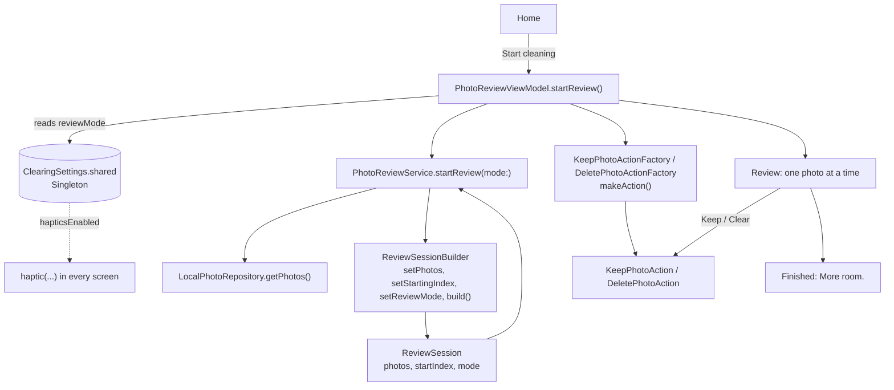

# Clearing — Photo Cleaner

Make room for what matters. A calm way to review photos you no longer need.

The Lab 1 report is in [lab1.md](lab1.md). The Lab 2 report is in [lab2.md](lab2.md).

## Lab

TMPS Lab 1 — SOLID principles

TMPS Lab 2 — Creational design patterns (Singleton, Factory Method, Builder)

- Language: Swift
- UI: SwiftUI
- Minimum iOS: 17.0
- Built with: Xcode 27

## What the app does

```text
Intro ──► Home ──► Start cleaning ──► Review ──► Keep / Clear ──► next photo ──► More room. ──► Done
```

1. **Intro** — the logo forms like a photo, opens, and its halves part to reveal Home.
2. **Home** shows your library as one object made of your photos, with a crack of light
   running through it. Touch it and it tilts and opens a little.
3. **Review** shows one photo at a time, with the next ones waiting underneath.
   - Swipe right or tap **Keep**: the photo stays whole and glides into the Keep button.
   - Swipe left or tap **Clear**: the photo cracks open along the logo's line and dissolves.
   - The first photo nudges left and right once to show that it can be swiped.
4. **More room.** — the light fills the screen, your library comes back with empty
   places where cleared photos were, and the grid breathes apart.

For Lab 1 the photos are 12 sample images bundled in `Assets.xcassets`, and "Clear"
only marks a photo. Nothing is deleted from the phone.

## Project structure

```text
Clearing/
├── Models/
│   ├── Photo.swift                  data about one photo
│   └── ReviewSession.swift          ReviewMode + ReviewSession (built by the Builder)
├── Protocols/
│   ├── PhotoRepository.swift        where photos come from (abstraction)
│   └── PhotoAction.swift            something you can do to a photo (abstraction)
├── Repositories/
│   └── LocalPhotoRepository.swift   sample photos from the asset catalog
├── Actions/
│   ├── KeepPhotoAction.swift
│   └── DeletePhotoAction.swift
├── Factories/                       Factory Method
│   ├── PhotoActionFactory.swift     creator protocol: makeAction()
│   ├── KeepPhotoActionFactory.swift
│   └── DeletePhotoActionFactory.swift
├── Builders/
│   └── ReviewSessionBuilder.swift   Builder: builds and validates a ReviewSession
├── Settings/
│   └── ClearingSettings.swift       Singleton: app settings saved in UserDefaults
├── Services/
│   └── PhotoReviewService.swift     review rules: current photo, what comes next, finished
├── ViewModels/
│   └── PhotoReviewViewModel.swift   texts and numbers for the screens
├── DesignSystem/
│   ├── Theme.swift                  colors, type, spacing, radii, motion and haptics
│   └── Split.swift                  the "opening" shape: logo, icons, cracks, progress
├── Views/
│   ├── RootView.swift               intro + switching between Home and Review
│   ├── IntroView.swift
│   ├── HomeView.swift
│   ├── ReviewView.swift             photo stack, gestures, haptics, light
│   ├── FinishedView.swift
│   └── Components/
│       ├── LibrarySlab.swift        your photos as one object (Home and Finished)
│       ├── PhotoCard.swift
│       ├── DecisionButton.swift     Keep / Clear
│       ├── ReviewProgress.swift
│       ├── PrimaryButton.swift
│       ├── StatView.swift
│       ├── EmptyStateView.swift
│       └── ScreenContainer.swift
└── ClearingApp.swift              creates the objects and connects them
ClearingTests/
└── Lab2PatternTests.swift           unit tests for the three patterns and the review flow
```

## Design

Everything is built from one idea: **a photo that opens to let space in.**

The logo is a rounded photo-square cut along a rising slant. The lower part stays,
the upper part lifts and fades. `Split.swift` draws this shape with an `opening`
value from 0 (a closed photo) to 1 (fully open), and the whole app reuses it:

| Where | Opening |
|-------|---------|
| App icon and header | half open |
| Intro | forms closed, opens, then flies apart |
| Home library | a thin crack of light, wider when touched |
| Progress (top of Review) | opens as you review |
| Clear (drag left) | the photo cracks open, then parts and dissolves |
| Empty state | fully open |

- **Colors:** lagoon green in Light Mode, luminous mint in Dark Mode, used as *light*.
  Keep is ink (solid, calm), Clear is light. There is no red: clearing is positive.
- **Typography:** SF Rounded for titles and numbers, SF Pro for text. Short copy:
  "Make room.", "More room.", "Nothing left to clear."
- **Motion:** small interactions are fast springs, gestures follow the finger and
  settle with springs, navigation is calm, completion is slow. All values live in `Motion`.
- **Haptics:** light when you touch, medium at the decision point, soft for Keep,
  crisp for Clear, success at the end. All values live in `Haptics`.
- **Accessibility:** Dynamic Type (screens scroll, stats stack), VoiceOver labels and
  Keep/Clear actions on the photo, Reduce Motion (no tilt or flying, simple fades),
  Light and Dark Mode.

The UI only reads from `PhotoReviewViewModel` and calls `keepCurrentPhoto()` /
`deleteCurrentPhoto()`. The SOLID classes below are the same as in the first version of Lab 1.

## SOLID principles implemented

### 1. Single Responsibility Principle (SRP)

> A class should have only one reason to change.

Every type has one job:

| Type | Responsibility |
|------|----------------|
| `Photo` | Describes a photo (image name, size). No logic. |
| `LocalPhotoRepository` | Provides the photos. |
| `KeepPhotoAction` / `DeletePhotoAction` | Do one thing with a photo. |
| `PhotoReviewService` | Review rules: which photo is current, moving to the next one, knowing when the review is finished. |
| `PhotoReviewViewModel` | Prepares data for the UI: `"Photo 3 of 12"`, `"4.2 MB"`, counts. |
| `HomeView`, `ReviewView`, `FinishedView` | Only display the interface and forward taps. |

Example: the view model formats text, the service does not.

```swift
// PhotoReviewService — review rule
func apply(_ action: PhotoAction) {
    guard let photo = currentPhoto else { return }
    action.execute(on: photo)
    reviewedCount += 1
}

// PhotoReviewViewModel — UI text
var positionText: String {
    "Photo \(reviewedCount + 1) of \(totalCount)"
}
```

If the design of the text changes, only the view model changes.
If the review rules change, only the service changes.

### 2. Open/Closed Principle (OCP)

> Software should be open for extension, but closed for modification.

`PhotoReviewService` works with the `PhotoAction` protocol and never checks
which action it received:

```swift
protocol PhotoAction {
    func execute(on photo: Photo)
}

func apply(_ action: PhotoAction) {
    guard let photo = currentPhoto else { return }
    action.execute(on: photo)
    reviewedCount += 1
}
```

There is no `if action is Keep ... else if action is Delete ...` in the service.

To add a new action later, for example "Favorite", we create a new type:

```swift
final class FavoritePhotoAction: PhotoAction {
    private(set) var favoritePhotos: [Photo] = []

    func execute(on photo: Photo) {
        favoritePhotos.append(photo)
    }
}
```

`PhotoReviewService` does not change at all. We only add a `favoriteCurrentPhoto()`
method to the view model and a Favorite button to the review screen.

### 3. Dependency Inversion Principle (DIP)

> High-level modules should not depend on low-level modules. Both should depend on abstractions.

`PhotoReviewService` (high-level review logic) does not know about
`LocalPhotoRepository` (low-level detail). It only knows the `PhotoRepository` protocol:

```swift
protocol PhotoRepository {
    func getPhotos() -> [Photo]
}

final class PhotoReviewService {
    private let repository: PhotoRepository

    init(repository: PhotoRepository) {
        self.repository = repository
    }
}
```

The concrete repository is chosen in only one place, `ClearingApp.swift`:

```swift
PhotoReviewService(repository: LocalPhotoRepository())
```

Later in the semester this becomes:

```swift
PhotoReviewService(repository: PhotoKitRepository())
```

and the service, view model and views stay the same.

## How to run

1. Open `Clearing.xcodeproj` in Xcode.
2. Choose an iPhone simulator (for example iPhone 17 Pro) in the toolbar.
3. Press **Run** (⌘R). Press **Test** (⌘U) to run the unit tests.

To run on a real iPhone: select the **Clearing** target → **Signing & Capabilities** →
choose your Team, and change the Bundle Identifier if Xcode asks for a unique one.

## Future labs

- `PhotoKitRepository` — real photos from the library (DIP: only `ClearingApp` changes).
- Real deletion through PhotoKit inside `DeletePhotoAction`.
- New actions such as Favorite or Skip (OCP).
- Strategy pattern for sorting or choosing which photos to review first.
- Factory for repositories too (actions already use Factory Method since Lab 2).
- Command pattern with Undo for Keep/Delete decisions.
- Observer, Adapter, Decorator and the remaining SOLID principles (LSP, ISP).

## TMPS Lab 2 — Design Patterns

Lab 2 adds three creational patterns to the same app. The flow, the look and the
Lab 1 SOLID structure stay the same. The full report with UML diagrams is in [lab2.md](lab2.md).

### Flow: where each pattern runs



### 1. Singleton: `ClearingSettings`

- **Problem:** settings must be the same in every screen. Two settings objects could disagree.
- **Where:** `Clearing/Settings/ClearingSettings.swift`. `static let shared` is the one object,
  `private init()` makes a second one impossible. Values are saved to `UserDefaults` in `didSet`.
- **What it changes in the app:**
  - **Haptic feedback** off: no vibration anywhere. All 8 vibration calls go through
    `haptic(...)` in `Theme.swift`, which checks `ClearingSettings.shared.hapticsEnabled`.
  - **Review style** Compact: the review screen hides the photo size and the swipe hint.
- **Where you change it:** the small menu in the top right corner of Home.
- **SOLID:** SRP, the class only keeps settings.

### 2. Factory Method: `PhotoActionFactory`

- **Problem:** the view model created `KeepPhotoAction()` and `DeletePhotoAction()` itself,
  so it depended on concrete classes.
- **Where:** `Clearing/Factories/`. `PhotoActionFactory` is the creator protocol with
  `makeAction() -> PhotoAction`. `KeepPhotoActionFactory` and `DeletePhotoActionFactory`
  are the concrete creators.
- **How it's used:** `PhotoReviewViewModel` gets the two factories in `init` and calls
  `makeAction()` every time a review starts. The concrete factories are chosen only in `ClearingApp.swift`.
- **Small protocol change:** `PhotoAction` now has `handledPhotos`, so the view model can
  count kept and cleared photos without knowing the concrete classes.
- **SOLID:** DIP (the view model depends on protocols only) and OCP (a new action is a new
  action class plus a new factory).

### 3. Builder: `ReviewSessionBuilder`

- **Problem:** a review was started by setting fields one by one, with no checks.
- **Where:** `Clearing/Builders/ReviewSessionBuilder.swift` builds a `ReviewSession`
  (`Clearing/Models/ReviewSession.swift`) with `setPhotos`, `setStartingIndex`, `setReviewMode` and `build()`.
- **Safety:** defaults are no photos, index 0 and Detailed. `build()` clamps the starting index
  (50 becomes the last photo, -3 becomes 0) and uses 0 when there are no photos.
- **How it's used:** `PhotoReviewService.startReview(mode:)` builds the session when you tap
  **Start cleaning**, then `start(_:)` starts the review from it.
- **SOLID:** SRP, building and checking a session is one job, separate from the review rules.

### Tests

`ClearingTests/Lab2PatternTests.swift` has 16 Swift Testing tests: the Singleton is one object
and its values reach the review, the factories create the right new actions, the builder's
defaults and clamping work, an empty library is safe, and Keep and Clear still count correctly.

### Presentation Q&A

**Why is `init` private in `ClearingSettings`?**
So nobody can write `ClearingSettings()`. The code wouldn't compile. The only object is `shared`.

**Is `static let shared` safe if two threads use it at the same time?**
Yes. Swift creates a `static let` only once, the first time it is used, and does it in a thread-safe way.

**What would go wrong without the Singleton?**
Every screen could create its own settings. The menu could turn haptics off in one object while
the review screen reads another object where they are still on.

**What are the downsides of a Singleton?**
It's global state, so it's harder to test and any code can reach it. I kept it small (only two
settings), and in the tests I put the old values back after each test.

**Which setting changes real behavior?**
Haptic feedback. When it's off, the condition inside `haptic(...)` is false, so no vibration plays.
Review style also changes the review screen (Compact hides the size and the hint).

**What is the difference between Factory Method and just calling the constructor?**
With a constructor, the view model must know the concrete class. With Factory Method it only
knows `PhotoActionFactory` and `PhotoAction`, and the concrete class is decided in `ClearingApp`.

**Which classes play which role in your Factory Method?**
Creator: `PhotoActionFactory`. Concrete creators: `KeepPhotoActionFactory`, `DeletePhotoActionFactory`.
Product: `PhotoAction`. Concrete products: `KeepPhotoAction`, `DeletePhotoAction`. Client: `PhotoReviewViewModel`.

**How would you add a Favorite action now?**
Add `FavoritePhotoAction: PhotoAction` and `FavoritePhotoActionFactory: PhotoActionFactory`,
pass the factory in `ClearingApp`, and add a button. `PhotoReviewService` doesn't change.

**Why does every review ask the factory for new actions?**
So the kept and cleared lists start empty. Otherwise a second review would continue counting from the first one.

**Why a Builder and not just an initializer with three parameters?**
The builder has defaults, lets me set only what I need, and checks the values in one place
(`build()`). An initializer would accept a wrong index without complaining.

**What happens with a wrong index or no photos?**
`build()` clamps the index into the range of the photos. With no photos the index is 0, the
review is finished right away and Home shows "Nothing left to clear."

**Why does each setter return `self`?**
So the calls can be chained: `.setPhotos(...).setStartingIndex(0).setReviewMode(mode).build()`.
`@discardableResult` allows calling a setter alone without a warning.

**Did the patterns break the SOLID principles from Lab 1?**
No. Each pattern is in new files, the service still only has the review rules (SRP), new actions
are added without editing the service (OCP), and concrete classes are still chosen only in `ClearingApp` (DIP).

## Credits

Sample photos from [Unsplash](https://unsplash.com) via [Lorem Picsum](https://picsum.photos), used under the Unsplash License.
