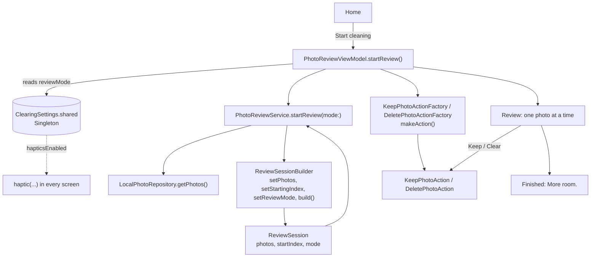
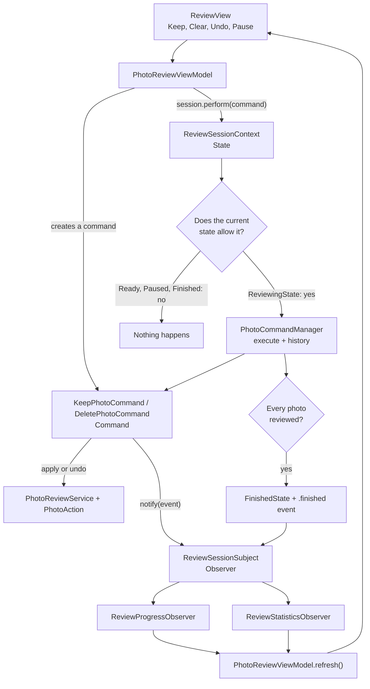
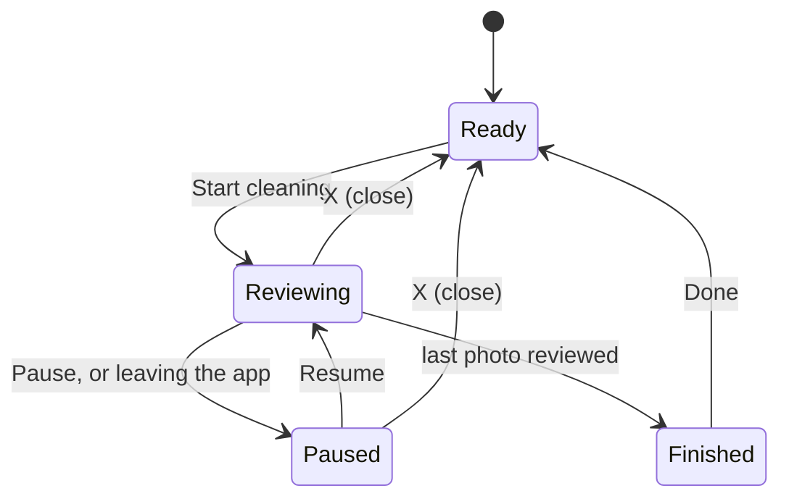

# Clearing — Photo Cleaner

Make room for what matters. A calm way to review photos you no longer need.

The Lab 1 report is in [lab1.md](lab1.md). The Lab 2 report is in [lab2.md](lab2.md). Lab 3 is explained in
[TMPS Lab 3 — Behavioral Design Patterns](#tmps-lab-3--behavioral-design-patterns).

## Lab

TMPS Lab 1 — SOLID principles

TMPS Lab 2 — Creational design patterns (Singleton, Factory Method, Builder)

TMPS Lab 3 — Behavioral design patterns (Command, Observer, State)

- Language: Swift
- UI: SwiftUI
- Minimum iOS: 17.0
- Built with: Xcode 27

## What the app does

```text
Intro ──► Home ──► Start cleaning ──► Review ──► Keep / Clear ──► next photo ──► More room. ──► Done
```

1. **Intro** — the logo forms like a photo, opens, and its halves part to reveal Home.
2. **Home** shows your library as one object made of your photos, with a crack of light
   running through it. Touch it and it tilts and opens a little.
3. **Review** shows one photo at a time, with the next ones waiting underneath.
   - Swipe right or tap **Keep**: the photo stays whole and glides into the Keep button.
   - Swipe left or tap **Clear**: the photo cracks open along the logo's line and dissolves.
   - The first photo nudges left and right once to show that it can be swiped.
   - Tap **Undo** (the round button between Clear and Keep) to bring back the last photo.
   - Tap **Pause** (top right) to stop deciding, then **Resume** to continue. Leaving the app also pauses.
4. **More room.** — the light fills the screen, your library comes back with empty
   places where cleared photos were, and the grid breathes apart.

For Lab 1 the photos are 12 sample images bundled in `Assets.xcassets`, and "Clear"
only marks a photo. Nothing is deleted from the phone.

## Project structure

```text
Clearing/
├── Models/
│   ├── Photo.swift                  data about one photo
│   └── ReviewSession.swift          ReviewMode + ReviewSession (built by the Builder)
├── Protocols/
│   ├── PhotoRepository.swift        where photos come from (abstraction)
│   └── PhotoAction.swift            something you can do to a photo (abstraction)
├── Repositories/
│   └── LocalPhotoRepository.swift   sample photos from the asset catalog
├── Actions/
│   ├── KeepPhotoAction.swift
│   └── DeletePhotoAction.swift
├── Factories/                       Factory Method
│   ├── PhotoActionFactory.swift     creator protocol: makeAction()
│   ├── KeepPhotoActionFactory.swift
│   └── DeletePhotoActionFactory.swift
├── Builders/
│   └── ReviewSessionBuilder.swift   Builder: builds and validates a ReviewSession
├── Settings/
│   └── ClearingSettings.swift       Singleton: app settings saved in UserDefaults
├── Commands/                        Command
│   ├── PhotoCommand.swift           command protocol: execute() and undo()
│   ├── KeepPhotoCommand.swift
│   ├── DeletePhotoCommand.swift
│   └── PhotoCommandManager.swift    runs commands and keeps the history for Undo
├── Observers/                       Observer
│   ├── ReviewSessionObserver.swift  ReviewSessionEvent + observer protocol
│   ├── ReviewSessionSubject.swift   attach, detach, notify
│   ├── ReviewProgressObserver.swift
│   └── ReviewStatisticsObserver.swift
├── States/                          State
│   ├── ReviewSessionState.swift     state protocol: every operation is off by default
│   ├── ReadyState.swift
│   ├── ReviewingState.swift
│   ├── PausedState.swift
│   ├── FinishedState.swift
│   └── ReviewSessionContext.swift   holds the current state and delegates to it
├── Services/
│   └── PhotoReviewService.swift     review rules: current photo, what comes next, finished
├── ViewModels/
│   └── PhotoReviewViewModel.swift   texts and numbers for the screens
├── DesignSystem/
│   ├── Theme.swift                  colors, type, spacing, radii, motion and haptics
│   └── Split.swift                  the "opening" shape: logo, icons, cracks, progress
├── Views/
│   ├── RootView.swift               intro + switching between Home and Review
│   ├── IntroView.swift
│   ├── HomeView.swift
│   ├── ReviewView.swift             photo stack, gestures, haptics, light
│   ├── FinishedView.swift
│   └── Components/
│       ├── LibrarySlab.swift        your photos as one object (Home and Finished)
│       ├── PhotoCard.swift
│       ├── DecisionButton.swift     Keep / Clear
│       ├── ReviewProgress.swift
│       ├── PrimaryButton.swift
│       ├── StatView.swift
│       ├── EmptyStateView.swift
│       └── ScreenContainer.swift
└── ClearingApp.swift              creates the objects and connects them
ClearingTests/
└── Lab2PatternTests.swift           unit tests for the three patterns and the review flow
```

## Design

Everything is built from one idea: **a photo that opens to let space in.**

The logo is a rounded photo-square cut along a rising slant. The lower part stays,
the upper part lifts and fades. `Split.swift` draws this shape with an `opening`
value from 0 (a closed photo) to 1 (fully open), and the whole app reuses it:

| Where | Opening |
|-------|---------|
| App icon and header | half open |
| Intro | forms closed, opens, then flies apart |
| Home library | a thin crack of light, wider when touched |
| Progress (top of Review) | opens as you review |
| Clear (drag left) | the photo cracks open, then parts and dissolves |
| Empty state | fully open |

- **Colors:** lagoon green in Light Mode, luminous mint in Dark Mode, used as *light*.
  Keep is ink (solid, calm), Clear is light. There is no red: clearing is positive.
- **Typography:** SF Rounded for titles and numbers, SF Pro for text. Short copy:
  "Make room.", "More room.", "Nothing left to clear."
- **Motion:** small interactions are fast springs, gestures follow the finger and
  settle with springs, navigation is calm, completion is slow. All values live in `Motion`.
- **Haptics:** light when you touch, medium at the decision point, soft for Keep,
  crisp for Clear, success at the end. All values live in `Haptics`.
- **Accessibility:** Dynamic Type (screens scroll, stats stack), VoiceOver labels and
  Keep/Clear actions on the photo, Reduce Motion (no tilt or flying, simple fades),
  Light and Dark Mode.

The UI only reads from `PhotoReviewViewModel` and calls `keepCurrentPhoto()` /
`deleteCurrentPhoto()`. The SOLID classes below are the same as in the first version of Lab 1.

## SOLID principles implemented

### 1. Single Responsibility Principle (SRP)

> A class should have only one reason to change.

Every type has one job:

| Type | Responsibility |
|------|----------------|
| `Photo` | Describes a photo (image name, size). No logic. |
| `LocalPhotoRepository` | Provides the photos. |
| `KeepPhotoAction` / `DeletePhotoAction` | Do one thing with a photo. |
| `PhotoReviewService` | Review rules: which photo is current, moving to the next one, knowing when the review is finished. |
| `PhotoReviewViewModel` | Prepares data for the UI: `"Photo 3 of 12"`, `"4.2 MB"`, counts. |
| `HomeView`, `ReviewView`, `FinishedView` | Only display the interface and forward taps. |

Example: the view model formats text, the service does not.

```swift
// PhotoReviewService — review rule
func apply(_ action: PhotoAction) {
    guard let photo = currentPhoto else { return }
    action.execute(on: photo)
    reviewedCount += 1
}

// PhotoReviewViewModel — UI text
var positionText: String {
    "Photo \(reviewedCount + 1) of \(totalCount)"
}
```

If the design of the text changes, only the view model changes.
If the review rules change, only the service changes.

### 2. Open/Closed Principle (OCP)

> Software should be open for extension, but closed for modification.

`PhotoReviewService` works with the `PhotoAction` protocol and never checks
which action it received:

```swift
protocol PhotoAction {
    func execute(on photo: Photo)
}

func apply(_ action: PhotoAction) {
    guard let photo = currentPhoto else { return }
    action.execute(on: photo)
    reviewedCount += 1
}
```

There is no `if action is Keep ... else if action is Delete ...` in the service.

To add a new action later, for example "Favorite", we create a new type:

```swift
final class FavoritePhotoAction: PhotoAction {
    private(set) var favoritePhotos: [Photo] = []

    func execute(on photo: Photo) {
        favoritePhotos.append(photo)
    }
}
```

`PhotoReviewService` does not change at all. We only add a `favoriteCurrentPhoto()`
method to the view model and a Favorite button to the review screen.

### 3. Dependency Inversion Principle (DIP)

> High-level modules should not depend on low-level modules. Both should depend on abstractions.

`PhotoReviewService` (high-level review logic) does not know about
`LocalPhotoRepository` (low-level detail). It only knows the `PhotoRepository` protocol:

```swift
protocol PhotoRepository {
    func getPhotos() -> [Photo]
}

final class PhotoReviewService {
    private let repository: PhotoRepository

    init(repository: PhotoRepository) {
        self.repository = repository
    }
}
```

The concrete repository is chosen in only one place, `ClearingApp.swift`:

```swift
PhotoReviewService(repository: LocalPhotoRepository())
```

Later in the semester this becomes:

```swift
PhotoReviewService(repository: PhotoKitRepository())
```

and the service, view model and views stay the same.

## How to run

1. Open `Clearing.xcodeproj` in Xcode.
2. Choose an iPhone simulator (for example iPhone 17 Pro) in the toolbar.
3. Press **Run** (⌘R). Press **Test** (⌘U) to run the unit tests.

To run on a real iPhone: select the **Clearing** target → **Signing & Capabilities** →
choose your Team, and change the Bundle Identifier if Xcode asks for a unique one.

## Future labs

- `PhotoKitRepository` — real photos from the library (DIP: only `ClearingApp` changes).
- Real deletion through PhotoKit inside `DeletePhotoAction`.
- New actions such as Favorite or Skip (OCP).
- Strategy pattern for sorting or choosing which photos to review first.
- Factory for repositories too (actions already use Factory Method since Lab 2).
- Adapter, Decorator and the remaining SOLID principles (LSP, ISP).

## TMPS Lab 2 — Design Patterns

Lab 2 adds three creational patterns to the same app. The flow, the look and the
Lab 1 SOLID structure stay the same. The full report with UML diagrams is in [lab2.md](lab2.md).

### Flow: where each pattern runs



### 1. Singleton: `ClearingSettings`

- **Problem:** settings must be the same in every screen. Two settings objects could disagree.
- **Where:** `Clearing/Settings/ClearingSettings.swift`. `static let shared` is the one object,
  `private init()` makes a second one impossible. Values are saved to `UserDefaults` in `didSet`.
- **What it changes in the app:**
  - **Haptic feedback** off: no vibration anywhere. All 9 vibration calls go through
    `haptic(...)` in `Theme.swift`, which checks `ClearingSettings.shared.hapticsEnabled`.
  - **Review style** Compact: the review screen hides the photo size and the swipe hint.
- **Where you change it:** the small menu in the top right corner of Home.
- **SOLID:** SRP, the class only keeps settings.

### 2. Factory Method: `PhotoActionFactory`

- **Problem:** the view model created `KeepPhotoAction()` and `DeletePhotoAction()` itself,
  so it depended on concrete classes.
- **Where:** `Clearing/Factories/`. `PhotoActionFactory` is the creator protocol with
  `makeAction() -> PhotoAction`. `KeepPhotoActionFactory` and `DeletePhotoActionFactory`
  are the concrete creators.
- **How it's used:** `PhotoReviewViewModel` gets the two factories in `init` and calls
  `makeAction()` every time a review starts. The concrete factories are chosen only in `ClearingApp.swift`.
- **Small protocol change:** `PhotoAction` now has `handledPhotos`, so the view model can
  count kept and cleared photos without knowing the concrete classes.
- **SOLID:** DIP (the view model depends on protocols only) and OCP (a new action is a new
  action class plus a new factory).

### 3. Builder: `ReviewSessionBuilder`

- **Problem:** a review was started by setting fields one by one, with no checks.
- **Where:** `Clearing/Builders/ReviewSessionBuilder.swift` builds a `ReviewSession`
  (`Clearing/Models/ReviewSession.swift`) with `setPhotos`, `setStartingIndex`, `setReviewMode` and `build()`.
- **Safety:** defaults are no photos, index 0 and Detailed. `build()` clamps the starting index
  (50 becomes the last photo, -3 becomes 0) and uses 0 when there are no photos.
- **How it's used:** `PhotoReviewService.startReview(mode:)` builds the session when you tap
  **Start cleaning**, then `start(_:)` starts the review from it.
- **SOLID:** SRP, building and checking a session is one job, separate from the review rules.

### Tests

`ClearingTests/Lab2PatternTests.swift` has 16 Swift Testing tests: the Singleton is one object
and its values reach the review, the factories create the right new actions, the builder's
defaults and clamping work, an empty library is safe, and Keep and Clear still count correctly.

### Presentation Q&A

**Why is `init` private in `ClearingSettings`?**
So nobody can write `ClearingSettings()`. The code wouldn't compile. The only object is `shared`.

**Is `static let shared` safe if two threads use it at the same time?**
Yes. Swift creates a `static let` only once, the first time it is used, and does it in a thread-safe way.

**What would go wrong without the Singleton?**
Every screen could create its own settings. The menu could turn haptics off in one object while
the review screen reads another object where they are still on.

**What are the downsides of a Singleton?**
It's global state, so it's harder to test and any code can reach it. I kept it small (only two
settings), and in the tests I put the old values back after each test.

**Which setting changes real behavior?**
Haptic feedback. When it's off, the condition inside `haptic(...)` is false, so no vibration plays.
Review style also changes the review screen (Compact hides the size and the hint).

**What is the difference between Factory Method and just calling the constructor?**
With a constructor, the view model must know the concrete class. With Factory Method it only
knows `PhotoActionFactory` and `PhotoAction`, and the concrete class is decided in `ClearingApp`.

**Which classes play which role in your Factory Method?**
Creator: `PhotoActionFactory`. Concrete creators: `KeepPhotoActionFactory`, `DeletePhotoActionFactory`.
Product: `PhotoAction`. Concrete products: `KeepPhotoAction`, `DeletePhotoAction`. Client: `PhotoReviewViewModel`.

**How would you add a Favorite action now?**
Add `FavoritePhotoAction: PhotoAction` and `FavoritePhotoActionFactory: PhotoActionFactory`,
pass the factory in `ClearingApp`, and add a button. `PhotoReviewService` doesn't change.

**Why does every review ask the factory for new actions?**
So the kept and cleared lists start empty. Otherwise a second review would continue counting from the first one.

**Why a Builder and not just an initializer with three parameters?**
The builder has defaults, lets me set only what I need, and checks the values in one place
(`build()`). An initializer would accept a wrong index without complaining.

**What happens with a wrong index or no photos?**
`build()` clamps the index into the range of the photos. With no photos the index is 0, the
review is finished right away and Home shows "Nothing left to clear."

**Why does each setter return `self`?**
So the calls can be chained: `.setPhotos(...).setStartingIndex(0).setReviewMode(mode).build()`.
`@discardableResult` allows calling a setter alone without a warning.

**Did the patterns break the SOLID principles from Lab 1?**
No. Each pattern is in new files, the service still only has the review rules (SRP), new actions
are added without editing the service (OCP), and concrete classes are still chosen only in `ClearingApp` (DIP).

## TMPS Lab 3 — Behavioral Design Patterns

Lab 3 adds three behavioral patterns to the same app. The Lab 1 SOLID structure and the Lab 2
patterns stay in place, and the look only gets three small additions: **Undo**, **Pause** and **Resume**.

| Pattern | Responsibility | Where it is used |
|---|---|---|
| Command | Encapsulates operations | Photo review actions |
| Observer | Notifies interested components | Progress and statistics |
| State | Controls behavior according to current state | Review session lifecycle |

### How the three patterns work together



The flow when you review a photo:

1. **Start cleaning** moves the session from Ready to Reviewing (State).
2. You choose Keep or Clear, and the view model creates the matching command (Command).
3. The current state decides if the command may run. Only `ReviewingState` runs it.
4. The command moves the review forward and tells the subject what happened.
5. The subject notifies the observers, and they update progress and statistics (Observer).
6. After the last photo, the session moves to Finished and observers get `.finished` (State + Observer).
7. `ReviewProgressObserver` marks the review complete, and `ReviewView` plays the ending and shows "More room."

### 1. Command: `PhotoCommand`

- **What it is:** a pattern that turns a request into an object, so it can be stored, run later or undone.
- **What problem it solves:** the view model used to call the service directly, so a decision was gone
  as soon as it happened and there was nothing to undo.
- **Which classes implement it** (`Clearing/Commands/`):
  - Command: `PhotoCommand`, with `execute()` and `undo()`.
  - Concrete commands: `KeepPhotoCommand` and `DeletePhotoCommand`.
  - Invoker: `PhotoCommandManager`, which runs a command and adds it to `history`.
  - Receivers: `PhotoReviewService` and `PhotoAction`, which do the real work.
  - Client: `PhotoReviewViewModel`, which creates the commands. The views never see them.
- **How Keep and Clear work:** `keepCurrentPhoto()` creates a `KeepPhotoCommand` with the current photo and
  the action made by the Lab 2 factory. `execute()` calls `reviewService.apply(action)`, which marks the
  photo and moves to the next one, then notifies observers with `.photoKept`. `DeletePhotoCommand` does the
  same with `.photoDeleted`.
- **How Undo works:** `undoLast()` takes the last command out of `history` and calls its `undo()`.
  `reviewService.undo(action)` moves back one photo and removes it from the action's list, then observers
  get `.keepUndone` or `.deleteUndone`. You can undo many times, in reverse order, back to the first photo.
- **Why Undo is safe:** Keep and Clear only change this review session. No photo on the phone is deleted,
  because the app uses its sample photos and doesn't call PhotoKit.
- **Why I used it:** Undo needs a memory of what happened, and a list of command objects is that memory.

### 2. Observer: `ReviewSessionSubject`

- **What it is:** one object (the subject) keeps a list of other objects (the observers) and tells all
  of them when something changes. The subject doesn't need to know what they do with the news.
- **The Subject:** `ReviewSessionSubject`, with `attach`, `detach` and `notify`.
- **The Observers:** classes that implement `ReviewSessionObserver`, which has one method: `update(with:)`.
  - `ReviewProgressObserver` keeps the reviewed count, the progress value and `isComplete`.
  - `ReviewStatisticsObserver` keeps the kept count, the cleared count and the space to free up.
- **How notifications work:** `PhotoReviewViewModel` attaches both observers in `init`. Commands and
  `ReviewSessionContext` call `subject.notify(event)`, and the subject calls `update(with:)` on each observer.
  The events are in `ReviewSessionEvent`: `started`, `photoKept`, `photoDeleted`, `keepUndone`, `deleteUndone`, `finished`.
- **How progress and statistics are updated:** each observer handles the events with a `switch`.
  `.photoDeleted(photo)` adds 1 cleared photo and adds the photo's size. `.deleteUndone(photo)` subtracts both,
  so the numbers are right after Undo. `.started` puts everything back to zero.
- **How the screen gets the numbers:** `refresh()` in the view model copies them from the observers into its
  `@Observable` properties, and SwiftUI redraws. The observers themselves don't use SwiftUI.
- **Why I used it:** a command only reports what happened. Adding another listener is a new class and one
  `attach` call, and no command changes.

### 3. State: `ReviewSessionState`

- **What it is:** an object changes its behavior when its internal state changes. Each state is its own
  class, and the object delegates its work to the current state.
- **Which states exist** (`Clearing/States/`): `ReadyState`, `ReviewingState`, `PausedState` and `FinishedState`.
  They implement `ReviewSessionState`, and `ReviewSessionContext` holds the current one.
- **How invalid transitions are prevented:** an extension of the protocol gives every operation an empty body.
  Each state writes only the operations it allows, so everything else does nothing.
- **Which operations are allowed:**

| State | Start | Pause | Resume | Keep / Clear | Undo | Close |
|---|---|---|---|---|---|---|
| Ready | yes | no | no | no | no | no |
| Reviewing | no | yes | no | yes | yes | yes |
| Paused | no | no | yes | no | no | yes |
| Finished | no | no | no | no | no | yes |

- **How transitions work:** the state calls `context.transition(to:)`.



- **What you see:** in Paused the card dims and shows PAUSED, and Keep, Clear and Undo are replaced by **Resume**.
  Swipes are ignored. In Finished you see the existing "More room." screen.
- **New session:** `startReview()` calls `close()` and then `start(mode:)`. That goes back to Ready first,
  so a new session is always allowed. Calling `start` alone during a review does nothing.
- **Empty library:** `ReadyState` goes to Reviewing, which sees no photos left and moves straight to Finished.
- **Why I used it:** the rules are in one small class per state, not in `if` checks spread through the view model.

### What stayed from Labs 1 and 2

- **Singleton:** `startReview()` still reads `ClearingSettings.shared.reviewMode`, and every vibration still
  goes through `haptic(...)`, including the new one for Undo.
- **Factory Method:** the view model still gets its actions from `makeAction()`, and passes them to the commands.
- **Builder:** `PhotoReviewService.startReview(mode:)` still builds the session with `ReviewSessionBuilder`.
- **SRP, OCP, DIP:** the service still has only the review rules, new behavior is in new classes, and
  `ClearingApp.swift` still chooses the repository and the factories. It didn't change at all.
- **Small changes to existing code:**
  - `PhotoAction` got `undo(on:)`, and `PhotoReviewService` got `undo(_:)`.
  - The kept and cleared counts now come from `ReviewStatisticsObserver`. The view model still reads
    `handledPhotos` to know which photos to show as cleared on the Finished screen.

### Presentation Q&A

**1. What are behavioral design patterns?**
Patterns about how objects work together and share responsibilities. Creational patterns are about
creating objects, structural patterns are about combining them, and behavioral patterns are about their communication.

**2. What is the Command pattern?**
It puts a request inside an object. In my app, "keep this photo" is a `KeepPhotoCommand` that I can run and undo.

**3. Why is a command different from calling a method directly?**
A method call happens and is gone. A command is an object, so `PhotoCommandManager` can keep it in a list
and call `undo()` later, without knowing whether it was a Keep or a Clear.

**4. How does Undo work?**
The manager removes the last command from `history` and calls `undo()`. The service goes back one photo, the
photo leaves the action's list, and observers fix the numbers. Nothing real is deleted from the phone.

**5. What is the Observer pattern?**
A subject keeps a list of observers and notifies all of them when something changes. My subject is
`ReviewSessionSubject`, and my observers are `ReviewProgressObserver` and `ReviewStatisticsObserver`.

**6. What is the difference between Observer and SwiftUI's `@Published`?**
`@Published` and `@Observable`, the newer one this app uses, are framework tools that tell SwiftUI to redraw.
They are based on the same idea, but SwiftUI hides the subject and the observers. In my pattern I wrote those
classes myself, so you can see `attach`, `notify` and `update(with:)`. They work without SwiftUI. `@Observable`
is only the last step, from the view model to the screen.

**7. What is the State pattern?**
Behavior depends on a current state object. `perform(command)` runs the command in `ReviewingState` and does
nothing in `PausedState`. The calling code is the same, and the state object decides.

**8. Why is State better than managing many Boolean variables?**
With `isReviewing`, `isPaused` and `isFinished`, two could be true at once, and every method would need `if`
checks. With State there is exactly one current object, and each state's rules are in its own class. The view
model does have `isPaused` and `canDecide`, but these are only copies for the screen, read from the current state.

**9. How do the three patterns interact?**
State decides if an action is allowed. Command does the action and can undo it. Observer spreads the result
to progress and statistics. After the last photo, State moves to Finished and observers get `.finished`.

**10. What is the difference between State and Strategy?**
The structure is almost the same: one object delegates to an interface. In Strategy, the client chooses an
algorithm, and the strategies don't know each other. In State, the states change the current state themselves,
like `ReviewingState` moving to `PausedState`.

**11. How do these patterns complement the previous SOLID principles?**
SRP: each command, observer and state has one job. OCP: a new observer or state is a new class.
DIP: the manager knows only `PhotoCommand`, the subject only `ReviewSessionObserver`, and the context only `ReviewSessionState`.

**12. What are the disadvantages of these patterns?**
More classes, and the flow is harder to follow because one tap passes through several objects. Command history
uses memory, though mine is cleared at each new session. With Observer, it's harder to see who reacts to what.
State is too much for very simple lifecycles.

## Credits

Sample photos from [Unsplash](https://unsplash.com) via [Lorem Picsum](https://picsum.photos), used under the Unsplash License.
