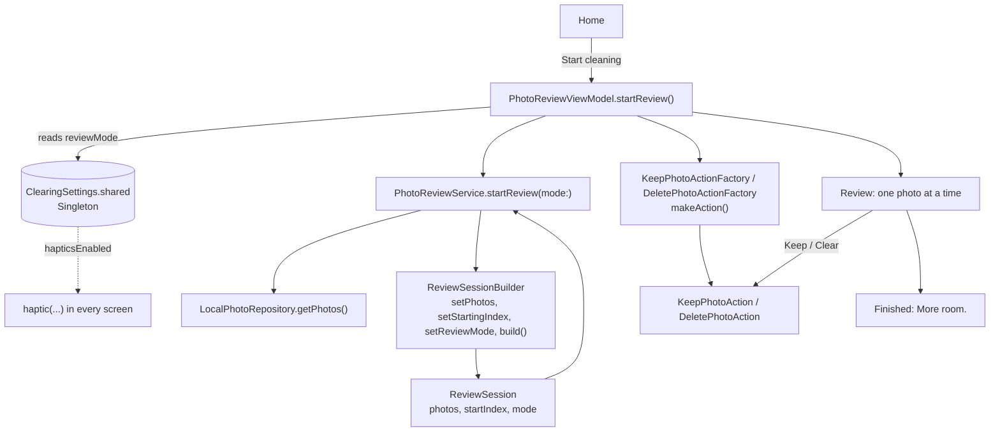
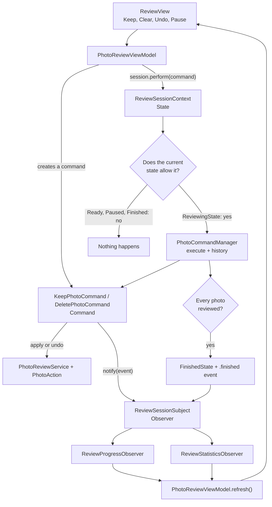
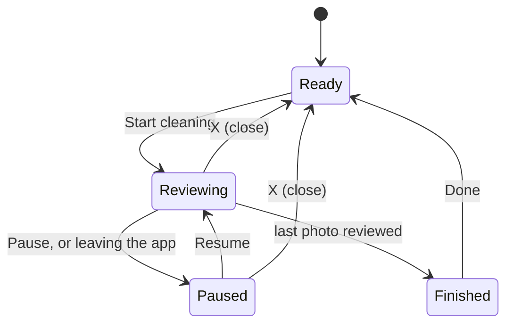
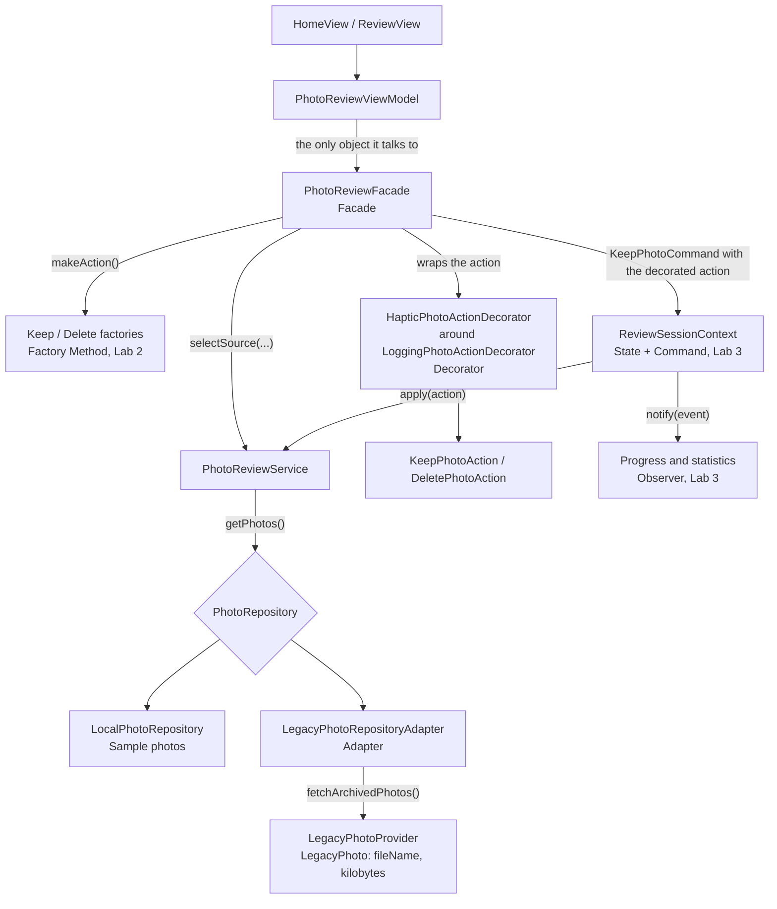

# Clearing — Photo Cleaner

Make room for what matters. A calm way to review photos you no longer need.

The Lab 1 report is in [lab1.md](lab1.md). The Lab 2 report is in [lab2.md](lab2.md). The Lab 3 report is in
[lab3.md](lab3.md). The Lab 4 report is in [lab4.md](lab4.md), and Lab 4 is also explained in
[Lab 4 — Structural Design Patterns](#lab-4--structural-design-patterns).

## Lab

TMPS Lab 1 — SOLID principles

TMPS Lab 2 — Creational design patterns (Singleton, Factory Method, Builder)

TMPS Lab 3 — Behavioral design patterns (Command, Observer, State)

TMPS Lab 4 — Structural design patterns (Adapter, Facade, Decorator)

- Language: Swift
- UI: SwiftUI
- Minimum iOS: 17.0
- Built with: Xcode 27

## What the app does

```text
Intro ──► Home ──► Start cleaning ──► Review ──► Keep / Clear ──► next photo ──► More room. ──► Done
```

1. **Intro** — the logo forms like a photo, opens, and its halves part to reveal Home.
2. **Home** shows your library as one object made of your photos, with a crack of light
   running through it. Touch it and it tilts and opens a little. The menu in the top right
   corner can switch the photo source from **Sample photos** to an **Old archive**.
3. **Review** shows one photo at a time, with the next ones waiting underneath.
   - Swipe right or tap **Keep**: the photo stays whole and glides into the Keep button.
   - Swipe left or tap **Clear**: the photo cracks open along the logo's line and dissolves.
   - The first photo nudges left and right once to show that it can be swiped.
   - Tap **Undo** (the round button between Clear and Keep) to bring back the last photo.
   - Tap **Pause** (top right) to stop deciding, then **Resume** to continue. Leaving the app also pauses.
4. **More room.** — the light fills the screen, your library comes back with empty
   places where cleared photos were, and the grid breathes apart.

For Lab 1 the photos are 12 sample images bundled in `Assets.xcassets`, and "Clear"
only marks a photo. Nothing is deleted from the phone. Since Lab 4 there is also an
**Old archive** of 8 photos, stored in an older format and read through an adapter.

## Project structure

```text
Clearing/
├── Models/
│   ├── Photo.swift                  data about one photo
│   ├── PhotoSource.swift            Sample photos or Old archive
│   └── ReviewSession.swift          ReviewMode + ReviewSession (built by the Builder)
├── Protocols/
│   ├── PhotoRepository.swift        where photos come from (abstraction)
│   └── PhotoAction.swift            something you can do to a photo (abstraction)
├── Repositories/
│   └── LocalPhotoRepository.swift   sample photos from the asset catalog
├── Legacy/
│   ├── LegacyPhoto.swift            the old archive's photo format
│   └── LegacyPhotoProvider.swift    the old archive, with its own interface
├── Adapters/                        Adapter
│   └── LegacyPhotoRepositoryAdapter.swift  makes the old archive look like a PhotoRepository
├── Actions/
│   ├── KeepPhotoAction.swift
│   └── DeletePhotoAction.swift
├── Factories/                       Factory Method
│   ├── PhotoActionFactory.swift     creator protocol: makeAction()
│   ├── KeepPhotoActionFactory.swift
│   └── DeletePhotoActionFactory.swift
├── Builders/
│   └── ReviewSessionBuilder.swift   Builder: builds and validates a ReviewSession
├── Settings/
│   └── ClearingSettings.swift       Singleton: app settings saved in UserDefaults
├── Commands/                        Command
│   ├── PhotoCommand.swift           command protocol: execute() and undo()
│   ├── KeepPhotoCommand.swift
│   ├── DeletePhotoCommand.swift
│   └── PhotoCommandManager.swift    runs commands and keeps the history for Undo
├── Observers/                       Observer
│   ├── ReviewSessionObserver.swift  ReviewSessionEvent + observer protocol
│   ├── ReviewSessionSubject.swift   attach, detach, notify
│   ├── ReviewProgressObserver.swift
│   └── ReviewStatisticsObserver.swift
├── States/                          State
│   ├── ReviewSessionState.swift     state protocol: every operation is off by default
│   ├── ReadyState.swift
│   ├── ReviewingState.swift
│   ├── PausedState.swift
│   ├── FinishedState.swift
│   └── ReviewSessionContext.swift   holds the current state and delegates to it
├── Decorators/                      Decorator
│   ├── PhotoActionDecorator.swift   wraps a PhotoAction and passes every call on
│   ├── LoggingPhotoActionDecorator.swift
│   └── HapticPhotoActionDecorator.swift
├── Facades/                         Facade
│   └── PhotoReviewFacade.swift      one simple entry point to the whole review subsystem
├── Services/
│   └── PhotoReviewService.swift     review rules: current photo, what comes next, finished
├── ViewModels/
│   └── PhotoReviewViewModel.swift   texts and numbers for the screens, talks only to the facade
├── DesignSystem/
│   ├── Theme.swift                  colors, type, spacing, radii, motion and haptics
│   └── Split.swift                  the "opening" shape: logo, icons, cracks, progress
├── Views/
│   ├── RootView.swift               intro + switching between Home and Review
│   ├── IntroView.swift
│   ├── HomeView.swift
│   ├── ReviewView.swift             photo stack, gestures, haptics, light
│   ├── FinishedView.swift
│   └── Components/
│       ├── LibrarySlab.swift        your photos as one object (Home and Finished)
│       ├── PhotoCard.swift
│       ├── DecisionButton.swift     Keep / Clear
│       ├── ReviewProgress.swift
│       ├── PrimaryButton.swift
│       ├── StatView.swift
│       ├── EmptyStateView.swift
│       └── ScreenContainer.swift
└── ClearingApp.swift              creates the objects and connects them
ClearingTests/
└── Lab2PatternTests.swift           unit tests for the three patterns and the review flow
```

## Design

Everything is built from one idea: **a photo that opens to let space in.**

The logo is a rounded photo-square cut along a rising slant. The lower part stays,
the upper part lifts and fades. `Split.swift` draws this shape with an `opening`
value from 0 (a closed photo) to 1 (fully open), and the whole app reuses it:

| Where | Opening |
|-------|---------|
| App icon and header | half open |
| Intro | forms closed, opens, then flies apart |
| Home library | a thin crack of light, wider when touched |
| Progress (top of Review) | opens as you review |
| Clear (drag left) | the photo cracks open, then parts and dissolves |
| Empty state | fully open |

- **Colors:** lagoon green in Light Mode, luminous mint in Dark Mode, used as *light*.
  Keep is ink (solid, calm), Clear is light. There is no red: clearing is positive.
- **Typography:** SF Rounded for titles and numbers, SF Pro for text. Short copy:
  "Make room.", "More room.", "Nothing left to clear."
- **Motion:** small interactions are fast springs, gestures follow the finger and
  settle with springs, navigation is calm, completion is slow. All values live in `Motion`.
- **Haptics:** light when you touch, medium at the decision point, soft for Keep,
  crisp for Clear, success at the end. All values live in `Haptics`. Keep and Clear are
  played by `HapticPhotoActionDecorator` (Lab 4), the others by the screens.
- **Accessibility:** Dynamic Type (screens scroll, stats stack), VoiceOver labels and
  Keep/Clear actions on the photo, Reduce Motion (no tilt or flying, simple fades),
  Light and Dark Mode.

The UI only reads from `PhotoReviewViewModel` and calls `keepCurrentPhoto()` /
`deleteCurrentPhoto()`. The SOLID classes below are the same as in the first version of Lab 1.

## SOLID principles implemented

### 1. Single Responsibility Principle (SRP)

> A class should have only one reason to change.

Every type has one job:

| Type | Responsibility |
|------|----------------|
| `Photo` | Describes a photo (image name, size). No logic. |
| `LocalPhotoRepository` | Provides the photos. |
| `KeepPhotoAction` / `DeletePhotoAction` | Do one thing with a photo. |
| `PhotoReviewService` | Review rules: which photo is current, moving to the next one, knowing when the review is finished. |
| `PhotoReviewViewModel` | Prepares data for the UI: `"Photo 3 of 12"`, `"4.2 MB"`, counts. |
| `HomeView`, `ReviewView`, `FinishedView` | Only display the interface and forward taps. |

Example: the view model formats text, the service does not.

```swift
// PhotoReviewService — review rule
func apply(_ action: PhotoAction) {
    guard let photo = currentPhoto else { return }
    action.execute(on: photo)
    reviewedCount += 1
}

// PhotoReviewViewModel — UI text
var positionText: String {
    "Photo \(reviewedCount + 1) of \(totalCount)"
}
```

If the design of the text changes, only the view model changes.
If the review rules change, only the service changes.

### 2. Open/Closed Principle (OCP)

> Software should be open for extension, but closed for modification.

`PhotoReviewService` works with the `PhotoAction` protocol and never checks
which action it received:

```swift
protocol PhotoAction {
    func execute(on photo: Photo)
}

func apply(_ action: PhotoAction) {
    guard let photo = currentPhoto else { return }
    action.execute(on: photo)
    reviewedCount += 1
}
```

There is no `if action is Keep ... else if action is Delete ...` in the service.

To add a new action later, for example "Favorite", we create a new type:

```swift
final class FavoritePhotoAction: PhotoAction {
    private(set) var favoritePhotos: [Photo] = []

    func execute(on photo: Photo) {
        favoritePhotos.append(photo)
    }
}
```

`PhotoReviewService` does not change at all. We only add a `favoriteCurrentPhoto()`
method to the view model and a Favorite button to the review screen.

### 3. Dependency Inversion Principle (DIP)

> High-level modules should not depend on low-level modules. Both should depend on abstractions.

`PhotoReviewService` (high-level review logic) does not know about
`LocalPhotoRepository` (low-level detail). It only knows the `PhotoRepository` protocol:

```swift
protocol PhotoRepository {
    func getPhotos() -> [Photo]
}

final class PhotoReviewService {
    private var repository: PhotoRepository

    init(repository: PhotoRepository) {
        self.repository = repository
    }
}
```

The concrete repositories are chosen in only one place, `ClearingApp.swift`:

```swift
PhotoReviewFacade(
    libraryRepository: LocalPhotoRepository(),
    archiveRepository: LegacyPhotoRepositoryAdapter(provider: LegacyPhotoProvider()),
    ...
)
```

Later in the semester the library becomes:

```swift
libraryRepository: PhotoKitRepository()
```

and the service, view model and views stay the same.

## How to run

1. Open `Clearing.xcodeproj` in Xcode.
2. Choose an iPhone simulator (for example iPhone 17 Pro) in the toolbar.
3. Press **Run** (⌘R). Press **Test** (⌘U) to run the unit tests.

To run on a real iPhone: select the **Clearing** target → **Signing & Capabilities** →
choose your Team, and change the Bundle Identifier if Xcode asks for a unique one.

## Future labs

- `PhotoKitRepository` — real photos from the library (DIP: only `ClearingApp` changes).
- Real deletion through PhotoKit inside `DeletePhotoAction`.
- New actions such as Favorite or Skip (OCP).
- Strategy pattern for sorting or choosing which photos to review first.
- Factory for repositories too (actions already use Factory Method since Lab 2).
- The remaining SOLID principles (LSP, ISP).

## TMPS Lab 2 — Design Patterns

Lab 2 adds three creational patterns to the same app. The flow, the look and the
Lab 1 SOLID structure stay the same. The full report with UML diagrams is in [lab2.md](lab2.md).

### Flow: where each pattern runs



### 1. Singleton: `ClearingSettings`

- **Problem:** settings must be the same in every screen. Two settings objects could disagree.
- **Where:** `Clearing/Settings/ClearingSettings.swift`. `static let shared` is the one object,
  `private init()` makes a second one impossible. Values are saved to `UserDefaults` in `didSet`.
- **What it changes in the app:**
  - **Haptic feedback** off: no vibration anywhere. Every vibration checks
    `ClearingSettings.shared.hapticsEnabled`: 7 go through `haptic(...)` in `Theme.swift`,
    and since Lab 4 the Keep and Clear vibrations go through `HapticPhotoActionDecorator`.
  - **Review style** Compact: the review screen hides the photo size and the swipe hint.
- **Where you change it:** the small menu in the top right corner of Home.
- **SOLID:** SRP, the class only keeps settings.

### 2. Factory Method: `PhotoActionFactory`

- **Problem:** the view model created `KeepPhotoAction()` and `DeletePhotoAction()` itself,
  so it depended on concrete classes.
- **Where:** `Clearing/Factories/`. `PhotoActionFactory` is the creator protocol with
  `makeAction() -> PhotoAction`. `KeepPhotoActionFactory` and `DeletePhotoActionFactory`
  are the concrete creators.
- **How it's used:** `PhotoReviewViewModel` gets the two factories in `init` and calls
  `makeAction()` every time a review starts. The concrete factories are chosen only in `ClearingApp.swift`.
- **Small protocol change:** `PhotoAction` now has `handledPhotos`, so the view model can
  count kept and cleared photos without knowing the concrete classes.
- **SOLID:** DIP (the view model depends on protocols only) and OCP (a new action is a new
  action class plus a new factory).

### 3. Builder: `ReviewSessionBuilder`

- **Problem:** a review was started by setting fields one by one, with no checks.
- **Where:** `Clearing/Builders/ReviewSessionBuilder.swift` builds a `ReviewSession`
  (`Clearing/Models/ReviewSession.swift`) with `setPhotos`, `setStartingIndex`, `setReviewMode` and `build()`.
- **Safety:** defaults are no photos, index 0 and Detailed. `build()` clamps the starting index
  (50 becomes the last photo, -3 becomes 0) and uses 0 when there are no photos.
- **How it's used:** `PhotoReviewService.startReview(mode:)` builds the session when you tap
  **Start cleaning**, then `start(_:)` starts the review from it.
- **SOLID:** SRP, building and checking a session is one job, separate from the review rules.

### Tests

`ClearingTests/Lab2PatternTests.swift` has 16 Swift Testing tests: the Singleton is one object
and its values reach the review, the factories create the right new actions, the builder's
defaults and clamping work, an empty library is safe, and Keep and Clear still count correctly.

### Presentation Q&A

**Why is `init` private in `ClearingSettings`?**
So nobody can write `ClearingSettings()`. The code wouldn't compile. The only object is `shared`.

**Is `static let shared` safe if two threads use it at the same time?**
Yes. Swift creates a `static let` only once, the first time it is used, and does it in a thread-safe way.

**What would go wrong without the Singleton?**
Every screen could create its own settings. The menu could turn haptics off in one object while
the review screen reads another object where they are still on.

**What are the downsides of a Singleton?**
It's global state, so it's harder to test and any code can reach it. I kept it small (only two
settings), and in the tests I put the old values back after each test.

**Which setting changes real behavior?**
Haptic feedback. When it's off, the condition inside `haptic(...)` is false, so no vibration plays.
Review style also changes the review screen (Compact hides the size and the hint).

**What is the difference between Factory Method and just calling the constructor?**
With a constructor, the view model must know the concrete class. With Factory Method it only
knows `PhotoActionFactory` and `PhotoAction`, and the concrete class is decided in `ClearingApp`.

**Which classes play which role in your Factory Method?**
Creator: `PhotoActionFactory`. Concrete creators: `KeepPhotoActionFactory`, `DeletePhotoActionFactory`.
Product: `PhotoAction`. Concrete products: `KeepPhotoAction`, `DeletePhotoAction`. Client: `PhotoReviewViewModel`.

**How would you add a Favorite action now?**
Add `FavoritePhotoAction: PhotoAction` and `FavoritePhotoActionFactory: PhotoActionFactory`,
pass the factory in `ClearingApp`, and add a button. `PhotoReviewService` doesn't change.

**Why does every review ask the factory for new actions?**
So the kept and cleared lists start empty. Otherwise a second review would continue counting from the first one.

**Why a Builder and not just an initializer with three parameters?**
The builder has defaults, lets me set only what I need, and checks the values in one place
(`build()`). An initializer would accept a wrong index without complaining.

**What happens with a wrong index or no photos?**
`build()` clamps the index into the range of the photos. With no photos the index is 0, the
review is finished right away and Home shows "Nothing left to clear."

**Why does each setter return `self`?**
So the calls can be chained: `.setPhotos(...).setStartingIndex(0).setReviewMode(mode).build()`.
`@discardableResult` allows calling a setter alone without a warning.

**Did the patterns break the SOLID principles from Lab 1?**
No. Each pattern is in new files, the service still only has the review rules (SRP), new actions
are added without editing the service (OCP), and concrete classes are still chosen only in `ClearingApp` (DIP).

## TMPS Lab 3 — Behavioral Design Patterns

Lab 3 adds three behavioral patterns to the same app. The Lab 1 SOLID structure and the Lab 2
patterns stay in place, and the look only gets three small additions: **Undo**, **Pause** and **Resume**.

| Pattern | Responsibility | Where it is used |
|---|---|---|
| Command | Encapsulates operations | Photo review actions |
| Observer | Notifies interested components | Progress and statistics |
| State | Controls behavior according to current state | Review session lifecycle |

### How the three patterns work together



The flow when you review a photo:

1. **Start cleaning** moves the session from Ready to Reviewing (State).
2. You choose Keep or Clear, and the view model creates the matching command (Command).
3. The current state decides if the command may run. Only `ReviewingState` runs it.
4. The command moves the review forward and tells the subject what happened.
5. The subject notifies the observers, and they update progress and statistics (Observer).
6. After the last photo, the session moves to Finished and observers get `.finished` (State + Observer).
7. `ReviewProgressObserver` marks the review complete, and `ReviewView` plays the ending and shows "More room."

### 1. Command: `PhotoCommand`

- **What it is:** a pattern that turns a request into an object, so it can be stored, run later or undone.
- **What problem it solves:** the view model used to call the service directly, so a decision was gone
  as soon as it happened and there was nothing to undo.
- **Which classes implement it** (`Clearing/Commands/`):
  - Command: `PhotoCommand`, with `execute()` and `undo()`.
  - Concrete commands: `KeepPhotoCommand` and `DeletePhotoCommand`.
  - Invoker: `PhotoCommandManager`, which runs a command and adds it to `history`.
  - Receivers: `PhotoReviewService` and `PhotoAction`, which do the real work.
  - Client: `PhotoReviewViewModel`, which creates the commands. The views never see them.
- **How Keep and Clear work:** `keepCurrentPhoto()` creates a `KeepPhotoCommand` with the current photo and
  the action made by the Lab 2 factory. `execute()` calls `reviewService.apply(action)`, which marks the
  photo and moves to the next one, then notifies observers with `.photoKept`. `DeletePhotoCommand` does the
  same with `.photoDeleted`.
- **How Undo works:** `undoLast()` takes the last command out of `history` and calls its `undo()`.
  `reviewService.undo(action)` moves back one photo and removes it from the action's list, then observers
  get `.keepUndone` or `.deleteUndone`. You can undo many times, in reverse order, back to the first photo.
- **Why Undo is safe:** Keep and Clear only change this review session. No photo on the phone is deleted,
  because the app uses its sample photos and doesn't call PhotoKit.
- **Why I used it:** Undo needs a memory of what happened, and a list of command objects is that memory.

### 2. Observer: `ReviewSessionSubject`

- **What it is:** one object (the subject) keeps a list of other objects (the observers) and tells all
  of them when something changes. The subject doesn't need to know what they do with the news.
- **The Subject:** `ReviewSessionSubject`, with `attach`, `detach` and `notify`.
- **The Observers:** classes that implement `ReviewSessionObserver`, which has one method: `update(with:)`.
  - `ReviewProgressObserver` keeps the reviewed count, the progress value and `isComplete`.
  - `ReviewStatisticsObserver` keeps the kept count, the cleared count and the space to free up.
- **How notifications work:** `PhotoReviewViewModel` attaches both observers in `init`. Commands and
  `ReviewSessionContext` call `subject.notify(event)`, and the subject calls `update(with:)` on each observer.
  The events are in `ReviewSessionEvent`: `started`, `photoKept`, `photoDeleted`, `keepUndone`, `deleteUndone`, `finished`.
- **How progress and statistics are updated:** each observer handles the events with a `switch`.
  `.photoDeleted(photo)` adds 1 cleared photo and adds the photo's size. `.deleteUndone(photo)` subtracts both,
  so the numbers are right after Undo. `.started` puts everything back to zero.
- **How the screen gets the numbers:** `refresh()` in the view model copies them from the observers into its
  `@Observable` properties, and SwiftUI redraws. The observers themselves don't use SwiftUI.
- **Why I used it:** a command only reports what happened. Adding another listener is a new class and one
  `attach` call, and no command changes.

### 3. State: `ReviewSessionState`

- **What it is:** an object changes its behavior when its internal state changes. Each state is its own
  class, and the object delegates its work to the current state.
- **Which states exist** (`Clearing/States/`): `ReadyState`, `ReviewingState`, `PausedState` and `FinishedState`.
  They implement `ReviewSessionState`, and `ReviewSessionContext` holds the current one.
- **How invalid transitions are prevented:** an extension of the protocol gives every operation an empty body.
  Each state writes only the operations it allows, so everything else does nothing.
- **Which operations are allowed:**

| State | Start | Pause | Resume | Keep / Clear | Undo | Close |
|---|---|---|---|---|---|---|
| Ready | yes | no | no | no | no | no |
| Reviewing | no | yes | no | yes | yes | yes |
| Paused | no | no | yes | no | no | yes |
| Finished | no | no | no | no | no | yes |

- **How transitions work:** the state calls `context.transition(to:)`.



- **What you see:** in Paused the card dims and shows PAUSED, and Keep, Clear and Undo are replaced by **Resume**.
  Swipes are ignored. In Finished you see the existing "More room." screen.
- **New session:** `startReview()` calls `close()` and then `start(mode:)`. That goes back to Ready first,
  so a new session is always allowed. Calling `start` alone during a review does nothing.
- **Empty library:** `ReadyState` goes to Reviewing, which sees no photos left and moves straight to Finished.
- **Why I used it:** the rules are in one small class per state, not in `if` checks spread through the view model.

### What stayed from Labs 1 and 2

- **Singleton:** `startReview()` still reads `ClearingSettings.shared.reviewMode`, and every vibration still
  respects the haptics setting, including the new one for Undo.
- **Factory Method:** the view model still gets its actions from `makeAction()`, and passes them to the commands.
- **Builder:** `PhotoReviewService.startReview(mode:)` still builds the session with `ReviewSessionBuilder`.
- **SRP, OCP, DIP:** the service still has only the review rules, new behavior is in new classes, and
  `ClearingApp.swift` still chooses the repository and the factories. It didn't change at all.
- **Small changes to existing code:**
  - `PhotoAction` got `undo(on:)`, and `PhotoReviewService` got `undo(_:)`.
  - The kept and cleared counts now come from `ReviewStatisticsObserver`. The view model still reads
    `handledPhotos` to know which photos to show as cleared on the Finished screen.

### Presentation Q&A

**1. What are behavioral design patterns?**
Patterns about how objects work together and share responsibilities. Creational patterns are about
creating objects, structural patterns are about combining them, and behavioral patterns are about their communication.

**2. What is the Command pattern?**
It puts a request inside an object. In my app, "keep this photo" is a `KeepPhotoCommand` that I can run and undo.

**3. Why is a command different from calling a method directly?**
A method call happens and is gone. A command is an object, so `PhotoCommandManager` can keep it in a list
and call `undo()` later, without knowing whether it was a Keep or a Clear.

**4. How does Undo work?**
The manager removes the last command from `history` and calls `undo()`. The service goes back one photo, the
photo leaves the action's list, and observers fix the numbers. Nothing real is deleted from the phone.

**5. What is the Observer pattern?**
A subject keeps a list of observers and notifies all of them when something changes. My subject is
`ReviewSessionSubject`, and my observers are `ReviewProgressObserver` and `ReviewStatisticsObserver`.

**6. What is the difference between Observer and SwiftUI's `@Published`?**
`@Published` and `@Observable`, the newer one this app uses, are framework tools that tell SwiftUI to redraw.
They are based on the same idea, but SwiftUI hides the subject and the observers. In my pattern I wrote those
classes myself, so you can see `attach`, `notify` and `update(with:)`. They work without SwiftUI. `@Observable`
is only the last step, from the view model to the screen.

**7. What is the State pattern?**
Behavior depends on a current state object. `perform(command)` runs the command in `ReviewingState` and does
nothing in `PausedState`. The calling code is the same, and the state object decides.

**8. Why is State better than managing many Boolean variables?**
With `isReviewing`, `isPaused` and `isFinished`, two could be true at once, and every method would need `if`
checks. With State there is exactly one current object, and each state's rules are in its own class. The view
model does have `isPaused` and `canDecide`, but these are only copies for the screen, read from the current state.

**9. How do the three patterns interact?**
State decides if an action is allowed. Command does the action and can undo it. Observer spreads the result
to progress and statistics. After the last photo, State moves to Finished and observers get `.finished`.

**10. What is the difference between State and Strategy?**
The structure is almost the same: one object delegates to an interface. In Strategy, the client chooses an
algorithm, and the strategies don't know each other. In State, the states change the current state themselves,
like `ReviewingState` moving to `PausedState`.

**11. How do these patterns complement the previous SOLID principles?**
SRP: each command, observer and state has one job. OCP: a new observer or state is a new class.
DIP: the manager knows only `PhotoCommand`, the subject only `ReviewSessionObserver`, and the context only `ReviewSessionState`.

**12. What are the disadvantages of these patterns?**
More classes, and the flow is harder to follow because one tap passes through several objects. Command history
uses memory, though mine is cleared at each new session. With Observer, it's harder to see who reacts to what.
State is too much for very simple lifecycles.

## Lab 4 — Structural Design Patterns

Lab 4 adds three structural patterns to the same app. Structural patterns are about **how classes and
objects are put together** into bigger structures: how one object fits another's interface, how a group
of objects hides behind one object, and how an object is wrapped to get extra behavior. The Lab 1 SOLID
structure and the patterns from Labs 2 and 3 stay in place. The only new thing on screen is one more
choice in the Home menu: **Photo source**, with **Sample photos** and **Old archive**.

| Pattern | Main classes | Purpose |
|---|---|---|
| Adapter | `LegacyPhotoRepositoryAdapter`, `LegacyPhotoProvider`, `LegacyPhoto` | Makes an old photo archive with a different interface work as a `PhotoRepository` |
| Facade | `PhotoReviewFacade` | One simple entry point to the review subsystem (service, Builder, Command, Observer, State) |
| Decorator | `PhotoActionDecorator`, `LoggingPhotoActionDecorator`, `HapticPhotoActionDecorator` | Adds logging and vibration to Keep and Clear without changing their classes |

### How the three patterns work together



What happens when you tap **Keep**:

1. `ReviewView` calls `viewModel.keepCurrentPhoto()`, and the view model calls `facade.keepCurrentPhoto()`.
2. **Facade:** it takes the Keep action that the Lab 2 factory made, and wraps it in the decorators.
3. **Decorator:** the action is now `HapticPhotoActionDecorator` around `LoggingPhotoActionDecorator` around `KeepPhotoAction`.
4. The facade creates a `KeepPhotoCommand` with the decorated action and gives it to the session.
5. **State:** only `ReviewingState` lets it run. While paused, nothing happens, so nothing is logged and nothing vibrates.
6. **Command:** the manager runs the command and saves it for Undo. The service calls `action.execute(on:)`.
   The call goes through both decorators down to `KeepPhotoAction`, which runs **once**. Then the log line is
   printed and the phone vibrates, if haptics are on.
7. **Observer:** the command notifies the subject, and progress and statistics update.
8. The view model copies the numbers from the facade, and SwiftUI redraws.

What happens when you choose **Old archive** on Home:

1. The menu changes `ClearingSettings.shared.photoSource` (Singleton, Lab 2).
2. `HomeView` sees the change and calls `viewModel.selectSource(.archive)`, which calls `facade.selectSource(.archive)`.
3. **Facade:** it closes any running review and gives the service the archive repository.
4. The service starts again with the Builder: `ReviewSessionBuilder().setPhotos(repository.getPhotos())`.
5. **Adapter:** `getPhotos()` asks the old archive for its `LegacyPhoto` list and converts each one into a `Photo`.
   Home now shows "8 photos to review · 31,7 MB". The service never knows the photos came from somewhere else.

### 1. Adapter: `LegacyPhotoRepositoryAdapter`

- **What problem it solves:** the app reads photos through `PhotoRepository.getPhotos() -> [Photo]`. The old
  archive has a different method, `fetchArchivedPhotos()`, and a different model: `LegacyPhoto` has a
  `fileName` with an extension (`"sample-09.jpg"`) and a size in **kilobytes**, while `Photo` has an
  `imageName` without the extension and a size in **bytes**. They don't fit together.
- **Why it is structural:** it doesn't add new behavior. It changes the *shape* of an existing class
  so it fits into a place built for another interface.
- **Files:**
  - `Clearing/Legacy/LegacyPhoto.swift`: the old model (adaptee's data).
  - `Clearing/Legacy/LegacyPhotoProvider.swift`: the old archive with its own interface (adaptee).
  - `Clearing/Adapters/LegacyPhotoRepositoryAdapter.swift`: the adapter.
  - `PhotoRepository` (from Lab 1) is the target interface.
- **How it works in Clearing:** the adapter implements `PhotoRepository`, keeps a `LegacyPhotoProvider`,
  and converts every `LegacyPhoto` into a `Photo`:

```swift
final class LegacyPhotoRepositoryAdapter: PhotoRepository {
    private let provider: LegacyPhotoProvider

    init(provider: LegacyPhotoProvider) {
        self.provider = provider
    }

    func getPhotos() -> [Photo] {
        provider.fetchArchivedPhotos().map { legacyPhoto in
            convert(legacyPhoto)
        }
    }

    private func convert(_ legacyPhoto: LegacyPhoto) -> Photo {
        Photo(
            imageName: URL(filePath: legacyPhoto.fileName).deletingPathExtension().lastPathComponent,
            sizeInBytes: Int64(legacyPhoto.kilobytes) * 1_000
        )
    }
}
```

  `"sample-09.jpg"` with `6_100` kilobytes becomes `Photo(imageName: "sample-09", sizeInBytes: 6_100_000)`.
  `ClearingApp.swift` passes the adapter wherever a `PhotoRepository` is expected:
  `archiveRepository: LegacyPhotoRepositoryAdapter(provider: LegacyPhotoProvider())`.
- **Analogy:** a travel plug adapter. A European plug doesn't fit a UK socket. You don't rebuild the phone
  charger or the wall. You put an adapter between them.
- **Roles:** Target `PhotoRepository`, Adaptee `LegacyPhotoProvider`, Adapter `LegacyPhotoRepositoryAdapter`,
  Client `PhotoReviewService`.

### 2. Facade: `PhotoReviewFacade`

- **What problem it solves:** after Lab 3 the view model had to hold and connect nine objects: the service,
  both factories, both actions, the subject, two observers and the session. It also built the commands itself.
  The screen's helper class knew every detail of the review subsystem.
- **Why it is structural:** it is about how the objects are organised. The subsystem classes stay the same.
  One new object stands in front of them, and the client talks only to that object.
- **File:** `Clearing/Facades/PhotoReviewFacade.swift`.
- **How it works in Clearing:** the facade creates and connects the subsystem in its `init`. Its public methods
  are short, and each one delegates:

| Facade method | What it delegates to |
|---|---|
| `selectSource(_:)` | `session.close()` and `reviewService.changeRepository(to:)` |
| `startReview(mode:)` | `session.close()`, `session.start(mode:)`, the factories' `makeAction()` |
| `keepCurrentPhoto()` / `deleteCurrentPhoto()` | decorates the action, creates the command, `session.perform(command)` |
| `undoLastDecision()` | `session.undo()` |
| `pauseReview()` / `resumeReview()` / `closeReview()` | `session.pause()` / `resume()` / `close()` |

  It also has read-only values for the screen, such as `currentPhoto`, `canUndo`, `progress` and `keptCount`,
  each read from the service, the session or an observer. The view model now has one dependency:

```swift
init(facade: PhotoReviewFacade) {
    self.facade = facade
    refresh()
}

func keepCurrentPhoto() {
    facade.keepCurrentPhoto()
    refresh()
}
```

  The rules didn't move into the facade. The service still decides which photo is current, the states still
  decide what is allowed, the commands still do and undo, and the observers still count.
- **Dependencies are explicit:** the facade receives the two repositories and the two factories as protocols,
  and `ClearingApp.swift` chooses the concrete classes.
- **Analogy:** a hotel reception desk. You ask one person for a room, a taxi or breakfast, and they talk to
  housekeeping, the kitchen and the drivers for you.

### 3. Decorator: `PhotoActionDecorator`

- **What problem it solves:** I wanted Keep and Clear to also write a log line and vibrate. Putting that code
  inside `KeepPhotoAction` and `DeletePhotoAction` would mix three jobs in one class and repeat it in both.
- **Why it is structural:** a decorator is built by *wrapping* one object in another object with the same
  interface. The structure (a chain of wrappers) is what adds the behavior.
- **Files** (`Clearing/Decorators/`):
  - `PhotoActionDecorator.swift`: the base decorator. It is a `PhotoAction`, holds a `PhotoAction`, and passes every call on.
  - `LoggingPhotoActionDecorator.swift`: after the action runs, it writes `"Keep sample-09"` or `"Undo Keep sample-09"`.
  - `HapticPhotoActionDecorator.swift`: after the action runs, it vibrates if `ClearingSettings.shared.hapticsEnabled` is on.
- **How it works in Clearing:**

```swift
class PhotoActionDecorator: PhotoAction {
    private let wrappedAction: PhotoAction

    init(wrapping action: PhotoAction) {
        wrappedAction = action
    }

    var handledPhotos: [Photo] {
        wrappedAction.handledPhotos
    }

    func execute(on photo: Photo) {
        wrappedAction.execute(on: photo)
    }

    func undo(on photo: Photo) {
        wrappedAction.undo(on: photo)
    }
}

final class HapticPhotoActionDecorator: PhotoActionDecorator {
    private let playFeedback: () -> Void

    init(wrapping action: PhotoAction, playFeedback: @escaping () -> Void) {
        self.playFeedback = playFeedback
        super.init(wrapping: action)
    }

    override func execute(on photo: Photo) {
        super.execute(on: photo)
        if ClearingSettings.shared.hapticsEnabled {
            playFeedback()
        }
    }
}
```

  The facade combines them right before it creates a command:

```swift
private func decorate(_ action: PhotoAction, name: String, playFeedback: @escaping () -> Void) -> PhotoAction {
    let loggedAction = LoggingPhotoActionDecorator(wrapping: action, name: name) { message in
        print(message)
    }
    return HapticPhotoActionDecorator(wrapping: loggedAction, playFeedback: playFeedback)
}
```

  - Every decorator calls `super` exactly once, so the real action runs exactly once.
  - Because a decorator is also a `PhotoAction`, one decorator can wrap another, in any order.
  - `handledPhotos` is passed on too, so the Finished screen still knows which photos were cleared.
  - Undo goes through the same wrappers, so the log also shows `"Undo Clear sample-02"`.
  - Keep and Clear were vibrating from `ReviewView` before. That vibration moved into the decorator
    (`Haptics.playKeep` and `Haptics.playClear`, with the same feel), so there is no double vibration.
  - `KeepPhotoAction` and `DeletePhotoAction` did not change.
- **Analogy:** a phone case. The phone works the same. The case adds protection, and you can add a
  wallet case on top. The phone never knows how many layers it is in.
- **To see it:** run the app from Xcode and look at the console while you review photos.

### Why Adapter, Facade and Decorator for Clearing

| Pattern | Does Clearing need it now? |
|---|---|
| **Adapter** | Yes. The app already reads photos through `PhotoRepository`, and photos can come from places with other interfaces: the old archive now, PhotoKit later. |
| **Facade** | Yes. After Lab 3 the view model coordinated nine objects. Now it talks to one. |
| **Decorator** | Yes. `PhotoAction` already exists, and logging and vibration are extras that shouldn't live inside Keep and Delete. |
| Bridge | Not yet. Clearing has no two independent things that both vary (for example many report types × many output formats). |
| Composite | Not yet. Clearing has a flat list of photos, with no albums inside albums. |
| Flyweight | Not yet. 12 photos don't use enough memory to need sharing. It would matter with thousands of photos. |
| Proxy | Not yet. The photos are local and cheap to load. It would matter with PhotoKit or cloud photos. |

### The other structural patterns, in theory

- **Bridge:** splits one big class tree into two separate trees, an abstraction and an implementation,
  connected by a reference, so both can grow on their own. *Clearing example:* a `CleaningReport`
  (Short or Detailed) that uses a `ReportRenderer` (on screen or PDF). Without Bridge you would need
  4 classes (ShortScreen, ShortPDF, DetailedScreen, DetailedPDF). With Bridge it's 2 + 2.
  *Analogy:* a TV remote and the TV. Any remote can work with any TV through the same buttons.
- **Composite:** lets you treat a single object and a group of objects the same way, as a tree.
  *Clearing example:* an `Album` and a `Photo` both have `sizeInBytes`. An album's size is the sum of
  its children, which can be photos or other albums. The app could then show "space to free" for a whole album.
  *Analogy:* folders and files on a computer.
- **Flyweight:** saves memory by sharing the parts that are the same in many objects, and keeping only the
  different parts in each object. *Clearing example:* with 10,000 photos, every card could share one decoded
  thumbnail per image from a cache, instead of each card loading its own copy.
  *Analogy:* a font. The letter "e" is drawn once and reused everywhere in the text.
- **Proxy:** an object with the same interface as another one, standing in front of it to control access.
  It can load the real object lazily, check permissions, or cache. *Clearing example:* a `PhotoKitRepositoryProxy`
  that asks for photo library permission first, and only then creates the real PhotoKit repository.
  *Difference from Decorator:* a decorator adds behavior and is chosen by the client, while a proxy controls
  access to the real object and often creates or manages it.
  *Analogy:* a credit card is a proxy for your bank account.

### What stayed from Labs 1, 2 and 3

- **SRP:** the view model only prepares texts and numbers, the facade only coordinates, each decorator adds one behavior.
- **OCP:** logging and vibration are new classes, and `KeepPhotoAction`, `DeletePhotoAction` and `LocalPhotoRepository` didn't change.
  A new photo source is a new adapter.
- **DIP:** the facade and the service depend on `PhotoRepository` and `PhotoActionFactory`. `ClearingApp.swift` is still the
  only place that chooses the concrete classes.
- **Singleton:** `ClearingSettings` got one more setting, `photoSource`. The haptic decorator reads `hapticsEnabled`.
- **Factory Method:** the facade still gets the actions from `makeAction()`. The decorators wrap what the factories make.
- **Builder:** choosing a source restarts the service, which builds the session with `ReviewSessionBuilder`.
- **Command:** the commands now carry decorated actions, so Undo also goes through the decorators.
- **Observer:** the facade attaches the same two observers. Progress and statistics work as before.
- **State:** the facade sends every request through the session, so Pause still blocks Keep, Clear and Undo.
- **Small changes to existing code:**
  - `PhotoReviewService`: the repository is now `var`, with `changeRepository(to:)`.
  - `ClearingSettings`: `photoSource`, saved in `UserDefaults`.
  - `Theme.swift`: `Haptics.keep` and `Haptics.clear` became `Haptics.playKeep()` and `Haptics.playClear()`, used by the haptic decorator.
  - `ReviewView`: its two Keep and Clear vibrations were removed, because the decorator plays them now.
  - `HomeView`: the **Photo source** choice in the menu.
  - `ClearingApp.swift` and the previews create the facade.

### Presentation script

> "For Lab 4 I added three structural patterns to Clearing. Structural patterns are about how objects are
> put together.
>
> First, **Adapter**. I have an old photo archive, `LegacyPhotoProvider`. It returns `LegacyPhoto`, with a file
> name like `sample-09.jpg` and a size in kilobytes, and its method is called `fetchArchivedPhotos`. My app only
> understands `PhotoRepository` with `getPhotos()` and the `Photo` model. `LegacyPhotoRepositoryAdapter` implements
> `PhotoRepository`, and converts the names and the sizes. On Home I choose **Old archive** in the menu, and the
> library shows 8 photos and 31.7 MB. The service didn't change at all.
>
> Second, **Facade**. After Lab 3 my view model created and connected the service, the factories, the session,
> the subject and the observers. Now `PhotoReviewFacade` does that, and the view model talks only to the facade
> with simple methods: `startReview`, `keepCurrentPhoto`, `undoLastDecision`, `pauseReview`. The facade only
> delegates. The rules stayed in their classes.
>
> Third, **Decorator**. I wanted Keep and Clear to log and vibrate, without changing `KeepPhotoAction` or
> `DeletePhotoAction`. `PhotoActionDecorator` is a `PhotoAction` that wraps another `PhotoAction`. The logging
> decorator writes a line, and the haptic decorator vibrates only if haptics are on in settings. Here in the
> console you can see 'Keep sample-09', and after Undo, 'Undo Keep sample-09'.
>
> All three work with the old patterns. One tap on Keep goes through the facade, the factory's action is
> wrapped in decorators, the command runs it, the state checks that it's allowed, and the observers update
> the progress."

Demo order: Home menu, **Old archive**, then Start, Keep, Clear, Undo, Pause and the Xcode console.

### Presentation Q&A

**1. What are structural design patterns?**
Patterns about how classes and objects are combined into bigger structures. Creational patterns create objects,
behavioral patterns are about how they communicate, and structural patterns are about how they fit together.

**2. What does the Adapter do in your app?**
It makes `LegacyPhotoProvider`, which has a different method and model, work as a `PhotoRepository`.
It converts `LegacyPhoto` into `Photo`: it removes `.jpg` and changes kilobytes into bytes.

**3. Why not just change `LegacyPhotoProvider` to implement `PhotoRepository`?**
In a real app an old or external source is code you can't or shouldn't change, like a library or an old module
other code still uses. The adapter keeps both sides untouched, and the conversion is in one place.

**4. Is your Adapter a class adapter or an object adapter?**
An object adapter. It holds a `LegacyPhotoProvider` and calls it. A class adapter would inherit from the
adaptee, but Swift has single inheritance, so composition is the usual choice.

**5. What does the Facade hide?**
The service, the two factories, the two actions, the subject, the two observers, the session with its states and
command manager, and how commands are created. The view model only calls simple methods like `keepCurrentPhoto()`.

**6. Isn't the Facade a "god object"?**
No. It has no review rules. Every method is one or two calls to the subsystem. The rules are still in
`PhotoReviewService`, the states, the commands and the observers.

**7. Can code still use the subsystem without the Facade?**
Yes. A facade is a shortcut, not a wall. `PhotoReviewService` and the other classes are still normal classes.

**8. How is a Decorator different from inheritance?**
With inheritance I would need classes like `LoggingKeepAction`, `HapticKeepAction`, `LoggingHapticKeepAction`,
and the same again for Delete. With decorators I wrap at runtime and combine them freely: 2 decorators work for every action.

**9. How do you make sure the wrapped action runs only once?**
The base decorator calls `wrappedAction.execute(on:)` once, and every subclass calls `super.execute(on:)` once,
then adds its extra work.

**10. Does the haptic decorator respect the settings?**
Yes. It checks `ClearingSettings.shared.hapticsEnabled` before it vibrates. The action itself always runs.

**11. What is the difference between Decorator and Proxy?**
Both have the same interface as the wrapped object. A decorator adds behavior, and you can stack several of them.
A proxy controls access to the real object, for example loading it lazily or checking permissions.

**12. What is the difference between Adapter and Facade?**
An adapter changes one interface into another interface that a client already expects. A facade creates a new,
simpler interface for a whole group of classes.

**13. How do the new patterns work with the old ones?**
The facade uses the Factory Method to get actions, wraps them with decorators, puts them in Command objects,
sends them through the State session, and the Observers update the numbers. The adapter feeds the Builder through `PhotoRepository`.

**14. What are the disadvantages?**
More classes, and one tap now passes through more objects, so it's harder to follow in a debugger. Many
decorators can make the call chain long. A facade can grow too big if every new feature is added to it.

## Credits

Sample photos from [Unsplash](https://unsplash.com) via [Lorem Picsum](https://picsum.photos), used under the Unsplash License.
