# Laboratory Work No. 1: SOLID Principles

**University:** Technical University of Moldova
**Course:** Software Design Techniques and Mechanisms (TMPS)
**Student:** Catalin Bitca
**Group:** ________
**Checked by:** ________
**Date:** October 2026

---

## 1. The task

For the first lab I had to build a small application that shows **3 SOLID principles** in practice. The app should stay simple, but it should be the start of a bigger project that I will keep developing during the whole semester, when we study design patterns.

I decided to make an **iPhone app in Swift and SwiftUI**. The topic I chose is a photo cleaner, because almost everyone has a phone full of photos they don't need, and the idea can grow a lot later (real photos, duplicates, statistics and so on).

The 3 principles I chose:

1. **S**ingle Responsibility Principle (SRP)
2. **O**pen/Closed Principle (OCP)
3. **D**ependency Inversion Principle (DIP)

## 2. A bit of theory

SOLID is a set of five rules for writing code that is easy to change and easy to understand.

| Letter | Principle | Short meaning |
|---|---|---|
| S | Single Responsibility | A class should have only one job, so only one reason to change. |
| O | Open/Closed | You can add new behaviour by adding new code, without editing code that already works. |
| L | Liskov Substitution | A subclass should work anywhere its parent class works. |
| I | Interface Segregation | Small, focused interfaces are better than one big interface. |
| D | Dependency Inversion | Important code should depend on abstractions (protocols), not on concrete classes. |

In Swift, the "abstraction" is usually a **protocol**. A protocol says *what* something can do, and a class or struct says *how* it does it.

## 3. My app: Clearing

**Clearing** is an app where you look at your photos one by one and decide what stays and what goes. The main idea is that cleaning photos should feel like making room, not like throwing things in the trash. That's why the button is called **Clear** and not "Delete".

How it works:

```
Intro ──► Home ──► Start cleaning ──► one photo at a time ──► Keep / Clear ──► "More room."
```

1. **Intro.** The logo appears and opens.
2. **Home.** Shows my photo library as one block of photos and how many photos are ready to review (12 photos, 43.8 MB).
3. **Review.** One photo at a time. I can swipe right or tap **Keep**, or swipe left or tap **Clear**.
4. **Finished.** Shows how many photos I kept, how many I cleared and how much space would be freed.

For Lab 1 the app uses **12 sample photos** that I put inside the project (free photos from Unsplash through Lorem Picsum). "Clear" only *marks* a photo. Nothing is really deleted from the phone yet. Reading real photos from the iPhone will come in a later lab.

<p>
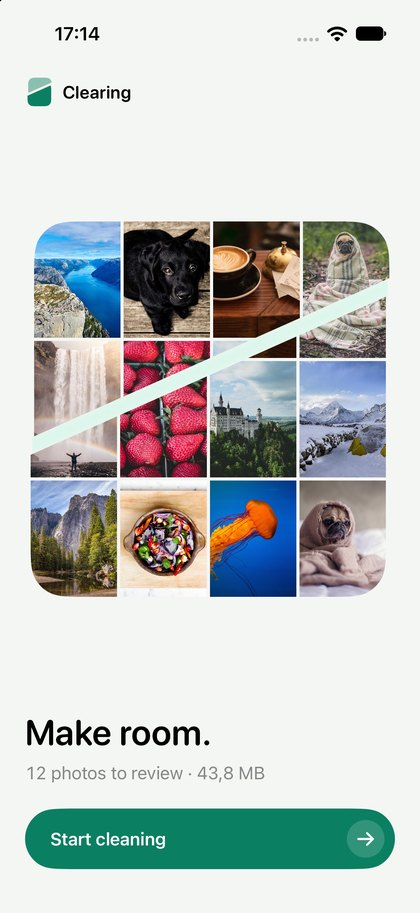
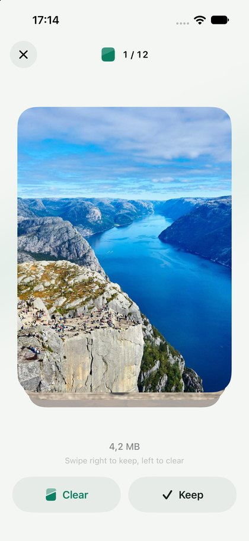
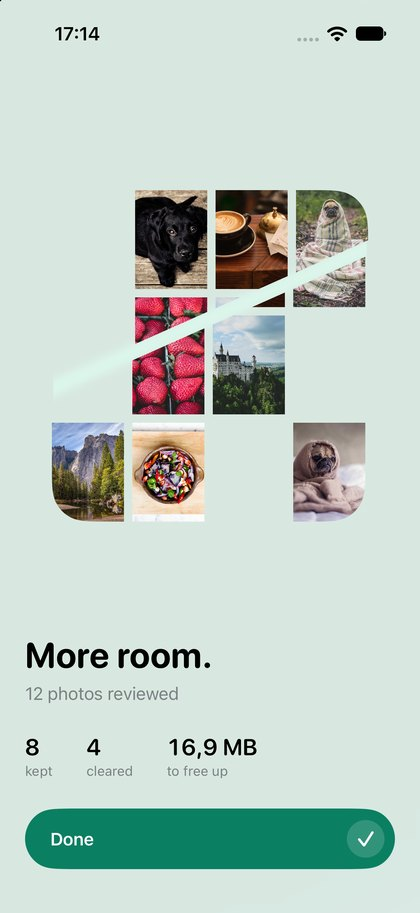
</p>

## 4. How I did the task

### Step 1. Planning the parts of the app

Before writing code I thought about which parts the app needs and what each part should do. I wanted every part to have one clear job, because that is exactly the first principle. I ended up with this structure:

```
Views (screens)          only show things and pass taps further
      │
PhotoReviewViewModel     prepares text and numbers for the screens
      │
PhotoReviewService       the review rules
      │                       │
PhotoRepository (protocol)   PhotoAction (protocol)
      │                       │
LocalPhotoRepository         KeepPhotoAction, DeletePhotoAction
```

### Step 2. Creating the project

I created a new Xcode project with SwiftUI, for iOS 17. Then I added folders for every layer: `Models`, `Protocols`, `Repositories`, `Actions`, `Services`, `ViewModels` and `Views`.

### Step 3. Writing the logic, from the bottom up

I started with the simplest part and went up:

1. `Photo`: a struct with the image name and the size of the photo.
2. The two protocols: `PhotoRepository` and `PhotoAction`.
3. `LocalPhotoRepository`, which returns the 12 sample photos.
4. `KeepPhotoAction` and `DeletePhotoAction`.
5. `PhotoReviewService`, which knows which photo is current and when the review is finished.
6. `PhotoReviewViewModel`, which turns the data into text like "4 / 12" or "4.2 MB".

Only after this part was working did I start the screens.

### Step 4. The first version of the interface

My first interface was very basic: a title, a photo, two standard buttons and a "You're done!" screen. It worked, but it looked like a default template. I tested the whole flow in the iOS Simulator: start, keep, delete, finish, start again.

### Step 5. Improving the design

Because this app will grow all semester, I wanted it to look like a real product. I redesigned the interface two times:

- I made a small **design system** in `Theme.swift`: colors, fonts, spacing, corner sizes, animation speeds and vibration (haptic) settings, all in one place.
- I designed a **logo**: a rounded square (a photo) cut by a slanted line. The bottom part stays and the top part lifts and fades, like a photo turning into free space. I drew it in code (`Split.swift`), so I could reuse the same shape everywhere. It's the app icon, the progress indicator, the crack that opens on a photo when you clear it, and the empty screen.
- I added **swipe gestures**. The photo follows the finger. When you drag left, the photo cracks open with light and then falls apart. When you drag right, the photo stays whole and flies into the Keep button. The phone vibrates lightly when you reach the point where releasing will decide.
- I added a short **intro** and a final screen, "More room.", where the cleared photos disappear from the library.
- I checked **Dark Mode**, big text sizes (Dynamic Type), VoiceOver labels and the "Reduce Motion" setting.

The important part for this lab: **during both redesigns I didn't have to change the logic of the SOLID classes.** I changed the views and some texts in the view model. The only change in the service was removing one property that nothing used anymore. For me this was the best proof that the responsibilities are really separated.

### Step 6. The name

At first the app was called CleanSpace. Later I wanted a name that is easier to remember and easier to find in the App Store. I checked "Roomy", but there is already an app called "Roomy: Phone Storage Cleaner", so I chose **Clearing**. A clearing is an open space in a forest where light comes in, and that matches the logo. I renamed everything: the project, the target, the folders and the main app file.

### Step 7. Git and GitHub

I used Git from the start and GitHub Desktop to publish the repository.

## 5. The 3 SOLID principles in my project

### 5.1 Single Responsibility Principle (SRP)

> One class has one job, so it has only one reason to change.

| Class | Its only job |
|---|---|
| `Photo` | Holds the data about one photo. No logic, no UI. |
| `LocalPhotoRepository` | Gives the list of photos. |
| `KeepPhotoAction` | Remembers the photos that were kept. |
| `DeletePhotoAction` | Remembers the photos marked to clear and adds up their size. |
| `PhotoReviewService` | The review rules: current photo, going to the next one, finished or not. |
| `PhotoReviewViewModel` | Prepares text and numbers for the screens. |
| `HomeView`, `ReviewView`, `FinishedView` | Only draw the screen and send taps to the view model. |

For example, the service has the rule and the view model has the text:

```swift
// PhotoReviewService: the rule
func apply(_ action: PhotoAction) {
    guard let photo = currentPhoto else { return }
    action.execute(on: photo)
    reviewedCount += 1
}

// PhotoReviewViewModel: the text for the screen
var positionText: String {
    "\(currentPosition) / \(totalCount)"
}
```

If I want to change how the counter looks, I change only the view model. If I want to change the rules, I change only the service.

**How the view model stays up to date (`refresh()`).** The screens watch only the view model. It's marked `@Observable`, so when its values change, SwiftUI redraws the screen. The service is a normal class and doesn't tell anyone when it changes. So after every action the view model calls `refresh()`, which copies the newest state from the service and the actions into its own properties:

```swift
private func refresh() {
    photos = reviewService.photos
    currentPhoto = reviewService.currentPhoto
    reviewedCount = reviewService.reviewedCount
    keptCount = keepAction.keptPhotos.count
    deletedCount = deleteAction.photosToDelete.count
    spaceToFree = deleteAction.spaceToFree
    removedPhotoIDs = Set(deleteAction.photosToDelete.map(\.id))
}
```

I call it in three places: in `init` (so the first screen already shows the 12 photos), in `startReview()` (everything goes back to zero) and after every Keep or Clear.

### 5.2 Open/Closed Principle (OCP)

> Open for extension, closed for modification.

I made a protocol for anything you can do with a photo:

```swift
protocol PhotoAction {
    func execute(on photo: Photo)
}
```

Keep and Delete are two separate classes that follow this protocol:

```swift
final class KeepPhotoAction: PhotoAction {
    private(set) var keptPhotos: [Photo] = []

    func execute(on photo: Photo) {
        keptPhotos.append(photo)
    }
}

final class DeletePhotoAction: PhotoAction {
    private(set) var photosToDelete: [Photo] = []

    func execute(on photo: Photo) {
        photosToDelete.append(photo)
    }
}
```

The review service accepts **any** action and never checks which one it got. There is no `if keep ... else if delete ...` anywhere:

```swift
func apply(_ action: PhotoAction) {
    guard let photo = currentPhoto else { return }
    action.execute(on: photo)
    reviewedCount += 1
}
```

This UML class diagram shows the idea. The service only points at the protocol, so a new class like `FavoritePhotoAction` can be plugged in without touching the service:

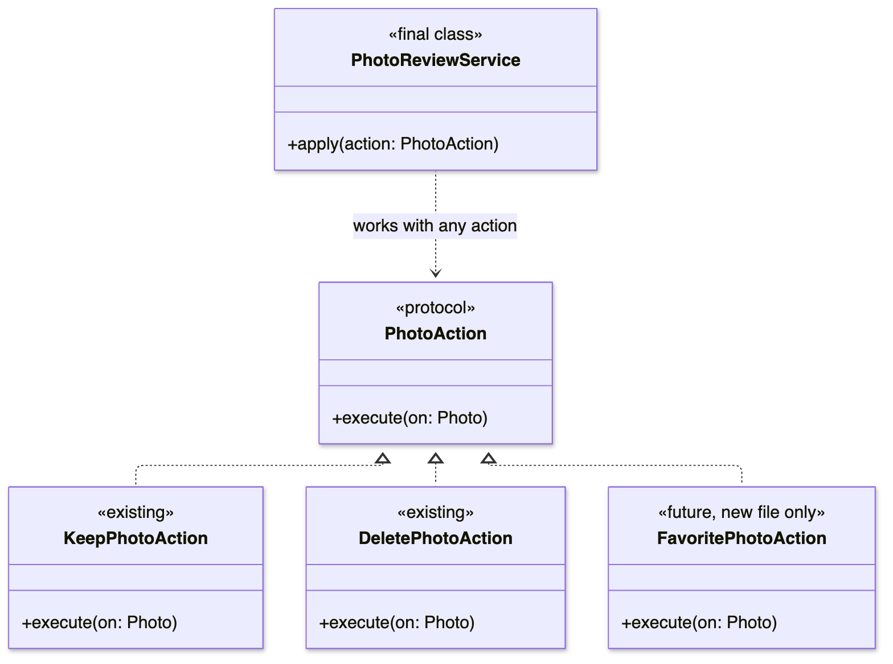

**How I would add a Favorite action.** If later I want a Favorite button, these are the steps:

1. Create one new file, `Clearing/Actions/FavoritePhotoAction.swift`, with a class that follows the same protocol:

```swift
final class FavoritePhotoAction: PhotoAction {
    private(set) var favoritePhotos: [Photo] = []

    func execute(on photo: Photo) {
        favoritePhotos.append(photo)
    }
}
```

2. In the view model, add `private var favoriteAction = FavoritePhotoAction()`, a method `favoriteCurrentPhoto()` that calls `apply(favoriteAction)`, and a `favoriteCount` that `refresh()` fills in. In `startReview()` I create a new `FavoritePhotoAction`, so every review starts from zero.
3. On the review screen, add a button that calls `viewModel.favoriteCurrentPhoto()`.

| File | Does it change? |
|---|---|
| `PhotoAction.swift` | No |
| `PhotoReviewService.swift` | **No** |
| `KeepPhotoAction.swift`, `DeletePhotoAction.swift` | No |
| `PhotoRepository.swift`, `LocalPhotoRepository.swift`, `Photo.swift` | No |
| `FavoritePhotoAction.swift` | New file |
| View model and review screen | Small additions, because the user has to see and tap the new option |

The review rules don't change at all. I only add new code, and that is exactly what Open/Closed means.

### 5.3 Dependency Inversion Principle (DIP)

> Important code should depend on an abstraction, not on a concrete class.

The review service needs photos, but it doesn't know where they come from. It only knows the protocol:

```swift
protocol PhotoRepository {
    func getPhotos() -> [Photo]
}

final class PhotoReviewService {
    private let repository: PhotoRepository

    init(repository: PhotoRepository) {
        self.repository = repository
    }
}
```

In the words of the principle:

- **High-level module:** `PhotoReviewService`, the important logic.
- **Low-level module:** `LocalPhotoRepository`, a detail (where the photos come from).
- **Abstraction:** the `PhotoRepository` protocol.

Without DIP, the service would point straight at the detail. With DIP, both point at the protocol, and the arrow of the detail is turned around. That's where the word "inversion" comes from:

```text
Without DIP:  PhotoReviewService ──► LocalPhotoRepository
With DIP:     PhotoReviewService ──► PhotoRepository ◄── LocalPhotoRepository
```

The same thing as a UML class diagram. `ClearingApp` is the only place that picks the real repository and gives it to the service:

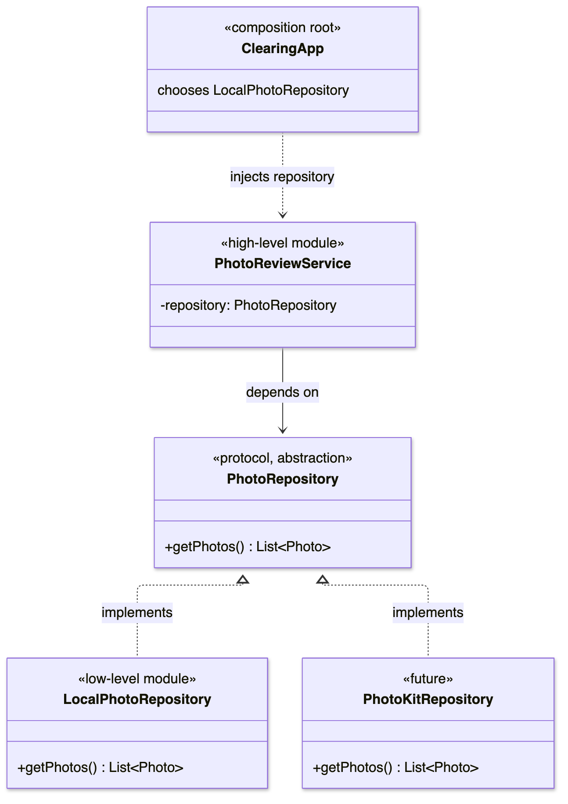

If I had written it without DIP, it would look like this, and the service would be stuck with one source of photos forever:

```swift
final class PhotoReviewService {
    private let repository = LocalPhotoRepository()
}
```

The real class is chosen in only one place, the app entry point `ClearingApp.swift`:

```swift
PhotoReviewService(repository: LocalPhotoRepository())
```

Right now the photos come from the sample images. Later I will read the real photos from the iPhone with Apple's PhotoKit framework. Then I will write a new class `PhotoKitRepository: PhotoRepository` and change only this one line. The service, the view model and all the screens will stay the same.

To apply DIP I used **dependency injection**: I pass the repository into the service through `init`, instead of creating it inside the service.

### 5.4 Where to find each principle in the code

| Principle | File | What to look at |
|---|---|---|
| SRP | `Clearing/Models/Photo.swift` | `Photo` only holds data (line 3) |
| SRP | `Clearing/Services/PhotoReviewService.swift` | only the review rules |
| SRP | `Clearing/ViewModels/PhotoReviewViewModel.swift` | only text and numbers for the screens, for example `positionText` (line 55) |
| SRP | `Clearing/Views/ReviewView.swift` | the screen only calls `viewModel.keepCurrentPhoto()` / `deleteCurrentPhoto()` (lines 266 and 268) |
| OCP | `Clearing/Protocols/PhotoAction.swift` | the `PhotoAction` protocol (line 3) |
| OCP | `Clearing/Actions/KeepPhotoAction.swift`, `DeletePhotoAction.swift` | two separate implementations (line 3 in each) |
| OCP | `Clearing/Services/PhotoReviewService.swift` | `apply(_ action: PhotoAction)` works with any action (line 27) |
| DIP | `Clearing/Protocols/PhotoRepository.swift` | the `PhotoRepository` protocol (line 3) |
| DIP | `Clearing/Services/PhotoReviewService.swift` | `private let repository: PhotoRepository` (line 4) and `init(repository:)` (line 9) |
| DIP | `Clearing/ClearingApp.swift` | the only place where `LocalPhotoRepository()` is chosen (line 6) |

## 6. UML diagrams

I drew the logic part of the app (not the screens) as UML diagrams. The sources are in `docs/uml/` as Mermaid files, so I can change them and draw them again.

### 6.1 Class diagram

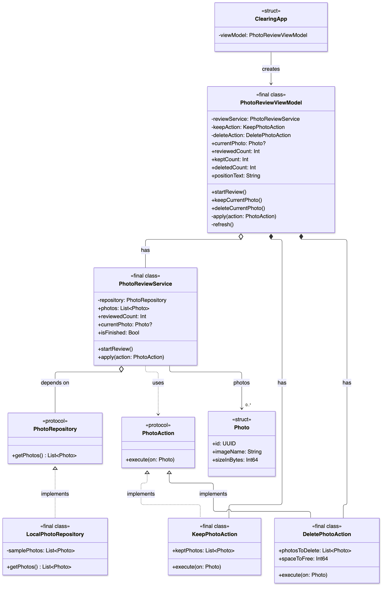

How to read it:

| Symbol | Meaning |
|---|---|
| `+` / `-` | public / private |
| `«protocol»` | an interface (a protocol in Swift) |
| dotted line with an empty triangle | **implements** the interface |
| line with an empty diamond | **has** it, but gets it from outside (in `init`) |
| line with a filled diamond | **has** it and creates it itself |
| dotted arrow | **uses** it |
| `0..*` | zero or more |

What the diagram shows:

- `LocalPhotoRepository` implements `PhotoRepository`, and `KeepPhotoAction` and `DeletePhotoAction` implement `PhotoAction`.
- `PhotoReviewService` has a `PhotoRepository` (the protocol, not the real class) and uses `PhotoAction` in `apply()`.
- `PhotoReviewViewModel` has the service and creates the two actions.
- There is no inheritance between classes. Everything is connected through protocols and composition.

### 6.2 Sequence diagram: starting the app

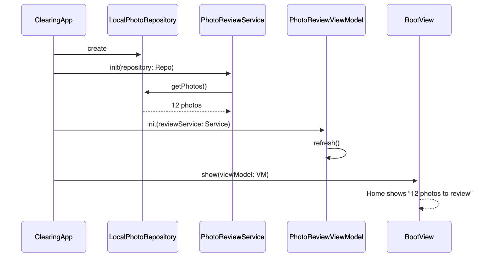

1. `ClearingApp` creates `LocalPhotoRepository`.
2. It gives the repository to `PhotoReviewService`, which asks it for the 12 photos.
3. It gives the service to `PhotoReviewViewModel`, which calls `refresh()` and copies the state.
4. `RootView` gets the view model, and Home shows "12 photos to review".

### 6.3 Sequence diagram: tapping Keep

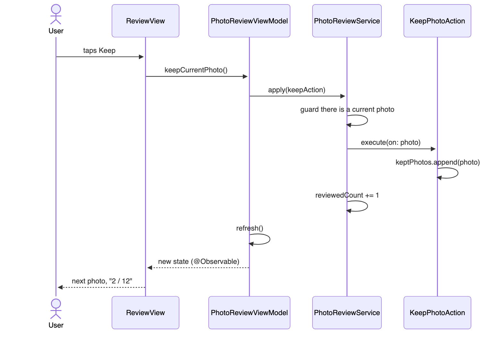

1. `ReviewView` calls `viewModel.keepCurrentPhoto()`.
2. The view model calls `reviewService.apply(keepAction)`.
3. The service checks that there is a current photo, calls `keepAction.execute(on: photo)` and moves to the next photo (`reviewedCount += 1`).
4. `KeepPhotoAction` remembers the photo.
5. The view model calls `refresh()` and copies the new numbers.
6. The screen shows the next photo and "2 / 12".

Clear works the same way, only with `deleteAction`. This one path goes through every layer, and all three principles show up on the way.

## 7. Other OOP ideas I used

| Idea | Where |
|---|---|
| Encapsulation | `private` and `private(set)`. For example, everyone can read `reviewedCount`, but only the service can change it. |
| Abstraction | The two protocols. The service knows *what* a repository and an action can do, not *how*. |
| Polymorphism | `action.execute(on: photo)` runs the Keep or the Delete version, decided at runtime, like a virtual function in C++. |
| Composition instead of inheritance | The view model *has* a service, it doesn't inherit from it. There is no inheritance in the project, so all classes are `final`. |
| Struct vs class | `Photo` and the screens are structs (values that get copied). The service, the view model and the actions are classes, because they are shared and their data changes over time. |

## 8. Project structure

```text
Clearing/
├── Models/
│   └── Photo.swift
├── Protocols/
│   ├── PhotoRepository.swift
│   └── PhotoAction.swift
├── Repositories/
│   └── LocalPhotoRepository.swift
├── Actions/
│   ├── KeepPhotoAction.swift
│   └── DeletePhotoAction.swift
├── Services/
│   └── PhotoReviewService.swift
├── ViewModels/
│   └── PhotoReviewViewModel.swift
├── DesignSystem/
│   ├── Theme.swift              colors, fonts, spacing, animations, haptics
│   └── Split.swift              the logo shape used in the whole app
├── Views/
│   ├── RootView.swift           switches between intro, Home and Review
│   ├── IntroView.swift
│   ├── HomeView.swift
│   ├── ReviewView.swift
│   ├── FinishedView.swift
│   └── Components/              buttons, photo card, progress and other pieces
└── ClearingApp.swift            creates all objects and connects them
```

## 9. Screenshots

<p>

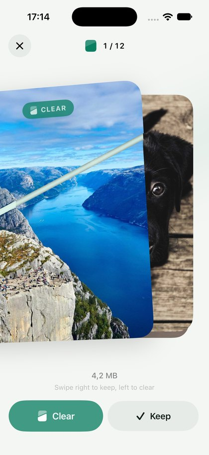
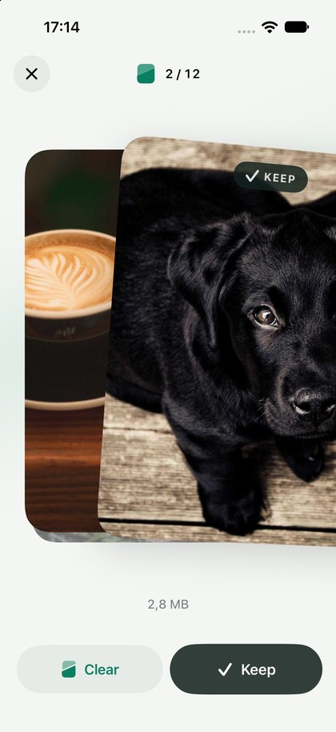
</p>

From left to right: one photo at a time, dragging left to **Clear** (the photo cracks open), dragging right to **Keep** (the photo stays whole).

<p>

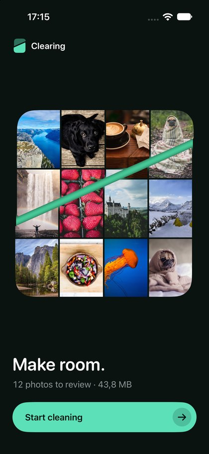
</p>

The final screen after reviewing all 12 photos, and the Home screen in Dark Mode.

## 10. Problems I had and how I solved them

- **The old photo came back for a moment.** After the last decision, the photo I had just swiped appeared again during the transition. The reason was that the position of the card was shared between the old and the new photo. I fixed it by drawing the leaving photo as a separate view that animates on its own.
- **The top bar jumped between screens.** I replaced the standard navigation with my own `RootView` that switches between the screens, so every transition is controlled by me.
- **The Keep icon looked like a "stop" button.** It was a filled square. I changed it to a checkmark, and I kept the logo shape only for Clear.
- **The light inside the crack looked wrong.** In light mode it looked like a heavy green stripe, and in dark mode it looked dull. I made a separate "glow" color for both modes and fixed its opacity.
- **A thin line appeared while a photo faded.** The photo is drawn in two halves, and they overlapped. Grouping the halves before fading them fixed it.
- **With very big text, the main button went off the screen.** I pinned the button to the bottom and made the rest of the screen scrollable.
- **The name.** "Roomy" was already taken by a similar app, so I chose Clearing.

## 11. How to run it

1. Open `Clearing.xcodeproj` in Xcode.
2. Choose an iPhone simulator at the top (for example iPhone 17 Pro).
3. Press **Run** (⌘R).

To run it on a real iPhone, select the **Clearing** target, go to **Signing & Capabilities** and choose your own team.

## 12. What comes next

This structure makes the next labs easier:

- **Real photos:** a `PhotoKitRepository` (only one line changes in `ClearingApp.swift`).
- **Real deletion** inside `DeletePhotoAction`.
- **Strategy** pattern: different orders for reviewing photos (largest first, oldest first).
- **Factory** pattern: creating repositories and actions in one place.
- **Command** pattern: an Undo button for Keep and Clear.
- **Observer, Adapter, Decorator** and the remaining SOLID principles (Liskov and Interface Segregation).

## 13. Conclusion

In this lab I built a working iPhone app and applied three SOLID principles in a way I can actually see in the code. SRP helped me keep every class small and focused. Because of that I could redesign the whole interface twice without touching the logic. OCP showed me how a protocol lets me add new actions without editing the service. DIP made the review logic independent from where the photos come from, so moving to real iPhone photos later will be a small change.

The biggest thing I learned is that these principles are not just theory. When I changed the design, the parts that followed the principles didn't need to change at all, and the changes stayed small and in one place.
