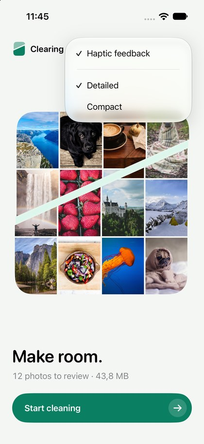
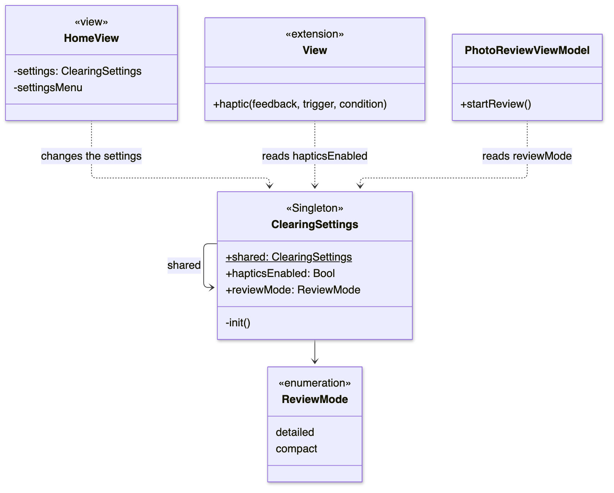
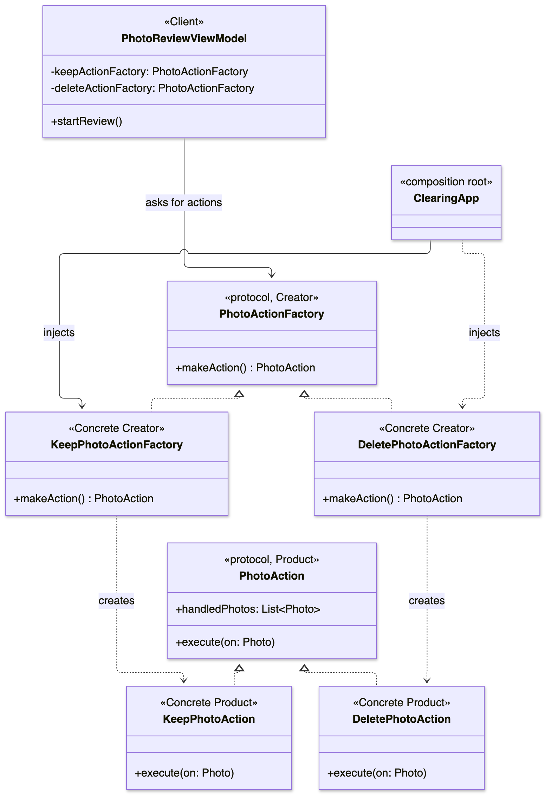
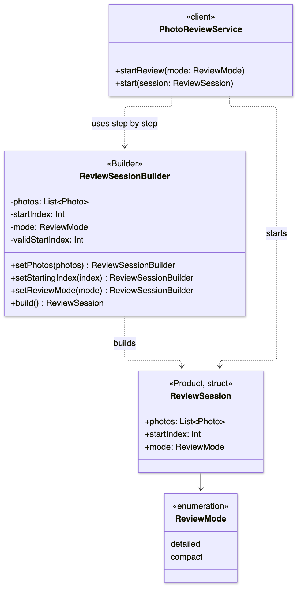
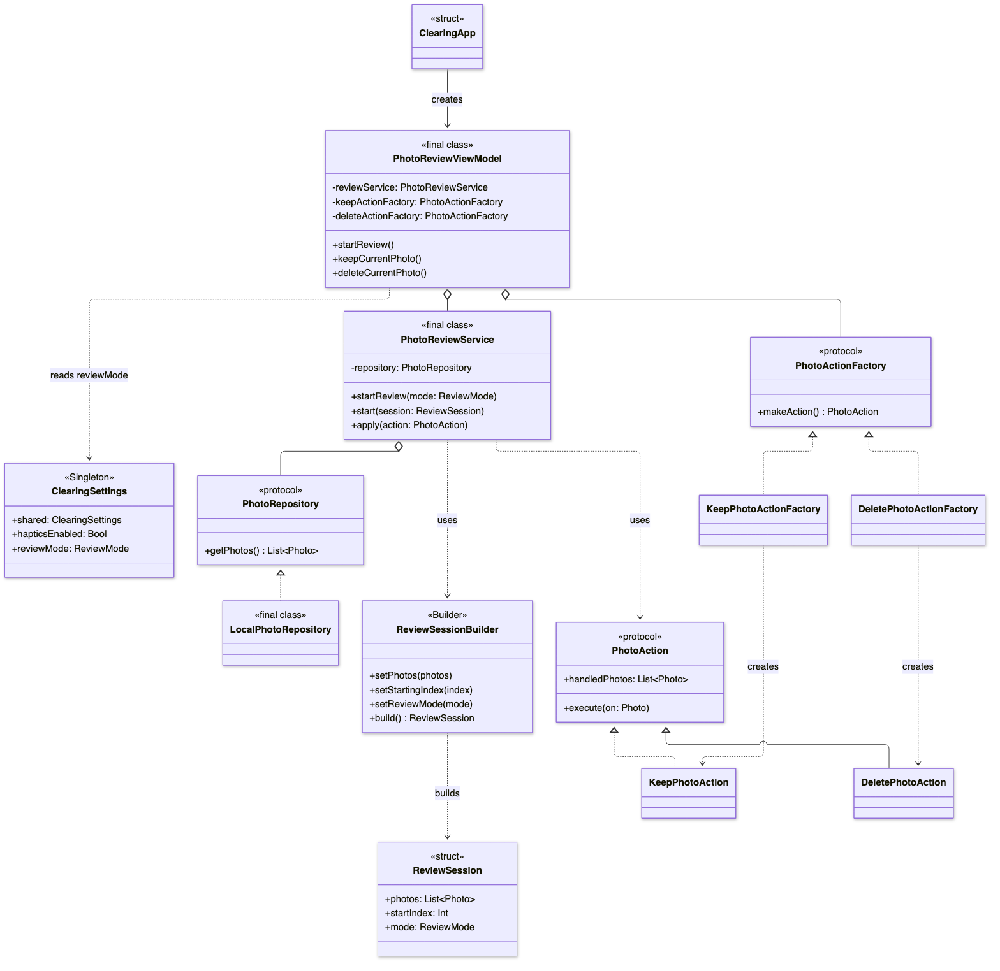
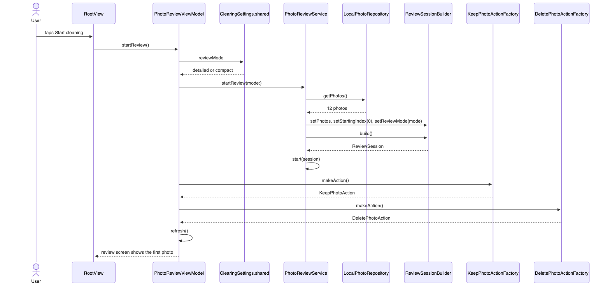

# Laboratory Work No. 2: Creational Design Patterns

**University:** Technical University of Moldova
**Course:** Software Design Techniques and Mechanisms (TMPS)
**Student:** Catalin Bitca
**Group:** ________
**Checked by:** ________
**Date:** October 2026

---

## 1. The task

For the second lab I had to implement **3 creational design patterns** in the project I started in Lab 1. I didn't have to make a new app. I had to add the patterns to **Clearing**, my iPhone photo cleaner, without breaking what already worked.

The 3 patterns I chose:

1. **Singleton**
2. **Factory Method**
3. **Builder**

My own rules for this lab:

- Don't rebuild the app. Keep the Lab 1 SOLID structure and the same look.
- Keep the same flow: Home, Start cleaning, Review, Keep or Clear, Finished.
- Every pattern must do something real in the app. No pattern just for the report.

## 2. A bit of theory

Design patterns are known solutions to problems that appear again and again in programming. **Creational** patterns are about one question: *how do objects get created?*

| Pattern | Short meaning |
|---|---|
| Singleton | A class has **only one object**, and everybody uses that same object. |
| Factory Method | The code asks a **factory** for an object, instead of calling the constructor itself. |
| Builder | A complex object is built **step by step**, and the builder checks the values at the end. |

If I compare with languages I knew before Swift:

| Swift | C++ | Kotlin |
|---|---|---|
| `static let shared = ClearingSettings()` + `private init()` | a `static` instance + a private constructor | `object ClearingSettings` |
| `protocol PhotoActionFactory` | an abstract class with a pure virtual `makeAction()` | `interface PhotoActionFactory` |
| `ReviewSessionBuilder().setPhotos(...).build()` | a builder class whose setters `return *this` | a builder whose setters `return this` (or `apply { }`) |

## 3. Where I started from

After Lab 1 the app already had this structure:

```
Views (screens)          only show things and pass taps further
      │
PhotoReviewViewModel     prepares text and numbers for the screens
      │
PhotoReviewService       the review rules
      │                       │
PhotoRepository (protocol)   PhotoAction (protocol)
      │                       │
LocalPhotoRepository         KeepPhotoAction, DeletePhotoAction
```

Before I started, I looked for places in this code where **creating objects** was a problem:

1. **The view model created the actions itself.** It had `KeepPhotoAction()` and `DeletePhotoAction()` written in two places. So the view model was tied to the concrete classes. This is where **Factory Method** fits.
2. **A review was started by setting fields one by one** in the service (`photos = ...`, `reviewedCount = 0`). Nothing checked if the values made sense. This is where **Builder** fits.
3. **There were no settings at all.** Haptics (vibrations) always played, and there was no way to turn them off. Settings must be the same in every screen. This is where **Singleton** fits.

## 4. How I did the task

### Step 1. Planning

I decided on one problem per pattern (the list above), and I planned to add **new files** for every pattern and to change the old files as little as possible.

### Step 2. New folders

I added three new folders: `Settings` (Singleton), `Factories` (Factory Method) and `Builders` (Builder). The new model `ReviewSession` went into the existing `Models` folder.

### Step 3. Singleton

I wrote `ClearingSettings` with two settings: **haptic feedback** on or off, and **review style** (Detailed or Compact). They are saved with `UserDefaults`, so they stay after the app is closed. Then I added a small settings menu in the top right corner of Home.

### Step 4. Factory Method

I wrote the `PhotoActionFactory` protocol and two factories. The view model now gets the factories through `init` and asks them for new actions.

### Step 5. Builder

I wrote `ReviewSession` and `ReviewSessionBuilder`. Now when you tap **Start cleaning**, the service builds a session with the builder and starts from it.

### Step 6. Tests

I added a test target, `ClearingTests`, with 16 small tests for the three patterns and for the old Keep and Clear flow.

### Step 7. Checking the app

I ran the app in the Simulator and went through the whole flow again: Home, the settings menu, Start cleaning, Keep, Clear, Finished. Everything looks and works like in Lab 1, plus the new settings.

## 5. The 3 design patterns in my project

### 5.1 Singleton: `ClearingSettings`

> A class has only one object, and the whole app uses that one object.

**The problem.** Settings like "haptics on or off" are needed in many screens: Home, Review, Finished and the intro. If every screen created its own settings object, one screen could think haptics are on while another thinks they are off. There must be exactly **one** settings object.

**The code** (`Clearing/Settings/ClearingSettings.swift`):

```swift
@Observable
final class ClearingSettings {
    static let shared = ClearingSettings()

    var hapticsEnabled: Bool {
        didSet {
            UserDefaults.standard.set(hapticsEnabled, forKey: Keys.hapticsEnabled)
        }
    }

    var reviewMode: ReviewMode {
        didSet {
            UserDefaults.standard.set(reviewMode.rawValue, forKey: Keys.reviewMode)
        }
    }

    private init() {
        let defaults = UserDefaults.standard
        hapticsEnabled = defaults.object(forKey: Keys.hapticsEnabled) as? Bool ?? true
        reviewMode = ReviewMode(rawValue: defaults.string(forKey: Keys.reviewMode) ?? "") ?? .detailed
    }

    private enum Keys {
        static let hapticsEnabled = "settings.hapticsEnabled"
        static let reviewMode = "settings.reviewMode"
    }
}
```

The two lines that make it a Singleton:

| Line | Why it matters |
|---|---|
| `static let shared = ClearingSettings()` | The one object. `static` means it belongs to the class, not to an object. `let` means it can never be replaced. Swift creates it the first time someone uses it, and it's thread safe. |
| `private init()` | Nobody outside this class can write `ClearingSettings()`. If someone tries, the code doesn't compile. So a second object is impossible. |

Other details:

- `didSet` runs every time a value changes, so every change is saved to `UserDefaults` right away.
- In `init` I read the saved values. If nothing was saved yet (first launch), the defaults are **haptics on** and **Detailed**.
- `@Observable` lets SwiftUI redraw the menu when a setting changes.

**Where it changes real behavior.**

1. **Haptics.** The app had 8 places that play a vibration. I replaced all of them with one helper in `Theme.swift`. It plays the vibration only if the setting allows it:

```swift
extension View {
    func haptic<Trigger: Equatable>(
        _ feedback: SensoryFeedback,
        trigger: Trigger,
        condition: @escaping (Trigger, Trigger) -> Bool
    ) -> some View {
        sensoryFeedback(feedback, trigger: trigger) { oldValue, newValue in
            ClearingSettings.shared.hapticsEnabled && condition(oldValue, newValue)
        }
    }
}
```

So when **Haptic feedback** is off, the app doesn't vibrate at all: not on touch, not on Keep, not on Clear, not at the end.

2. **Review style.** In **Compact** mode the review screen hides the size of the photo ("4.2 MB") and the hint "Swipe right to keep, left to clear". Only the photo and the two buttons stay.

**The settings menu.** I didn't want a big settings screen, so it's a small menu on Home:

```swift
Menu {
    Toggle("Haptic feedback", isOn: $settings.hapticsEnabled)

    Picker("Review style", selection: $settings.reviewMode) {
        Text("Detailed").tag(ReviewMode.detailed)
        Text("Compact").tag(ReviewMode.compact)
    }
} label: {
    Image(systemName: "slider.horizontal.3")
}
```

<p>


</p>



### 5.2 Factory Method: `PhotoActionFactory`

> The code asks a factory for an object, and the factory decides which concrete class to create.

**The problem.** In Lab 1 the view model created the actions itself:

```swift
private var keepAction = KeepPhotoAction()
private var deleteAction = DeletePhotoAction()
```

and again in `startReview()`. So the view model knew the concrete classes. This is the same kind of problem as in DIP: an important class depends on details.

**The code.** One protocol (the creator) and two concrete factories (`Clearing/Factories/`):

```swift
protocol PhotoActionFactory {
    func makeAction() -> PhotoAction
}

final class KeepPhotoActionFactory: PhotoActionFactory {
    func makeAction() -> PhotoAction {
        KeepPhotoAction()
    }
}

final class DeletePhotoActionFactory: PhotoActionFactory {
    func makeAction() -> PhotoAction {
        DeletePhotoAction()
    }
}
```

The roles of the pattern in my code:

| Role | In my code |
|---|---|
| Creator (abstract) | `PhotoActionFactory` protocol, with the factory method `makeAction()` |
| Concrete creators | `KeepPhotoActionFactory`, `DeletePhotoActionFactory` |
| Product (abstract) | `PhotoAction` protocol (from Lab 1) |
| Concrete products | `KeepPhotoAction`, `DeletePhotoAction` (from Lab 1) |
| Client | `PhotoReviewViewModel` |

**How the view model uses it.** The factories come in through `init`, and the view model only sees the protocols:

```swift
private let keepActionFactory: PhotoActionFactory
private let deleteActionFactory: PhotoActionFactory
private var keepAction: PhotoAction
private var deleteAction: PhotoAction

func startReview() {
    reviewService.startReview(mode: ClearingSettings.shared.reviewMode)
    keepAction = keepActionFactory.makeAction()
    deleteAction = deleteActionFactory.makeAction()
    refresh()
}
```

Every new review asks the factories for **new** actions, so the counters start from zero.

The concrete factories are chosen only in `ClearingApp.swift`, the same place where Lab 1 chooses the repository:

```swift
PhotoReviewViewModel(
    reviewService: PhotoReviewService(repository: LocalPhotoRepository()),
    keepActionFactory: KeepPhotoActionFactory(),
    deleteActionFactory: DeletePhotoActionFactory()
)
```

**One change I had to make in the protocol.** Before, the view model read `keepAction.keptPhotos` and `deleteAction.photosToDelete`. Now it only knows `PhotoAction`, so it can't see those properties. I added one property to the protocol, `handledPhotos`, which returns the photos the action worked on. Keep returns its kept photos, Delete returns the photos to clear. The size to free is now added up in the view model from `handledPhotos`.

```swift
protocol PhotoAction {
    var handledPhotos: [Photo] { get }
    func execute(on photo: Photo)
}
```



**Adding Favorite now.** In Lab 1 I explained how I would add a Favorite action. With factories it's even cleaner: I add `FavoritePhotoAction` and `FavoritePhotoActionFactory`, and I pass the new factory in `ClearingApp`. The view model never sees the new concrete class.

### 5.3 Builder: `ReviewSessionBuilder`

> A complex object is built step by step, and the builder makes sure the result is valid.

**The problem.** To start a review you need several things: the photos, which photo to start from, and the review style. Before, the service set these fields one by one, and nothing checked them. A wrong starting index (like 50 when there are 12 photos, or -3) could make the review start in a broken state.

**The product** (`Clearing/Models/ReviewSession.swift`):

```swift
enum ReviewMode: String {
    case detailed
    case compact
}

struct ReviewSession {
    let photos: [Photo]
    let startIndex: Int
    let mode: ReviewMode
}
```

`ReviewSession` is a struct with `let` fields, so once it's built it can't change.

**The builder** (`Clearing/Builders/ReviewSessionBuilder.swift`):

```swift
final class ReviewSessionBuilder {
    private var photos: [Photo] = []
    private var startIndex = 0
    private var mode: ReviewMode = .detailed

    @discardableResult
    func setPhotos(_ photos: [Photo]) -> ReviewSessionBuilder {
        self.photos = photos
        return self
    }

    @discardableResult
    func setStartingIndex(_ index: Int) -> ReviewSessionBuilder {
        startIndex = index
        return self
    }

    @discardableResult
    func setReviewMode(_ mode: ReviewMode) -> ReviewSessionBuilder {
        self.mode = mode
        return self
    }

    func build() -> ReviewSession {
        ReviewSession(photos: photos, startIndex: validStartIndex, mode: mode)
    }

    private var validStartIndex: Int {
        guard !photos.isEmpty else { return 0 }
        return min(max(startIndex, 0), photos.count - 1)
    }
}
```

What it does:

- **Defaults:** no photos, start at 0, Detailed. So `ReviewSessionBuilder().build()` already gives a valid session.
- **Chaining:** every setter returns `self`, so I can write the steps one after another. `@discardableResult` means I'm also allowed to call a setter alone, without using the result.
- **Validation in `build()`:** the starting index is clamped. 50 becomes 11 (the last photo), -3 becomes 0. With no photos the index is always 0.

**Where it's used.** When you tap **Start cleaning**, the service builds the session and then starts from it:

```swift
func startReview(mode: ReviewMode = .detailed) {
    let session = ReviewSessionBuilder()
        .setPhotos(repository.getPhotos())
        .setStartingIndex(0)
        .setReviewMode(mode)
        .build()
    start(session)
}

func start(_ session: ReviewSession) {
    photos = session.photos
    reviewedCount = session.startIndex
    mode = session.mode
}
```

**Empty library.** If the repository returns no photos, the builder gives a session with no photos and index 0. The service is finished right away, and the app shows "Nothing left to clear." instead of crashing.



### 5.4 Where to find each pattern in the code

| Pattern | File | What to look at |
|---|---|---|
| Singleton | `Clearing/Settings/ClearingSettings.swift` | `static let shared` (line 6), `private init()` (line 20), saving in `didSet` (lines 9 and 15) |
| Singleton | `Clearing/DesignSystem/Theme.swift` | `haptic(_:trigger:condition:)` checks `hapticsEnabled` (lines 57 and 63) |
| Singleton | `Clearing/Views/HomeView.swift` | the settings menu (line 73) |
| Singleton | `Clearing/Views/ReviewView.swift` | Compact hides the details (line 66) |
| Singleton | `Clearing/ViewModels/PhotoReviewViewModel.swift` | the review style is read in `startReview()` (line 91) |
| Factory Method | `Clearing/Factories/PhotoActionFactory.swift` | the creator protocol (line 3) |
| Factory Method | `Clearing/Factories/KeepPhotoActionFactory.swift`, `DeletePhotoActionFactory.swift` | `makeAction()` (line 4 in each) |
| Factory Method | `Clearing/ViewModels/PhotoReviewViewModel.swift` | factories in `init` (lines 21 to 32), new actions in `startReview()` (lines 92 and 93) |
| Factory Method | `Clearing/ClearingApp.swift` | the only place where the concrete factories are chosen (lines 7 and 8) |
| Builder | `Clearing/Models/ReviewSession.swift` | `ReviewMode` (line 3) and the product `ReviewSession` (line 8) |
| Builder | `Clearing/Builders/ReviewSessionBuilder.swift` | the setters (lines 9, 15, 21), `build()` (line 26), the validation (line 30) |
| Builder | `Clearing/Services/PhotoReviewService.swift` | `startReview(mode:)` uses the builder (line 23), `start(_:)` (line 32) |

## 6. UML diagrams

Like in Lab 1, the sources are in `docs/uml/` as Mermaid files (`lab2-*.mmd`).

### 6.1 Class diagram of the whole logic



Compared to Lab 1:

- `ClearingSettings` is new and is the only Singleton.
- The view model doesn't point at `KeepPhotoAction` and `DeletePhotoAction` anymore. It points at the `PhotoActionFactory` protocol, and the factories create the actions.
- The service uses `ReviewSessionBuilder`, which builds a `ReviewSession`.
- Everything that was in Lab 1 is still there: the repository protocol, the action protocol and the same connections.

### 6.2 Sequence diagram: tapping Start cleaning

This one action uses all three patterns.



1. The user taps **Start cleaning**, and `RootView` calls `viewModel.startReview()`.
2. The view model reads the review style from `ClearingSettings.shared` (**Singleton**).
3. It calls `reviewService.startReview(mode:)`.
4. The service gets the photos from the repository and builds a `ReviewSession` with `ReviewSessionBuilder` (**Builder**).
5. The service starts from the session.
6. The view model asks both factories for new actions (**Factory Method**).
7. `refresh()` copies the new state, and the review screen shows "1 / 12".

## 7. The SOLID principles from Lab 1 are still there

| Principle | How the patterns kept it |
|---|---|
| SRP | Every new class has one job: `ClearingSettings` keeps the settings, the factories create actions, the builder builds and checks a session. The service still only has the review rules. |
| OCP | A new action now means a new action class and a new factory. The service and the view model logic don't change. |
| DIP | The view model depends on the `PhotoActionFactory` protocol, not on concrete actions. The concrete classes are chosen only in `ClearingApp`, like the repository in Lab 1. |

## 8. Testing

I added a unit test target, `ClearingTests`, using Apple's **Swift Testing** framework (`@Test` and `#expect`). There are 16 tests in 4 groups, and they all pass.

| Group | What it checks |
|---|---|
| `SingletonTests` | `shared` is always the same object. A change is seen everywhere. The review style from the settings reaches the review. |
| `FactoryMethodTests` | The Keep factory creates a `KeepPhotoAction`, the Delete factory creates a `DeletePhotoAction`, and every call creates a new object. |
| `BuilderTests` | The values are set correctly, the defaults are sensible, an index that is too big or negative is fixed, empty photos give a safe session, and the service starts from the session index. |
| `ReviewFlowTests` | Keep and Clear still count correctly, the review ends after the last photo, an empty library is safe, and starting again resets everything. |

The Singleton tests change the real settings, so every test puts the old value back at the end, and this group runs one test at a time (`@Suite(.serialized)`).

To run them: open the project in Xcode and press **⌘U**.

The Simulator can't vibrate, so the vibration itself can only be felt on a real iPhone. The tests check that the setting reaches the code that decides.

## 9. Project structure

New files are marked with `+`, changed files with `~`.

```text
Clearing/
├── Models/
│   ├── Photo.swift
│   └── ReviewSession.swift          + ReviewMode and ReviewSession (Builder product)
├── Protocols/
│   ├── PhotoRepository.swift
│   └── PhotoAction.swift            ~ added handledPhotos
├── Repositories/
│   └── LocalPhotoRepository.swift
├── Actions/
│   ├── KeepPhotoAction.swift        ~ handledPhotos
│   └── DeletePhotoAction.swift      ~ handledPhotos
├── Factories/                       + Factory Method
│   ├── PhotoActionFactory.swift
│   ├── KeepPhotoActionFactory.swift
│   └── DeletePhotoActionFactory.swift
├── Builders/                        + Builder
│   └── ReviewSessionBuilder.swift
├── Settings/                        + Singleton
│   └── ClearingSettings.swift
├── Services/
│   └── PhotoReviewService.swift     ~ starts a review from a ReviewSession
├── ViewModels/
│   └── PhotoReviewViewModel.swift   ~ uses the factories and the review style
├── DesignSystem/
│   ├── Theme.swift                  ~ haptic(...) checks the settings
│   └── Split.swift
├── Views/                           ~ haptic(...), settings menu, Compact mode
└── ClearingApp.swift                ~ chooses the concrete factories
ClearingTests/
└── Lab2PatternTests.swift           + 16 tests
```

## 10. Problems I had and how I solved them

- **The view model couldn't read the counters anymore.** After switching to factories, the view model only knows `PhotoAction`, so `keptPhotos` and `photosToDelete` were not visible. I added `handledPhotos` to the protocol, so every action can say which photos it worked on.
- **8 places played vibrations.** I didn't want to add an `if` in 8 places. I wrote one `haptic(...)` helper that checks the setting, and replaced all 8 calls with it.
- **Tests and a Singleton.** There is only one settings object, so a test that turns haptics off would change it for the whole app. In every Singleton test I save the old value and put it back with `defer`.
- **A wrong starting index.** I decided that the builder fixes the index instead of crashing, because a photo app should never crash because of a number.
- **When does Compact apply?** The style is read when a review starts, and the menu is only on Home. So the style never changes in the middle of a review.

## 11. How to run it

1. Open `Clearing.xcodeproj` in Xcode.
2. Choose an iPhone simulator at the top (for example iPhone 17 Pro).
3. Press **Run** (⌘R) to start the app, or **Test** (⌘U) to run the tests.
4. On Home, tap the button in the top right corner to change **Haptic feedback** and **Review style**.

## 12. What comes next

- A `PhotoKitRepository` with the real photos from the iPhone.
- The **Command** pattern for Undo on Keep and Clear.
- The **Strategy** pattern for the review order (largest first, oldest first). It could become one more step in the builder.
- More settings in `ClearingSettings` if the app needs them.

## 13. Conclusion

In this lab I added three creational patterns to an app that already worked, and the app still looks and works the same, with two new settings.

The **Singleton** gave the app one place for settings, and turning off haptics really stops every vibration. The **Factory Method** took the concrete action classes out of the view model, so it now depends only on protocols, the same idea as DIP in Lab 1. The **Builder** made starting a review safe: wrong indexes and an empty library can't break it.

The most interesting thing for me was how well the patterns fit on top of Lab 1. Because the responsibilities were already separated, every pattern went into a new file, and the old classes needed only small changes.
