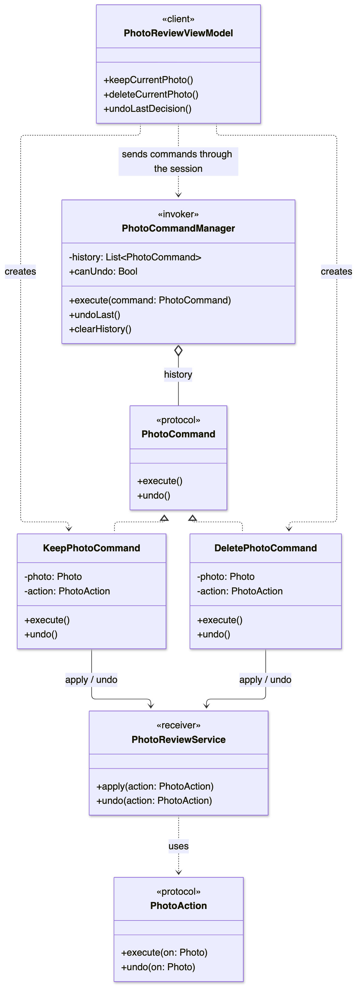
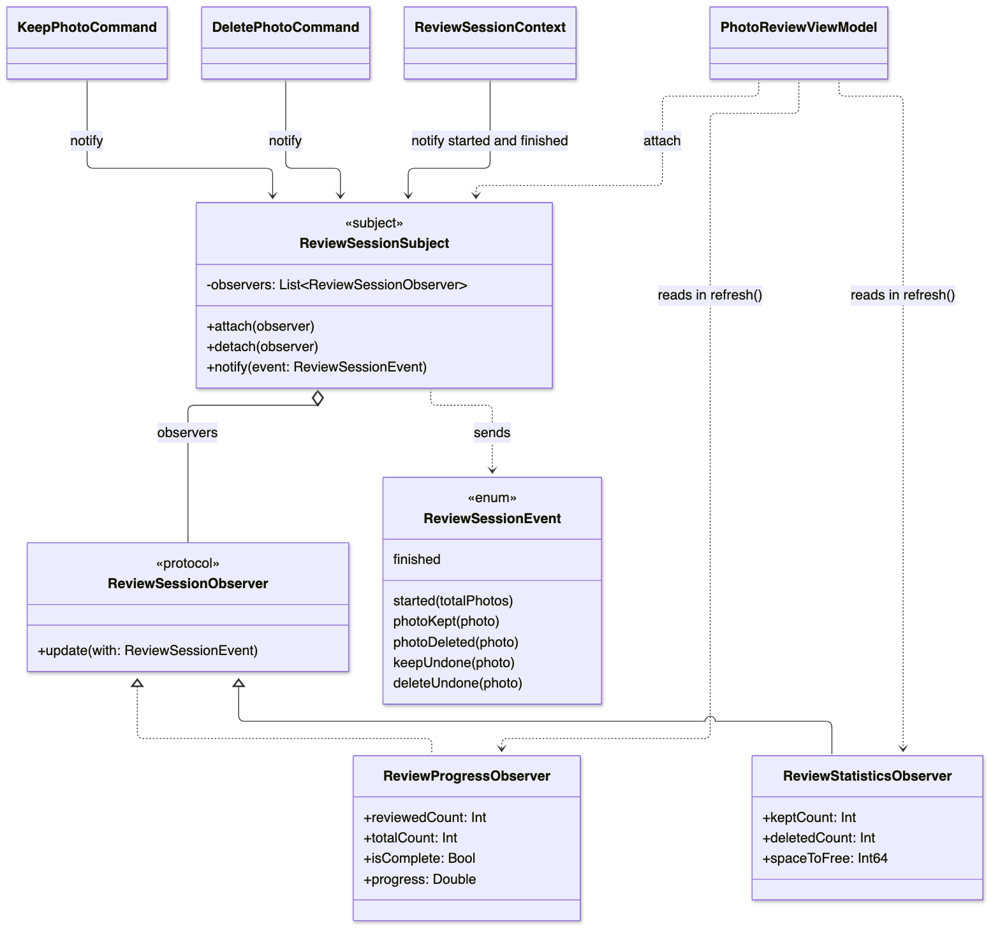
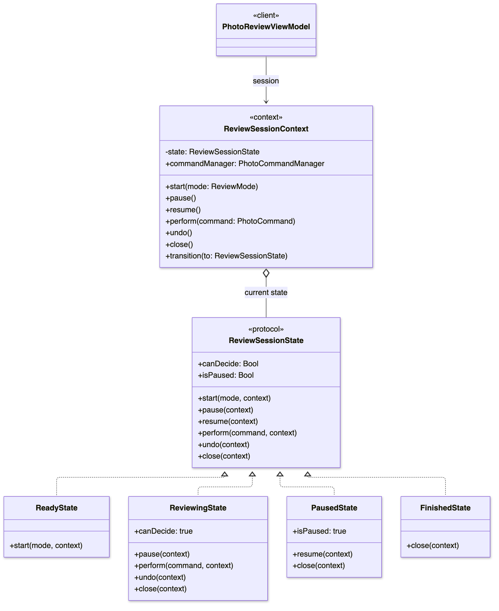
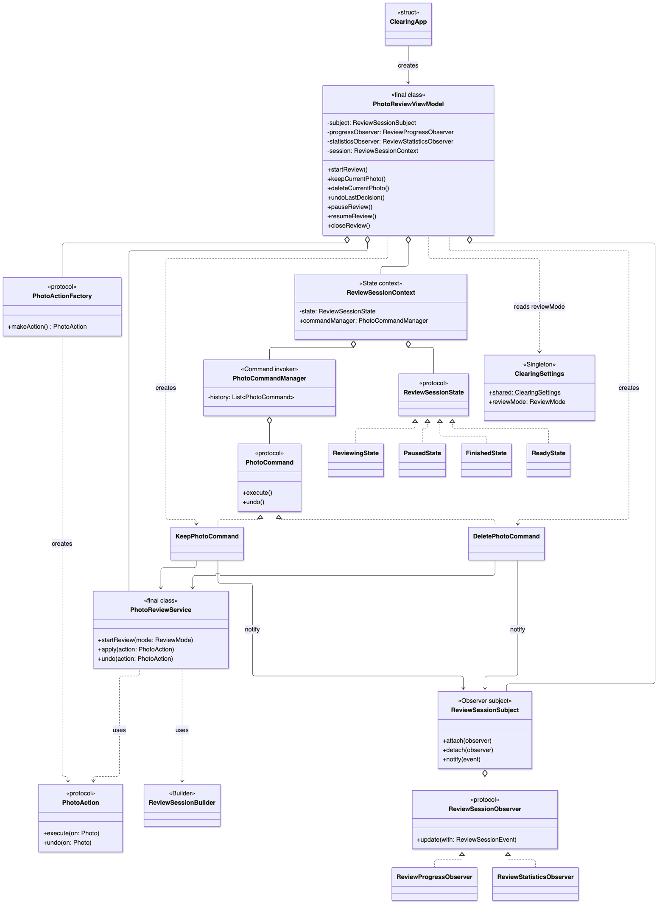
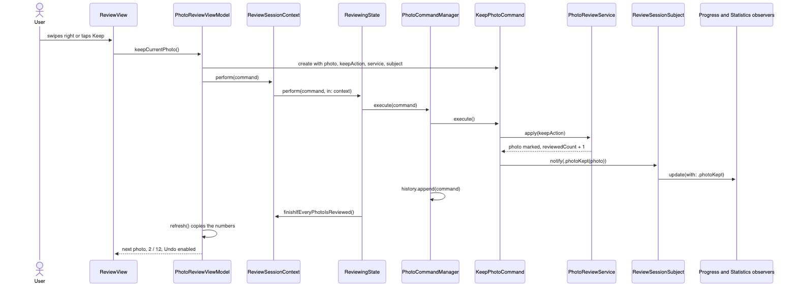
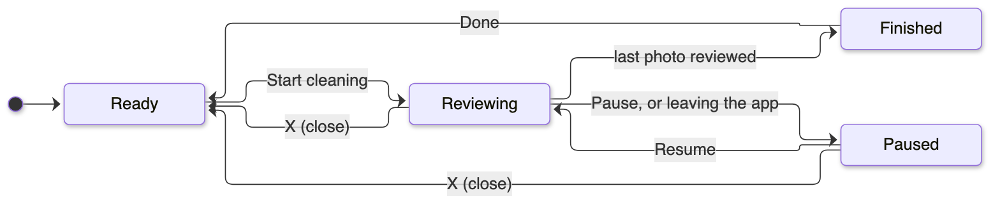

# Laboratory Work No. 3: Behavioral Design Patterns

**University:** Technical University of Moldova
**Course:** Software Design Techniques and Mechanisms (TMPS)
**Student:** Catalin Bitca
**Group:** ________
**Checked by:** ________
**Date:** November 2026

---

## 1. The task

For the third lab I had to implement **3 behavioral design patterns** in the same project from Labs 1 and 2. Again I didn't make a new app. I added the patterns to **Clearing**, my iPhone photo cleaner, and they had to work together in the real review flow.

The 3 patterns:

1. **Command**
2. **Observer**
3. **State**

My own rules for this lab:

- Don't rebuild the app. Keep the Lab 1 SOLID structure, the Lab 2 patterns and the same look.
- Every pattern must be a real feature that you can see in the app, not a class that exists only for the report.
- No real photo is deleted from the phone. Clear still only marks a photo, like in Labs 1 and 2.
- Keep the code small enough that I can explain every class.

## 2. A bit of theory

**Behavioral** patterns are about one question: *how do objects talk to each other and share the work?* Creational patterns (Lab 2) were about creating objects. Behavioral patterns are about what happens after the objects exist.

| Pattern | Short meaning |
|---|---|
| Command | A request (like "keep this photo") is turned into an **object**. The object can be run, stored, and **undone** later. |
| Observer | One object (the **subject**) keeps a list of other objects (the **observers**) and **notifies** all of them when something happens. |
| State | An object changes its behavior when its **state** changes. Every state is its own class, and the object asks the current state what to do. |

If I compare with languages I knew before Swift:

| Swift | C++ | Kotlin |
|---|---|---|
| `protocol PhotoCommand { func execute(); func undo() }` | an abstract class with `virtual void execute() = 0;` | `interface PhotoCommand` |
| `history.popLast()?.undo()` | `if (!history.empty()) { history.back()->undo(); history.pop_back(); }` | `history.removeLastOrNull()?.undo()` |
| `protocol ReviewSessionObserver: AnyObject` | an abstract class, used through pointers | `interface ReviewSessionObserver` |
| `observers.removeAll { $0 === observer }` | erase the element whose pointer equals `observer` | `observers.removeAll { it === observer }` |
| `extension ReviewSessionState { func pause(...) {} }` | a base class with empty virtual methods | an interface with default (empty) methods |

## 3. Where I started from

After Lab 2 the app worked like this: **Home**, then **Start cleaning**, then one photo at a time with **Keep** or **Clear**, then the **Finished** screen. The structure was:

```
Views (screens)          only show things and pass taps further
      │
PhotoReviewViewModel     prepares text and numbers, uses the factories (Lab 2)
      │
PhotoReviewService       the review rules, starts a session with the builder (Lab 2)
      │                       │
PhotoRepository (protocol)   PhotoAction (protocol)
```

Before I started, I looked for three things that were missing or weak:

1. **A decision could not be undone.** The view model called `reviewService.apply(keepAction)` directly. After that call, nothing remembered what had happened, so an Undo button was impossible. This is where **Command** fits.
2. **The numbers were calculated in one place.** The view model counted kept photos, cleared photos and the space to free from the actions' lists every time. If I wanted another thing to react to a decision, I had to change the view model again. This is where **Observer** fits.
3. **The review had no clear lifecycle.** There was no pause, and nothing said when a decision was allowed. Adding pause with Booleans would mean `isPaused`, `isFinished`, `isStarted` and `if` checks in every method. This is where **State** fits.

## 4. How I did the task

### Step 1. Planning

I planned one visible feature for each pattern:

| Feature in the app | Pattern |
|---|---|
| The **Undo** button | Command |
| The **progress** (2 / 12) and the **statistics** on the Finished screen | Observer |
| The **Pause** button, Resume, and the rules about when you can decide | State |

### Step 2. New folders

I added three folders, one per pattern: `Commands`, `Observers` and `States`. The old classes got only small changes.

### Step 3. Command

I wrote the `PhotoCommand` protocol, the two commands `KeepPhotoCommand` and `DeletePhotoCommand`, and `PhotoCommandManager`, which keeps the history. To make undo possible, I added `undo(on:)` to `PhotoAction` and `undo(_:)` to `PhotoReviewService`.

### Step 4. Observer

I wrote the subject `ReviewSessionSubject`, the `ReviewSessionObserver` protocol with the list of events, and two observers: one for progress and one for statistics.

### Step 5. State

I wrote the `ReviewSessionState` protocol, the four states (Ready, Reviewing, Paused, Finished) and `ReviewSessionContext`, which holds the current state.

### Step 6. Connecting everything in the view model

The view model now creates the commands, gives them to the session, and reads its numbers from the observers. I kept its `init` exactly the same, so `ClearingApp.swift` didn't change at all.

### Step 7. Small additions to the screen

On the review screen I added:

- a round **Undo** button between Clear and Keep,
- a **Pause** button in the top right corner,
- a **PAUSED** badge and a dimmed photo while paused, with a **Resume** button instead of Keep and Clear,
- an automatic pause when you leave the app.

### Step 8. Checking the app

I ran the app in the Simulator and checked by hand:

- Keep and Clear still work with buttons and with swipes.
- Undo brings the photo back, and the counter goes back too. When there is nothing to undo, the button is grey.
- While paused, swipes and buttons do nothing. Resume continues from the same photo.
- Leaving the app pauses the review.
- A full review with one Undo in the middle shows the right numbers at the end (11 kept, 1 cleared).
- After Done, a new review starts from photo 1 with an empty Undo history.
- Light mode, Dark mode, Detailed and Compact all look right.

## 5. The 3 design patterns in my project

### 5.1 Command: `PhotoCommand`

> A request is turned into an object, so it can be stored and undone.

**The problem.** Before this lab, Keep looked like this in the view model:

```swift
func keepCurrentPhoto() {
    apply(keepAction)
}

private func apply(_ action: PhotoAction) {
    reviewService.apply(action)
    refresh()
}
```

The call happened and was gone. There was no record of it, so there was nothing to undo.

**The code.** First the protocol (`Clearing/Commands/PhotoCommand.swift`):

```swift
protocol PhotoCommand {
    func execute()
    func undo()
}
```

Every command must know how to **do** itself and how to **undo** itself.

Then the concrete command for Keep (`Clearing/Commands/KeepPhotoCommand.swift`):

```swift
final class KeepPhotoCommand: PhotoCommand {
    private let photo: Photo
    private let action: PhotoAction
    private let reviewService: PhotoReviewService
    private let subject: ReviewSessionSubject

    init(photo: Photo, action: PhotoAction, reviewService: PhotoReviewService, subject: ReviewSessionSubject) {
        self.photo = photo
        self.action = action
        self.reviewService = reviewService
        self.subject = subject
    }

    func execute() {
        reviewService.apply(action)
        subject.notify(.photoKept(photo))
    }

    func undo() {
        reviewService.undo(action)
        subject.notify(.keepUndone(photo))
    }
}
```

The command remembers everything it needs: which photo, which action (made by the Lab 2 factory), who does the real work (the service), and who to tell (the subject from the Observer pattern). `DeletePhotoCommand` is the same, but it sends `.photoDeleted` and `.deleteUndone`.

Then the manager with the history (`Clearing/Commands/PhotoCommandManager.swift`):

```swift
final class PhotoCommandManager {
    private var history: [PhotoCommand] = []

    var canUndo: Bool {
        !history.isEmpty
    }

    func execute(_ command: PhotoCommand) {
        command.execute()
        history.append(command)
    }

    func undoLast() {
        history.popLast()?.undo()
    }

    func clearHistory() {
        history.removeAll()
    }
}
```

- `history` is a stack: the last command in is the first one out.
- `execute` runs the command and saves it.
- `undoLast` takes the last command out and undoes it. If the list is empty, `popLast()` returns `nil` and nothing happens.
- `canUndo` tells the screen if the Undo button should be active.
- `clearHistory` is called when a new review starts.

**The receiver.** The real work is still done by the service. I only added `undo(_:)` next to `apply(_:)` (`Clearing/Services/PhotoReviewService.swift`):

```swift
func apply(_ action: PhotoAction) {
    guard let photo = currentPhoto else { return }
    action.execute(on: photo)
    reviewedCount += 1
}

func undo(_ action: PhotoAction) {
    guard reviewedCount > 0 else { return }
    reviewedCount -= 1
    guard let photo = currentPhoto else { return }
    action.undo(on: photo)
}
```

`currentPhoto` is the photo at position `reviewedCount`. So `undo` first goes **back** one position, and only then is `currentPhoto` the photo that must be undone. The actions got the opposite of `execute`:

```swift
func undo(on photo: Photo) {
    keptPhotos.removeAll { $0.id == photo.id }
}
```

**The roles of the pattern in my code:**

| Role | In my code |
|---|---|
| Command | `PhotoCommand` protocol |
| Concrete commands | `KeepPhotoCommand`, `DeletePhotoCommand` |
| Invoker (runs and stores commands) | `PhotoCommandManager` |
| Receiver (does the real work) | `PhotoReviewService` and `PhotoAction` |
| Client (creates the commands) | `PhotoReviewViewModel` |

**An example with 12 photos:**

| What I do | `reviewedCount` | Photo on screen | `history` | Kept | Cleared |
|---|---|---|---|---|---|
| Start | 0 | Photo 1 | empty | none | none |
| Keep | 1 | Photo 2 | Keep(P1) | P1 | none |
| Clear | 2 | Photo 3 | Keep(P1), Delete(P2) | P1 | P2 |
| Undo | 1 | Photo 2 | Keep(P1) | P1 | none |
| Undo | 0 | Photo 1 | empty | none | none |

When `history` is empty, the Undo button is grey.

**Advantages:**

- Undo became possible, because every decision is remembered as an object.
- The view model doesn't know how a decision is done. It only creates the command.
- A new decision, for example Favorite, is a new command class. The manager doesn't change (OCP).

**Disadvantages:**

- More classes: four files for something that used to be one method call.
- Every command must undo itself correctly, or the numbers become wrong.
- The history uses memory, one object per decision. Mine is cleared at every new review.



### 5.2 Observer: `ReviewSessionSubject`

> A subject keeps a list of observers and tells all of them when something happens.

**The problem.** In Lab 2 the view model calculated all the numbers itself:

```swift
keptCount = keepAction.handledPhotos.count
deletedCount = deleteAction.handledPhotos.count
spaceToFree = deleteAction.handledPhotos.reduce(0) { total, photo in total + photo.sizeInBytes }
```

Every new thing that wanted to react to a decision meant changing the view model again.

**The events and the observer protocol** (`Clearing/Observers/ReviewSessionObserver.swift`):

```swift
enum ReviewSessionEvent {
    case started(totalPhotos: Int)
    case photoKept(Photo)
    case photoDeleted(Photo)
    case keepUndone(Photo)
    case deleteUndone(Photo)
    case finished
}

protocol ReviewSessionObserver: AnyObject {
    func update(with event: ReviewSessionEvent)
}
```

- The enum is the list of everything that can happen in a review. Some events carry a value, for example the photo that was kept.
- Every observer has one method: `update(with:)`.
- `AnyObject` means only classes can be observers. I need this because `detach` compares objects with `===` (the same object in memory, like comparing two pointers in C++).

**The subject** (`Clearing/Observers/ReviewSessionSubject.swift`):

```swift
final class ReviewSessionSubject {
    private var observers: [ReviewSessionObserver] = []

    func attach(_ observer: ReviewSessionObserver) {
        observers.append(observer)
    }

    func detach(_ observer: ReviewSessionObserver) {
        observers.removeAll { $0 === observer }
    }

    func notify(_ event: ReviewSessionEvent) {
        for observer in observers {
            observer.update(with: event)
        }
    }
}
```

- `attach` subscribes an observer (adds it to the list).
- `detach` unsubscribes it (removes it from the list).
- `notify` sends the event to everyone in the list.

**The observers.** The progress observer (`Clearing/Observers/ReviewProgressObserver.swift`):

```swift
func update(with event: ReviewSessionEvent) {
    switch event {
    case .started(let totalPhotos):
        totalCount = totalPhotos
        reviewedCount = 0
        isComplete = false
    case .photoKept, .photoDeleted:
        reviewedCount += 1
    case .keepUndone, .deleteUndone:
        reviewedCount -= 1
    case .finished:
        isComplete = true
    }
}
```

The statistics observer (`Clearing/Observers/ReviewStatisticsObserver.swift`) does the same for its own numbers. For example, `.photoDeleted(let photo)` adds 1 cleared photo and adds the photo's size, and `.deleteUndone(let photo)` subtracts both. So after an Undo the numbers are right again.

**Where the observers are attached.** Once, in the view model's `init` (`Clearing/ViewModels/PhotoReviewViewModel.swift`):

```swift
subject.attach(progressObserver)
subject.attach(statisticsObserver)
```

`detach` is part of the pattern, but the app doesn't need it: both observers live as long as the view model, so they never have to unsubscribe.

**Who sends events.** The commands send `photoKept`, `photoDeleted`, `keepUndone` and `deleteUndone`. The session (from the State pattern) sends `started` and `finished`.

**How the screen gets the numbers.** The observers are plain classes, not SwiftUI objects. After every action, `refresh()` in the view model copies their numbers into its own `@Observable` properties, and SwiftUI redraws the screen:

```swift
reviewedCount = progressObserver.reviewedCount
progress = progressObserver.progress
isFinished = progressObserver.isComplete
keptCount = statisticsObserver.keptCount
deletedCount = statisticsObserver.deletedCount
spaceToFree = statisticsObserver.spaceToFree
```

**The roles of the pattern in my code:**

| Role | In my code |
|---|---|
| Subject | `ReviewSessionSubject` |
| Observer | `ReviewSessionObserver` protocol |
| Concrete observers | `ReviewProgressObserver`, `ReviewStatisticsObserver` |
| Message | `ReviewSessionEvent` |

**Advantages:**

- Loose coupling: a command only says what happened. It doesn't know who listens.
- A new listener, for example a message after 100 cleared photos, is a new class and one `attach` call. No command changes (OCP).
- Each observer has one job (SRP): one counts progress, the other counts statistics.

**Disadvantages:**

- The flow is harder to follow. When you read `notify(...)`, you don't see who reacts. You have to look for the `attach` calls.
- The subject keeps the observers in memory until `detach` is called.
- Observers are notified in the order they were attached.



### 5.3 State: `ReviewSessionState`

> An object changes its behavior when its state changes, and every state is its own class.

**The problem.** With pause added, the review has four situations: not started yet, reviewing, paused, and finished. With Booleans I would need `isStarted`, `isPaused` and `isFinished`, and an `if` like this in every method:

```swift
if isStarted && !isPaused && !isFinished { ... }
```

It's easy to forget one check, and impossible combinations (paused and finished at the same time) can appear.

**The states:**

| State | Start | Pause | Resume | Keep / Clear | Undo | Close |
|---|---|---|---|---|---|---|
| Ready | yes | no | no | no | no | no |
| Reviewing | no | yes | no | yes | yes | yes |
| Paused | no | no | yes | no | no | yes |
| Finished | no | no | no | no | no | yes |

**The protocol** (`Clearing/States/ReviewSessionState.swift`):

```swift
protocol ReviewSessionState {
    var canDecide: Bool { get }
    var isPaused: Bool { get }

    func start(mode: ReviewMode, in context: ReviewSessionContext)
    func pause(in context: ReviewSessionContext)
    func resume(in context: ReviewSessionContext)
    func perform(_ command: PhotoCommand, in context: ReviewSessionContext)
    func undo(in context: ReviewSessionContext)
    func close(in context: ReviewSessionContext)
}

extension ReviewSessionState {
    var canDecide: Bool { false }
    var isPaused: Bool { false }

    func start(mode: ReviewMode, in context: ReviewSessionContext) {}
    func pause(in context: ReviewSessionContext) {}
    func resume(in context: ReviewSessionContext) {}
    func perform(_ command: PhotoCommand, in context: ReviewSessionContext) {}
    func undo(in context: ReviewSessionContext) {}
    func close(in context: ReviewSessionContext) {}
}
```

The extension is the most important part. It gives every operation an **empty** body, so by default **everything is forbidden**. Each state writes only the operations it allows. If a state doesn't write `perform`, then Keep does nothing in that state.

**The states.** `ReviewingState` is the only state where you can decide (`Clearing/States/ReviewingState.swift`):

```swift
final class ReviewingState: ReviewSessionState {
    var canDecide: Bool { true }

    func pause(in context: ReviewSessionContext) {
        context.transition(to: PausedState())
    }

    func perform(_ command: PhotoCommand, in context: ReviewSessionContext) {
        context.commandManager.execute(command)
        context.finishIfEveryPhotoIsReviewed()
    }

    func undo(in context: ReviewSessionContext) {
        context.commandManager.undoLast()
    }

    func close(in context: ReviewSessionContext) {
        context.transition(to: ReadyState())
    }
}
```

`PausedState` allows only Resume and Close:

```swift
final class PausedState: ReviewSessionState {
    var isPaused: Bool { true }

    func resume(in context: ReviewSessionContext) {
        context.transition(to: ReviewingState())
    }

    func close(in context: ReviewSessionContext) {
        context.transition(to: ReadyState())
    }
}
```

`ReadyState` allows only Start, and `FinishedState` allows only Close.

**The context** (`Clearing/States/ReviewSessionContext.swift`) holds the current state and passes every request to it:

```swift
private(set) var state: ReviewSessionState = ReadyState()
let commandManager = PhotoCommandManager()

func perform(_ command: PhotoCommand) {
    state.perform(command, in: self)
}

func transition(to newState: ReviewSessionState) {
    state = newState
}

func prepareReview(mode: ReviewMode) {
    reviewService.startReview(mode: mode)
    commandManager.clearHistory()
    subject.notify(.started(totalPhotos: reviewService.photos.count))
}

func finishIfEveryPhotoIsReviewed() {
    guard reviewService.isFinished else { return }
    transition(to: FinishedState())
    subject.notify(.finished)
}
```

The context doesn't have a single `if` about the state. It just asks the current state. For example: in Paused you tap Keep, the context calls `state.perform(...)`, `PausedState` has no `perform`, so the empty one from the extension runs and nothing happens.

**What you see on the screen.** The view model copies `isPaused`, `canDecide` and `canUndo` from the session. `ReviewView` uses them:

```swift
Group {
    if viewModel.isPaused {
        PrimaryButton(title: "Resume", systemImage: "play.fill", action: resume)
    } else {
        decisionButtons
    }
}
```

```swift
.compositingGroup()
.opacity(viewModel.isPaused ? 0.4 : 1)
.overlay {
    if viewModel.isPaused {
        PausedBadge()
            .transition(.opacity)
    }
}
```

And when you leave the app, the review pauses by itself:

```swift
.onChange(of: scenePhase) { _, newPhase in
    if newPhase == .background {
        pause()
    }
}
```

**The roles of the pattern in my code:**

| Role | In my code |
|---|---|
| Context | `ReviewSessionContext` |
| State | `ReviewSessionState` protocol |
| Concrete states | `ReadyState`, `ReviewingState`, `PausedState`, `FinishedState` |

**Advantages:**

- No `if` chains about the lifecycle. Each state decides by itself.
- Impossible combinations can't appear, because there is always exactly one current state.
- The rules for one state are in one small file. To know what happens in Paused, I open `PausedState.swift`.
- A new state is a new class (OCP).

**Disadvantages:**

- More classes: six files for four states.
- A forbidden action is ignored silently, with no error. Here that's what I want, but it can hide mistakes.
- The transitions are spread over several classes, so it's hard to see the whole lifecycle at once. That's why I drew the state diagram in section 6.3.



### 5.4 How the three patterns work together

All three patterns are used in **one tap on Keep**:

1. `ReviewView` calls `viewModel.keepCurrentPhoto()`.
2. The view model creates a `KeepPhotoCommand` and calls `session.perform(command)`.
3. **State:** the session asks the current state. Only `ReviewingState` allows it.
4. **Command:** `ReviewingState` gives the command to `PhotoCommandManager`, which runs it and saves it in the history.
5. The command calls the service, which marks the photo and moves to the next one.
6. **Observer:** the command calls `subject.notify(.photoKept(photo))`, and both observers update their numbers.
7. If that was the last photo, the session moves to `FinishedState` and sends `.finished`.
8. The view model calls `refresh()`, and SwiftUI redraws the screen: next photo, 2 / 12, Undo active.

So **State decides if**, **Command does it and remembers it**, and **Observer tells everyone about it**.

### 5.5 Where to find each pattern in the code

| Pattern | File | What to look at |
|---|---|---|
| Command | `Clearing/Commands/PhotoCommand.swift` | the protocol with `execute()` and `undo()` (line 3) |
| Command | `Clearing/Commands/KeepPhotoCommand.swift`, `DeletePhotoCommand.swift` | `execute()` (line 16) and `undo()` (line 21) in each |
| Command | `Clearing/Commands/PhotoCommandManager.swift` | `history` (line 4), `canUndo` (line 6), `execute` (line 10), `undoLast` (line 15) |
| Command | `Clearing/Services/PhotoReviewService.swift` | `apply` (line 38) and the new `undo` (line 44) |
| Command | `Clearing/Protocols/PhotoAction.swift` | the new `undo(on:)` (line 6) |
| Command | `Clearing/ViewModels/PhotoReviewViewModel.swift` | commands created in `keepCurrentPhoto()` (line 102) and `deleteCurrentPhoto()` (line 108), `undoLastDecision()` (line 114) |
| Command | `Clearing/Views/ReviewView.swift` | the Undo button (line 249) |
| Observer | `Clearing/Observers/ReviewSessionObserver.swift` | the events (line 3) and the protocol (line 12) |
| Observer | `Clearing/Observers/ReviewSessionSubject.swift` | `attach` (line 6), `detach` (line 10), `notify` (line 14) |
| Observer | `Clearing/Observers/ReviewProgressObserver.swift` | `update(with:)` (line 12) |
| Observer | `Clearing/Observers/ReviewStatisticsObserver.swift` | `update(with:)` (line 8) |
| Observer | `Clearing/ViewModels/PhotoReviewViewModel.swift` | `attach` in `init` (lines 41 and 42), numbers copied in `refresh()` (lines 141 to 146) |
| State | `Clearing/States/ReviewSessionState.swift` | the protocol (line 3) and the "forbidden by default" extension (line 15) |
| State | `Clearing/States/ReadyState.swift`, `ReviewingState.swift`, `PausedState.swift`, `FinishedState.swift` | the operations each state allows |
| State | `Clearing/States/ReviewSessionContext.swift` | `state` (line 4), `perform` (line 39), `transition` (line 51), `prepareReview` (line 55), `finishIfEveryPhotoIsReviewed` (line 61) |
| State | `Clearing/ViewModels/PhotoReviewViewModel.swift` | `pauseReview()` (line 119), `resumeReview()` (line 124), `closeReview()` (line 129) |
| State | `Clearing/Views/ReviewView.swift` | Resume instead of the decision buttons (line 85), the Pause button (line 124), the dimmed card and PAUSED badge (lines 157 to 161), pause when leaving the app (line 60) |

## 6. UML diagrams

Like in Labs 1 and 2, the sources are in `docs/uml/` as Mermaid files (`lab3-*.mmd`).

### 6.1 Class diagram of the whole logic



Compared to Lab 2:

- The view model now owns the subject, the two observers and the session.
- The session (`ReviewSessionContext`) holds the current state and the command manager.
- The commands point at the service (to do the work) and at the subject (to report it).
- Everything from Labs 1 and 2 is still there: the repository and action protocols, the factories, the builder and the settings Singleton.

### 6.2 Sequence diagram: tapping Keep



This one tap goes through all three patterns, in the order from section 5.4.

### 6.3 State diagram: the review lifecycle



- **Start cleaning** moves from Ready to Reviewing.
- **Pause**, or leaving the app, moves from Reviewing to Paused, and **Resume** goes back.
- After the **last photo**, Reviewing moves to Finished.
- **X** or **Done** always goes back to Ready, so the next review starts clean.

## 7. What stayed from Labs 1 and 2

| From | What it does now |
|---|---|
| Singleton (`ClearingSettings`) | `startReview()` still reads `ClearingSettings.shared.reviewMode`. The new Undo vibration also goes through `haptic(...)`, so it respects the haptics setting. |
| Factory Method (`PhotoActionFactory`) | The view model still gets its actions from `makeAction()`, and now passes them into the commands. |
| Builder (`ReviewSessionBuilder`) | `PhotoReviewService.startReview(mode:)` still builds the session with the builder. Now it's called from `ReadyState` through the context. |
| SRP | Each new class has one job: a command does one decision, the manager keeps the history, each observer counts one kind of number, each state knows its own rules. |
| OCP | A new decision, a new observer or a new state is a new class. The existing classes don't change. |
| DIP | The manager knows only `PhotoCommand`, the subject only `ReviewSessionObserver`, and the context only `ReviewSessionState`. `ClearingApp.swift` didn't change. |

## 8. Project structure

New files are marked with `+`, changed files with `~`.

```text
Clearing/
├── Models/
│   ├── Photo.swift
│   └── ReviewSession.swift
├── Protocols/
│   ├── PhotoRepository.swift
│   └── PhotoAction.swift            ~ added undo(on:)
├── Repositories/
│   └── LocalPhotoRepository.swift
├── Actions/
│   ├── KeepPhotoAction.swift        ~ undo(on:)
│   └── DeletePhotoAction.swift      ~ undo(on:)
├── Factories/
├── Builders/
├── Settings/
├── Commands/                        + Command
│   ├── PhotoCommand.swift
│   ├── KeepPhotoCommand.swift
│   ├── DeletePhotoCommand.swift
│   └── PhotoCommandManager.swift
├── Observers/                       + Observer
│   ├── ReviewSessionObserver.swift
│   ├── ReviewSessionSubject.swift
│   ├── ReviewProgressObserver.swift
│   └── ReviewStatisticsObserver.swift
├── States/                          + State
│   ├── ReviewSessionState.swift
│   ├── ReadyState.swift
│   ├── ReviewingState.swift
│   ├── PausedState.swift
│   ├── FinishedState.swift
│   └── ReviewSessionContext.swift
├── Services/
│   └── PhotoReviewService.swift     ~ added undo(_:)
├── ViewModels/
│   └── PhotoReviewViewModel.swift   ~ creates commands, uses the session and the observers
├── Views/
│   ├── ReviewView.swift             ~ Undo, Pause, Resume, PAUSED badge, pause when leaving the app
│   ├── RootView.swift               ~ closes the session when going back to Home
│   └── FinishedView.swift           ~ the preview starts a review first
└── ClearingApp.swift                  not changed
```

## 9. Problems I had and how I solved them

- **The paused screen showed the cards underneath.** When I made the photo stack transparent for the paused look, every card got its own transparency, so the next photos showed through the top one. I added `.compositingGroup()` before `.opacity(...)`. Now the stack is drawn as one picture first, and then the whole picture is dimmed.
- **VoiceOver could still use Keep and Clear while paused.** The buttons were hidden, but the photo card still offered the Keep and Clear actions. I changed the card to `.accessibilityHidden(!isTop || viewModel.isPaused)`.
- **States and the context holding each other.** If a state kept a reference to the context, and the context kept the state, they would keep each other in memory forever (a retain cycle, like two `shared_ptr` pointing at each other in C++). So the states don't store the context. They get it as a parameter: `pause(in context:)`.
- **The observers are not SwiftUI objects.** I wanted the pattern to be visible, so I wrote the subject and the observers myself instead of using SwiftUI's own observation. To update the screen, the view model copies their numbers in `refresh()`.
- **The order inside Undo.** The current photo is the photo at `reviewedCount`. If I undid the action first, I would remove the wrong photo. So `undo` first goes back one position, and then removes the photo.
- **The Finished screen preview showed zeros.** The preview made decisions without starting a review, and in `ReadyState` decisions are ignored. The preview now calls `startReview()` first. The State pattern found this mistake for me.
- **Starting a new review after the last one.** In `FinishedState` you can't call `start`. So `startReview()` calls `close()` first, which always goes back to Ready, and then `start(mode:)`.

## 10. How to run it

1. Open `Clearing.xcodeproj` in Xcode.
2. Choose an iPhone simulator at the top (for example iPhone 17 Pro).
3. Press **Run** (⌘R).
4. Tap **Start cleaning**, make a few decisions, and try **Undo** (the round button in the middle) and **Pause** (top right).

## 11. What comes next

- A `PhotoKitRepository` with the real photos from the iPhone. Then Clear could really delete, after a confirmation.
- The **Strategy** pattern for the review order (largest first, oldest first).
- More observers, for example a small message after many cleared photos, without changing the commands.

## 12. Conclusion

In this lab I added three behavioral patterns to an app that already worked, and each one is a feature you can see: **Undo**, **Pause** and the **progress with statistics**.

**Command** turned every decision into an object, and a simple list of these objects is enough for Undo. **Observer** moved the counting out of the view model: commands only say what happened, and the observers decide what it means for their numbers. **State** replaced the idea of many Booleans with four small classes, and the "forbidden by default" extension makes it impossible to decide while paused or finished.

The most interesting thing for me was how the three patterns depend on each other in one tap: State decides if the action is allowed, Command does it and remembers it, and Observer tells everyone about it. The patterns from Lab 2 didn't have to change. The factories now create the actions that go inside the commands, and the builder is now called from the Ready state.
