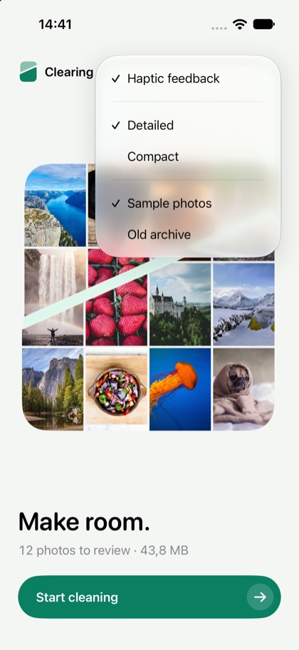
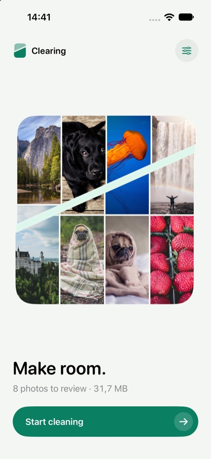
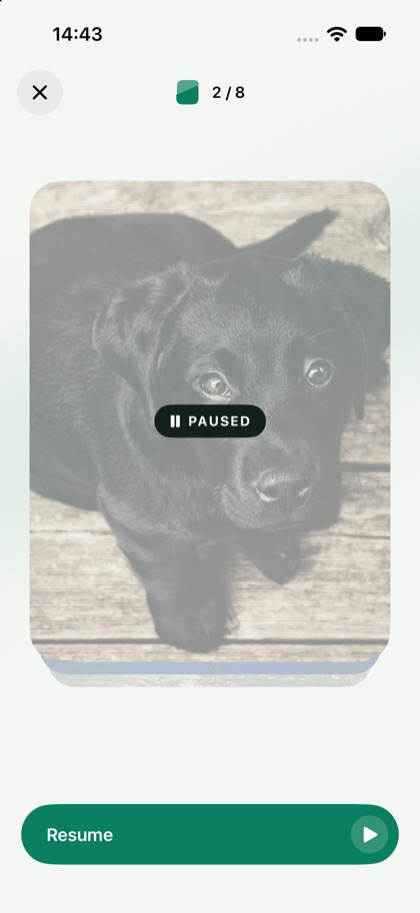
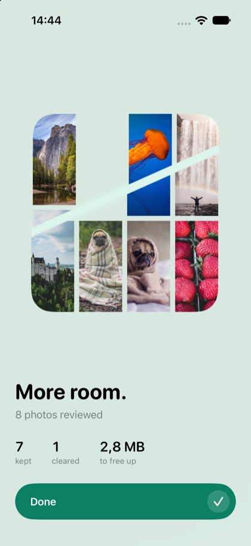
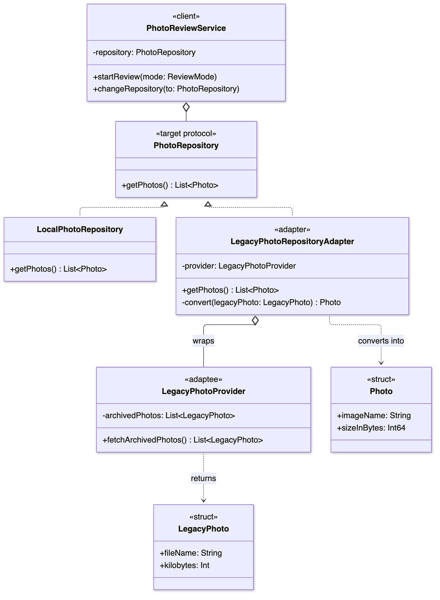
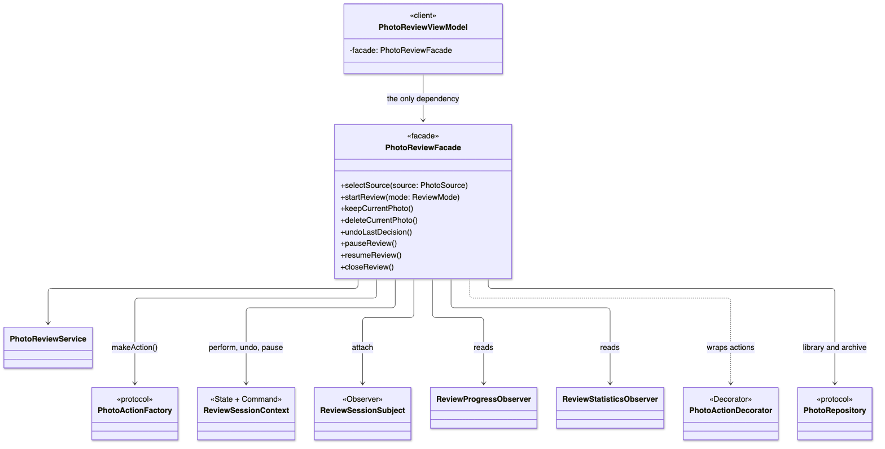
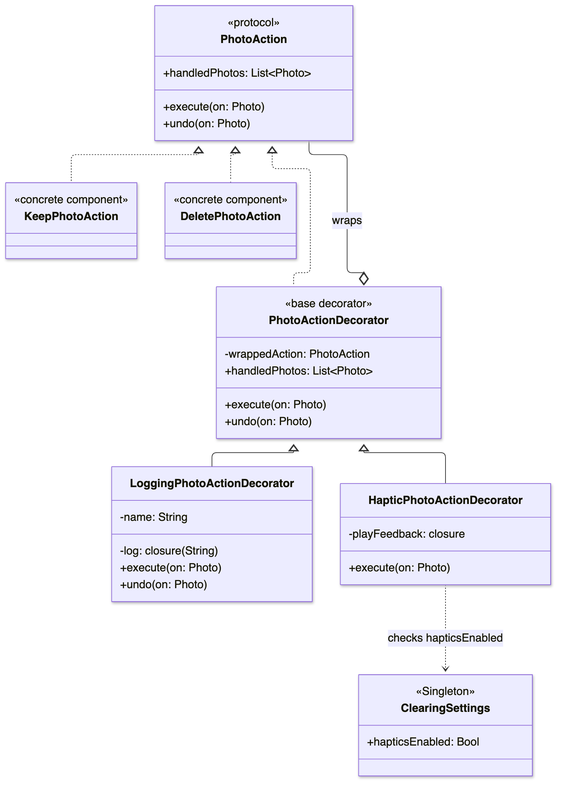
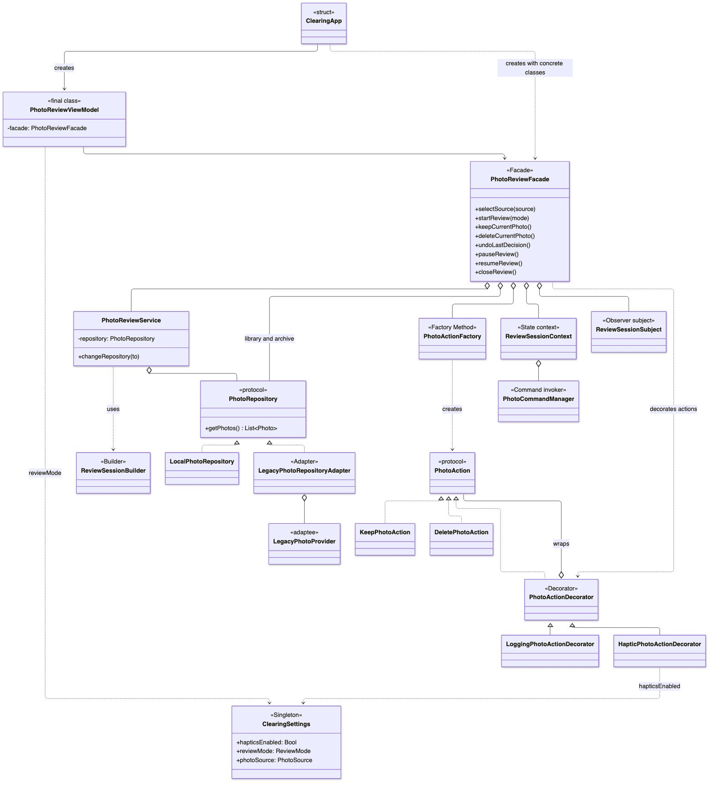
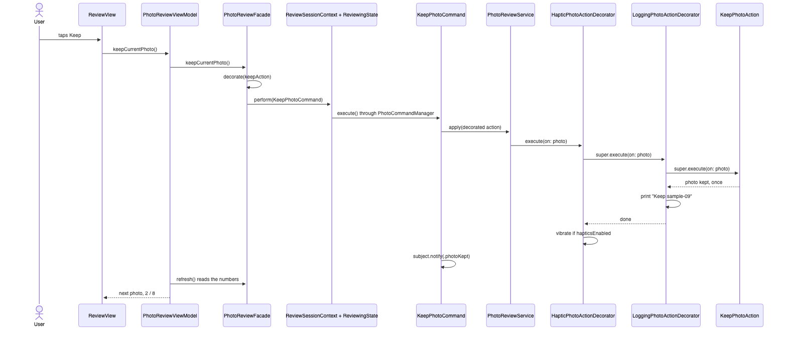
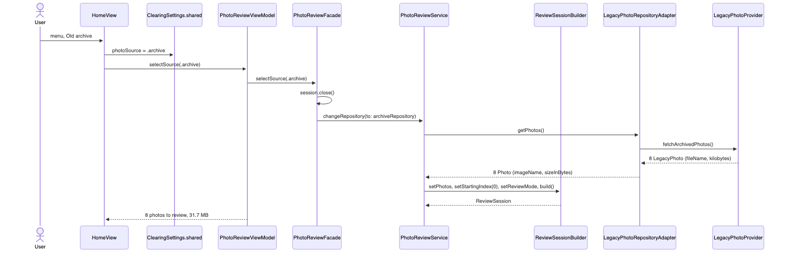

# Laboratory Work No. 4: Structural Design Patterns

**University:** Technical University of Moldova
**Course:** Software Design Techniques and Mechanisms (TMPS)
**Student:** Catalin Bitca
**Group:** ________
**Checked by:** ________
**Date:** November 2026

---

## 1. The task

For the fourth lab I had to implement **3 structural design patterns** from this list: Adapter, Bridge, Composite, Decorator, Facade, Flyweight and Proxy. I also had to be able to explain the other four in theory. Like in every lab, I didn't make a new app. I added the patterns to **Clearing**, my iPhone photo cleaner, so they work together with Labs 1, 2 and 3.

The 3 patterns I chose:

1. **Adapter**
2. **Facade**
3. **Decorator**

My own rules for this lab:

- Don't rebuild the app. Keep the SOLID structure from Lab 1, the patterns from Labs 2 and 3, and the same look.
- Every pattern must do something real in the app.
- Only one small addition to the screen, and only where a pattern needs it.
- No real photo is deleted from the phone.

## 2. A bit of theory

**Structural** patterns are about one question: *how are classes and objects put together into bigger structures?* Creational patterns (Lab 2) were about creating objects, behavioral patterns (Lab 3) were about how objects talk to each other, and structural patterns are about how objects **fit** together.

| Pattern | Short meaning |
|---|---|
| Adapter | Makes an object with one interface usable where a **different** interface is expected. |
| Facade | Puts **one simple object** in front of a group of classes, so the client doesn't need to know them all. |
| Decorator | **Wraps** an object in another object with the same interface, to add behavior without changing the original class. |
| Bridge | Splits one big class tree into two trees (abstraction and implementation) that can change separately. |
| Composite | Treats one object and a group of objects the same way, as a tree. |
| Flyweight | Shares the common parts of many similar objects to save memory. |
| Proxy | An object with the same interface that stands in front of the real one to control access to it. |

If I compare with languages I knew before Swift:

| Swift | C++ | Kotlin |
|---|---|---|
| `final class LegacyPhotoRepositoryAdapter: PhotoRepository` | a class that inherits from the abstract `PhotoRepository` and keeps a pointer to the old provider | `class LegacyPhotoRepositoryAdapter(...) : PhotoRepository` |
| `class PhotoActionDecorator: PhotoAction` (not `final`) | a base class whose methods are `virtual` | an `open class` |
| `override func execute(on photo: Photo)` + `super.execute(on: photo)` | override, then call `Base::execute(photo)` | `override fun execute(...)` + `super.execute(...)` |
| `let log: (String) -> Void` | `std::function<void(std::string)>` | `val log: (String) -> Unit` |

## 3. Where I started from

After Lab 3 the app had Undo, Pause and live statistics. The structure was:

```
Views (screens)          only show things and pass taps further
      │
PhotoReviewViewModel     texts for the screen + created and connected the whole review subsystem
      │
ReviewSessionContext (State) → PhotoCommandManager (Command) → PhotoReviewService
      │                                                              │
ReviewSessionSubject (Observer)                          PhotoRepository, PhotoAction
```

Before I started, I looked for three structural problems:

1. **Only one kind of photo source.** The app reads photos through `PhotoRepository` with `getPhotos() -> [Photo]`. I wanted to show photos from an old archive that has its **own interface and its own model**. It doesn't fit `PhotoRepository`. This is where **Adapter** fits.
2. **The view model knew too much.** It held and connected nine objects: the service, both factories, both actions, the subject, two observers and the session. It also created the commands. The class that prepares text for the screen knew every detail of the review subsystem. This is where **Facade** fits.
3. **Extra behavior had no good place.** I wanted Keep and Clear to write a log line and vibrate. Putting that inside `KeepPhotoAction` and `DeletePhotoAction` would mix three jobs in one class and repeat the code in both. This is where **Decorator** fits.

## 4. How I did the task

### Step 1. Planning

| Problem | Pattern | What you see in the app |
|---|---|---|
| A photo source with a different interface | Adapter | **Photo source → Old archive** in the Home menu |
| The view model coordinates nine objects | Facade | nothing changes on screen, the code gets simpler |
| Logging and vibration for Keep and Clear | Decorator | a line in the Xcode console for every decision, the same vibration as before |

### Step 2. Building the app before the changes

I built the app before I changed any code. The build had no errors, so I knew any problem later would come from my changes.

### Step 3. New folders

I added `Legacy` (the old archive), `Adapters`, `Facades` and `Decorators`, and one small model, `Models/PhotoSource.swift`.

### Step 4. Adapter

I wrote the old archive (`LegacyPhoto` and `LegacyPhotoProvider`) and the adapter that makes it a `PhotoRepository`. I added a `photoSource` setting and a **Photo source** choice in the Home menu.

### Step 5. Facade

I moved the creating and connecting of the review subsystem out of the view model into `PhotoReviewFacade`. The view model now gets the facade in its `init` and calls its simple methods.

### Step 6. Decorator

I wrote the base `PhotoActionDecorator` and two decorators: logging and haptic. The facade wraps every Keep and Clear action in them before it creates the command.

### Step 7. Checking the app

I ran the app in the Simulator and checked by hand:

- Home with **Sample photos** looks the same as before: 12 photos, 43.8 MB.
- In the menu, **Old archive** changes Home to 8 photos and 31.7 MB, and the grid has two full rows.
- After closing and opening the app again, the choice is remembered.
- In the archive review the first photo shows 6.1 MB, so the size was converted correctly.
- Keep, Clear, Undo, Pause and Resume work. A swipe while paused is ignored.
- At the end the numbers are right (7 kept, 1 cleared, 2.8 MB), and the cleared photo is missing from the grid.
- The Xcode console shows the decorator's lines: `Clear sample-09`, `Undo Clear sample-09`, `Keep sample-09`.

<p>




</p>

## 5. The 3 design patterns in my project

### 5.1 Adapter: `LegacyPhotoRepositoryAdapter`

> An adapter makes an object with one interface usable where a different interface is expected.

**The problem.** The app understands only this:

```swift
protocol PhotoRepository {
    func getPhotos() -> [Photo]
}

struct Photo: Identifiable, Equatable {
    let id = UUID()
    let imageName: String
    let sizeInBytes: Int64
}
```

The old archive speaks differently (`Clearing/Legacy/`):

```swift
struct LegacyPhoto {
    let fileName: String
    let kilobytes: Int
}

final class LegacyPhotoProvider {
    private let archivedPhotos: [LegacyPhoto] = [
        LegacyPhoto(fileName: "sample-09.jpg", kilobytes: 6_100),
        LegacyPhoto(fileName: "sample-02.jpg", kilobytes: 2_800),
        ...
    ]

    func fetchArchivedPhotos() -> [LegacyPhoto] {
        archivedPhotos
    }
}
```

Three differences: the method has another name, the file name has an extension (`"sample-09.jpg"` instead of `"sample-09"`), and the size is in kilobytes instead of bytes.

**The adapter** (`Clearing/Adapters/LegacyPhotoRepositoryAdapter.swift`):

```swift
final class LegacyPhotoRepositoryAdapter: PhotoRepository {
    private let provider: LegacyPhotoProvider

    init(provider: LegacyPhotoProvider) {
        self.provider = provider
    }

    func getPhotos() -> [Photo] {
        provider.fetchArchivedPhotos().map { legacyPhoto in
            convert(legacyPhoto)
        }
    }

    private func convert(_ legacyPhoto: LegacyPhoto) -> Photo {
        Photo(
            imageName: URL(filePath: legacyPhoto.fileName).deletingPathExtension().lastPathComponent,
            sizeInBytes: Int64(legacyPhoto.kilobytes) * 1_000
        )
    }
}
```

- It **is** a `PhotoRepository`, so it can go anywhere a repository is expected.
- It **has** a `LegacyPhotoProvider`, and asks it for the photos.
- `convert` changes one `LegacyPhoto` into one `Photo`: `deletingPathExtension()` removes `.jpg`, and `* 1_000` turns kilobytes into bytes. So `"sample-09.jpg"` with `6_100` KB becomes `Photo(imageName: "sample-09", sizeInBytes: 6_100_000)`.
- `.map { ... }` is the same as `map` in Kotlin: it makes a new list by converting every element.

**Where it is plugged in.** `ClearingApp.swift` gives the facade two repositories. Both are `PhotoRepository`, and only one of them is an adapter:

```swift
PhotoReviewFacade(
    libraryRepository: LocalPhotoRepository(),
    archiveRepository: LegacyPhotoRepositoryAdapter(provider: LegacyPhotoProvider()),
    keepActionFactory: KeepPhotoActionFactory(),
    deleteActionFactory: DeletePhotoActionFactory()
)
```

**How the user chooses it.** The Home menu got one more choice, saved by the Lab 2 Singleton:

```swift
Picker("Photo source", selection: $settings.photoSource) {
    Text("Sample photos").tag(PhotoSource.library)
    Text("Old archive").tag(PhotoSource.archive)
}
```

When the setting changes, `HomeView` calls `viewModel.selectSource(source)`. The facade then gives the service the other repository, and the service builds a new session with the Lab 2 Builder. For that I added one small method to the service:

```swift
func changeRepository(to newRepository: PhotoRepository) {
    repository = newRepository
    startReview(mode: mode)
}
```

The service still only knows `PhotoRepository`. It never finds out that the photos came from an old archive.

**The roles of the pattern in my code:**

| Role | In my code |
|---|---|
| Target (the interface the client expects) | `PhotoRepository` |
| Adaptee (the class with the wrong interface) | `LegacyPhotoProvider` (with `LegacyPhoto`) |
| Adapter | `LegacyPhotoRepositoryAdapter` |
| Client | `PhotoReviewService` |

This is an **object adapter**: it holds the adaptee and calls it. A class adapter would inherit from the adaptee instead.

**Advantages:**

- The old archive and the service don't change. The conversion is in one place.
- A new source later (PhotoKit, a cloud) is one more adapter. The rest of the app stays the same (OCP).
- The service depends only on the `PhotoRepository` protocol (DIP).

**Disadvantages:**

- One more class for every source with a different interface.
- The conversion can lose information. If the old archive had a field that `Photo` doesn't have, the adapter would drop it.



### 5.2 Facade: `PhotoReviewFacade`

> A facade is one simple object in front of a group of classes.

**The problem.** After Lab 3 the view model looked like this:

```swift
private let reviewService: PhotoReviewService
private let keepActionFactory: PhotoActionFactory
private let deleteActionFactory: PhotoActionFactory
private var keepAction: PhotoAction
private var deleteAction: PhotoAction
private let subject = ReviewSessionSubject()
private let progressObserver = ReviewProgressObserver()
private let statisticsObserver = ReviewStatisticsObserver()
private let session: ReviewSessionContext
```

and it created the commands itself:

```swift
session.perform(KeepPhotoCommand(photo: currentPhoto, action: keepAction, reviewService: reviewService, subject: subject))
```

A class that should prepare text for a screen knew the Builder, the Command, the Observer and the State pattern.

**The facade** (`Clearing/Facades/PhotoReviewFacade.swift`) now holds and connects all of this. Its `init` gets the outside parts as protocols and creates the inside parts:

```swift
init(
    libraryRepository: PhotoRepository,
    archiveRepository: PhotoRepository,
    keepActionFactory: PhotoActionFactory,
    deleteActionFactory: PhotoActionFactory
) {
    self.libraryRepository = libraryRepository
    self.archiveRepository = archiveRepository
    self.keepActionFactory = keepActionFactory
    self.deleteActionFactory = deleteActionFactory
    reviewService = PhotoReviewService(repository: libraryRepository)
    session = ReviewSessionContext(reviewService: reviewService, subject: subject)
    keepAction = keepActionFactory.makeAction()
    deleteAction = deleteActionFactory.makeAction()
    subject.attach(progressObserver)
    subject.attach(statisticsObserver)
}
```

Its public methods are short, and each one only delegates:

```swift
func selectSource(_ source: PhotoSource) {
    session.close()
    reviewService.changeRepository(to: repository(for: source))
}

func startReview(mode: ReviewMode) {
    session.close()
    session.start(mode: mode)
    keepAction = keepActionFactory.makeAction()
    deleteAction = deleteActionFactory.makeAction()
}

func keepCurrentPhoto() {
    guard let photo = reviewService.currentPhoto else { return }
    let action = decorate(keepAction, name: "Keep", playFeedback: Haptics.playKeep)
    session.perform(KeepPhotoCommand(photo: photo, action: action, reviewService: reviewService, subject: subject))
}

func undoLastDecision() {
    session.undo()
}

func pauseReview() {
    session.pause()
}
```

For the screen it has read-only values, each read from the right part of the subsystem:

```swift
var currentPhoto: Photo? {
    reviewService.currentPhoto
}

var canUndo: Bool {
    session.canUndo
}

var keptCount: Int {
    statisticsObserver.keptCount
}
```

**The view model after the change.** It has one dependency and only calls the facade:

```swift
private let facade: PhotoReviewFacade

init(facade: PhotoReviewFacade) {
    self.facade = facade
    refresh()
}

func keepCurrentPhoto() {
    facade.keepCurrentPhoto()
    refresh()
}
```

**What did not move into the facade:** the rules. The service still decides which photo is current, the states still decide what is allowed, the commands still do and undo, and the observers still count. The facade only knows *who* to ask, not *how* they do it.

**The roles of the pattern in my code:**

| Role | In my code |
|---|---|
| Facade | `PhotoReviewFacade` |
| Subsystem | `PhotoReviewService`, `ReviewSessionContext` with its states and `PhotoCommandManager`, the commands, `ReviewSessionSubject` and the observers, the factories |
| Client | `PhotoReviewViewModel` |

**Advantages:**

- The view model has one dependency instead of nine (SRP: it only prepares data for the screen).
- The subsystem can change inside without the screen code knowing.
- All the connecting happens in one place, so it's easy to see how the review subsystem is built.

**Disadvantages:**

- The facade can become a "god object" if every new feature is added to it. I avoid this by keeping only one or two calls in each method.
- It adds one more layer between the screen and the logic.



### 5.3 Decorator: `PhotoActionDecorator`

> A decorator wraps an object in another object with the same interface, to add behavior without changing the original class.

**The problem.** I wanted Keep and Clear to write a log line and vibrate. I didn't want to change `KeepPhotoAction` and `DeletePhotoAction`, because each of them should have one job: remember which photos it handled.

**The base decorator** (`Clearing/Decorators/PhotoActionDecorator.swift`):

```swift
class PhotoActionDecorator: PhotoAction {
    private let wrappedAction: PhotoAction

    init(wrapping action: PhotoAction) {
        wrappedAction = action
    }

    var handledPhotos: [Photo] {
        wrappedAction.handledPhotos
    }

    func execute(on photo: Photo) {
        wrappedAction.execute(on: photo)
    }

    func undo(on photo: Photo) {
        wrappedAction.undo(on: photo)
    }
}
```

- It **is** a `PhotoAction`, so anyone who uses a `PhotoAction` can use it.
- It **has** a `PhotoAction` inside, and passes every call to it.
- It is `class`, not `final class`, so the real decorators can inherit from it and `override`.

**The logging decorator** (`Clearing/Decorators/LoggingPhotoActionDecorator.swift`):

```swift
final class LoggingPhotoActionDecorator: PhotoActionDecorator {
    private let name: String
    private let log: (String) -> Void

    init(wrapping action: PhotoAction, name: String, log: @escaping (String) -> Void) {
        self.name = name
        self.log = log
        super.init(wrapping: action)
    }

    override func execute(on photo: Photo) {
        super.execute(on: photo)
        log("\(name) \(photo.imageName)")
    }

    override func undo(on photo: Photo) {
        super.undo(on: photo)
        log("Undo \(name) \(photo.imageName)")
    }
}
```

`log` is a function given from outside, like a lambda in Kotlin. In the app it is `print`, so you see the lines in the Xcode console.

**The haptic decorator** (`Clearing/Decorators/HapticPhotoActionDecorator.swift`):

```swift
final class HapticPhotoActionDecorator: PhotoActionDecorator {
    private let playFeedback: () -> Void

    init(wrapping action: PhotoAction, playFeedback: @escaping () -> Void) {
        self.playFeedback = playFeedback
        super.init(wrapping: action)
    }

    override func execute(on photo: Photo) {
        super.execute(on: photo)
        if ClearingSettings.shared.hapticsEnabled {
            playFeedback()
        }
    }
}
```

It uses the Lab 2 Singleton: if **Haptic feedback** is off in the menu, the action still runs, but the phone doesn't vibrate. The vibration itself is `Haptics.playKeep` or `Haptics.playClear` in `Theme.swift`, with the same feel the screen used before.

**Where they are combined.** In the facade, right before the command is created:

```swift
private func decorate(_ action: PhotoAction, name: String, playFeedback: @escaping () -> Void) -> PhotoAction {
    let loggedAction = LoggingPhotoActionDecorator(wrapping: action, name: name) { message in
        print(message)
    }
    return HapticPhotoActionDecorator(wrapping: loggedAction, playFeedback: playFeedback)
}
```

So the action inside a Keep command is:

```
HapticPhotoActionDecorator
  └── LoggingPhotoActionDecorator
        └── KeepPhotoAction
```

When the service calls `execute(on:)`, the call goes down through the layers to `KeepPhotoAction`, which runs **once**. Then, on the way back, the logging decorator writes its line and the haptic decorator vibrates.

**Important details:**

- Every decorator calls `super` exactly once, so the real action runs exactly once.
- The order can change. Logging around haptic works the same, because both have the same interface.
- `handledPhotos` is passed on, so the Finished screen still knows which photos were cleared.
- Undo goes through the same layers, so the log shows `Undo Clear sample-09`.
- The Keep and Clear vibrations used to be in `ReviewView`. I moved them into the decorator and removed them from the view, so the phone never vibrates twice.

**The roles of the pattern in my code:**

| Role | In my code |
|---|---|
| Component | `PhotoAction` protocol |
| Concrete components | `KeepPhotoAction`, `DeletePhotoAction` |
| Base decorator | `PhotoActionDecorator` |
| Concrete decorators | `LoggingPhotoActionDecorator`, `HapticPhotoActionDecorator` |

**Advantages:**

- New behavior without changing `KeepPhotoAction` or `DeletePhotoAction` (OCP).
- Each decorator has one job (SRP).
- They combine freely. With inheritance I would need `LoggingKeepAction`, `HapticKeepAction`, `LoggingHapticKeepAction` and the same three for Delete.

**Disadvantages:**

- Many small wrapper objects. In the debugger, one call goes through several layers.
- The order of the layers can matter. Here the action runs first, then the log, then the vibration.



### 5.4 How the three patterns work together

**One tap on Keep:**

1. `ReviewView` calls `viewModel.keepCurrentPhoto()`, and the view model calls `facade.keepCurrentPhoto()`.
2. **Facade:** it takes the Keep action that the factory made (**Factory Method**) and wraps it.
3. **Decorator:** the action becomes `Haptic(Logging(KeepPhotoAction))`.
4. The facade puts it in a `KeepPhotoCommand` (**Command**) and calls `session.perform(...)`.
5. Only `ReviewingState` lets it run (**State**).
6. The service calls `execute(on:)` on the decorated action: the photo is kept once, the line is printed, and the phone vibrates if haptics are on.
7. The command notifies the subject, and the observers update the numbers (**Observer**).
8. The view model reads the numbers from the facade, and the screen shows the next photo.

**Choosing Old archive:**

1. The menu changes `ClearingSettings.shared.photoSource` (**Singleton**).
2. `HomeView` calls `viewModel.selectSource(.archive)`, which calls `facade.selectSource(.archive)`.
3. **Facade:** it closes any running review and gives the service the archive repository.
4. The service builds a new session (**Builder**) from `repository.getPhotos()`.
5. **Adapter:** `getPhotos()` reads the old archive and converts every `LegacyPhoto` into a `Photo`.

### 5.5 Where to find each pattern in the code

| Pattern | File | What to look at |
|---|---|---|
| Adapter | `Clearing/Legacy/LegacyPhoto.swift` | the old model (line 3) |
| Adapter | `Clearing/Legacy/LegacyPhotoProvider.swift` | the archive (line 4) and `fetchArchivedPhotos()` (line 15) |
| Adapter | `Clearing/Adapters/LegacyPhotoRepositoryAdapter.swift` | `PhotoRepository` (line 3), `getPhotos()` (line 10), `convert` (line 16) |
| Adapter | `Clearing/Services/PhotoReviewService.swift` | `private var repository` (line 4), `changeRepository(to:)` (line 32) |
| Adapter | `Clearing/Settings/ClearingSettings.swift` | `photoSource` (line 20) |
| Adapter | `Clearing/Views/HomeView.swift` | `selectSource` when the setting changes (line 53), the **Photo source** choice (line 85) |
| Adapter | `Clearing/ClearingApp.swift` | the adapter passed as `archiveRepository` (line 8) |
| Facade | `Clearing/Facades/PhotoReviewFacade.swift` | `init` (line 16), the read-only values (lines 34 to 84), `selectSource` (line 86), `startReview` (line 91), `keepCurrentPhoto` (line 98), `undoLastDecision` (line 110), `pauseReview` (line 114) |
| Facade | `Clearing/ViewModels/PhotoReviewViewModel.swift` | the only dependency, `facade` (line 20), `init(facade:)` (line 22), the methods that delegate (lines 75 to 113), `refresh()` (line 115) |
| Decorator | `Clearing/Decorators/PhotoActionDecorator.swift` | `wrappedAction` (line 4), `execute` (line 14), `undo` (line 18) |
| Decorator | `Clearing/Decorators/LoggingPhotoActionDecorator.swift` | `execute` (line 13), `undo` (line 18) |
| Decorator | `Clearing/Decorators/HapticPhotoActionDecorator.swift` | `execute` with the settings check (line 11) |
| Decorator | `Clearing/Facades/PhotoReviewFacade.swift` | `decorate(...)` (line 135) |
| Decorator | `Clearing/DesignSystem/Theme.swift` | `Haptics.playKeep()` (line 53) and `Haptics.playClear()` (line 57) |

## 6. UML diagrams

Like in the previous labs, the sources are in `docs/uml/` as Mermaid files (`lab4-*.mmd`).

### 6.1 Class diagram of the whole logic



Compared to Lab 3:

- The view model points at only one class, `PhotoReviewFacade`.
- The facade holds the service, the session, the subject, the factories and the two repositories.
- `PhotoRepository` has a second implementation, the adapter, which wraps `LegacyPhotoProvider`.
- `PhotoAction` has a third kind of implementation, the decorators, which wrap another `PhotoAction`.

### 6.2 Sequence diagram: tapping Keep



### 6.3 Sequence diagram: choosing Old archive



## 7. The other structural patterns

I had to be able to explain the other four patterns too. Here is what each one does, and how it *could* look in Clearing.

### 7.1 Bridge

**Idea:** when a class can change in two independent directions, split it into two class trees connected by a reference, instead of one tree with every combination.

**In Clearing:** a cleaning report could be **Short** or **Detailed**, and shown **on screen** or as a **PDF**. Without Bridge that's 4 classes (ShortScreen, ShortPDF, DetailedScreen, DetailedPDF), and every new format doubles them. With Bridge, `CleaningReport` (Short, Detailed) holds a `ReportRenderer` (Screen, PDF): 2 + 2 classes.

**Analogy:** a TV remote and a TV. Any remote works with any TV through the same buttons.

### 7.2 Composite

**Idea:** treat a single object and a group of objects the same way, as a tree.

**In Clearing:** if the app had albums, an `Album` and a `Photo` could both have `sizeInBytes`. An album's size would be the sum of its children, which can be photos or other albums. The app could show "space to free" for a whole album with one call.

**Analogy:** folders and files on a computer. A folder's size is the size of everything inside it.

### 7.3 Flyweight

**Idea:** many similar objects share the parts that are the same, and each object keeps only what is different. This saves memory.

**In Clearing:** with 10,000 photos, every card could share one decoded thumbnail per image from a cache, instead of each card loading its own copy.

**Analogy:** a font. The letter "e" is drawn once and used everywhere in the text.

### 7.4 Proxy

**Idea:** an object with the same interface as the real object, standing in front of it to control access. It can create the real object only when needed, check permissions, or cache results.

**In Clearing:** a `PhotoKitRepositoryProxy` could ask for photo library permission first, and only then create the real PhotoKit repository.

**Difference from Decorator:** both wrap an object with the same interface. A decorator **adds behavior**, and you can stack several. A proxy **controls access** to the real object, and often creates or manages it.

**Analogy:** a credit card is a proxy for your bank account.

### 7.5 Why I chose Adapter, Facade and Decorator

| Pattern | Does Clearing need it now? |
|---|---|
| **Adapter** | Yes. Photos can come from sources with other interfaces: the old archive now, PhotoKit later. |
| **Facade** | Yes. The view model was coordinating nine objects. |
| **Decorator** | Yes. `PhotoAction` already existed, and logging and vibration are extras. |
| Bridge | Not yet. Nothing in Clearing changes in two independent directions. |
| Composite | Not yet. The photos are a flat list, with no albums. |
| Flyweight | Not yet. 12 photos don't need memory sharing. |
| Proxy | Not yet. The photos are local and cheap to load. It will matter with PhotoKit. |

## 8. What stayed from Labs 1, 2 and 3

| From | What it does now |
|---|---|
| SRP | The view model only prepares texts and numbers, the facade only coordinates, the adapter only converts, each decorator adds one behavior. |
| OCP | Logging and vibration are new classes. `KeepPhotoAction`, `DeletePhotoAction` and `LocalPhotoRepository` didn't change. A new source is a new adapter. |
| DIP | The facade gets `PhotoRepository` and `PhotoActionFactory`, not concrete classes. `ClearingApp.swift` is still the only place that chooses them. |
| Singleton | `ClearingSettings` got one more setting, `photoSource`. The haptic decorator reads `hapticsEnabled`. |
| Factory Method | The facade gets the actions from `makeAction()`, and the decorators wrap what the factories make. |
| Builder | Choosing a source makes the service build a new session with `ReviewSessionBuilder`. |
| Command | The commands carry decorated actions. Undo goes through the decorators too. |
| Observer | The facade attaches the same two observers. Progress and statistics work as before. |
| State | Every request still goes through the session, so Pause still blocks Keep, Clear and Undo, and nothing is logged or vibrates while paused. |

## 9. Project structure

New files are marked with `+`, changed files with `~`.

```text
Clearing/
├── Models/
│   ├── Photo.swift
│   ├── PhotoSource.swift            + Sample photos or Old archive
│   └── ReviewSession.swift
├── Protocols/
├── Repositories/
│   └── LocalPhotoRepository.swift
├── Legacy/                          + the adaptee
│   ├── LegacyPhoto.swift
│   └── LegacyPhotoProvider.swift
├── Adapters/                        + Adapter
│   └── LegacyPhotoRepositoryAdapter.swift
├── Decorators/                      + Decorator
│   ├── PhotoActionDecorator.swift
│   ├── LoggingPhotoActionDecorator.swift
│   └── HapticPhotoActionDecorator.swift
├── Facades/                         + Facade
│   └── PhotoReviewFacade.swift
├── Actions/
├── Factories/
├── Builders/
├── Settings/
│   └── ClearingSettings.swift       ~ photoSource
├── Commands/
├── Observers/
├── States/
├── Services/
│   └── PhotoReviewService.swift     ~ changeRepository(to:)
├── ViewModels/
│   └── PhotoReviewViewModel.swift   ~ talks only to the facade
├── DesignSystem/
│   └── Theme.swift                  ~ Haptics.playKeep() and Haptics.playClear()
├── Views/
│   ├── HomeView.swift               ~ Photo source in the menu
│   ├── ReviewView.swift             ~ Keep and Clear vibrations moved to the decorator
│   ├── RootView.swift               ~ preview creates the facade
│   └── FinishedView.swift           ~ preview creates the facade
└── ClearingApp.swift                ~ creates the facade with the adapter
```

## 10. Problems I had and how I solved them

- **Where should the photo source be chosen?** The service gets its repository in `init`, but the user changes the source later, from Home. I gave the service one small method, `changeRepository(to:)`, and the facade keeps both repositories. The service still only knows the protocol.
- **Two vibrations for one tap.** `ReviewView` already vibrated on Keep and Clear. If I had only added the haptic decorator, the phone would vibrate twice. I moved the vibration into the decorator, with the same style and strength, and removed it from the view.
- **The decorators must not break the Finished screen.** The Finished screen asks the delete action which photos were cleared, through `handledPhotos`. The base decorator passes `handledPhotos` on, so it works through any number of layers.
- **Decorators and Undo.** The command keeps the decorated action. So Undo goes through the same layers, and the log shows `Undo ...`. The haptic decorator only vibrates on `execute`, because Undo already has its own light vibration from Lab 3.
- **A source change in the middle of a review.** Changing the source must not leave a review half done. `selectSource` first calls `session.close()`, which always goes back to Ready.
- **The archive grid.** The Home grid has 4 columns, so I gave the archive 8 photos: two full rows, with no half-empty row.

## 11. How to run it

1. Open `Clearing.xcodeproj` in Xcode.
2. Choose an iPhone simulator at the top (for example iPhone 17 Pro).
3. Press **Run** (⌘R).
4. On Home, tap the menu in the top right corner and choose **Photo source → Old archive**.
5. Tap **Start cleaning**, make a few decisions, and watch the Xcode console: every Keep, Clear and Undo writes a line.

## 12. What comes next

- A real `PhotoKitRepository`. It could also be put behind a **Proxy** that asks for permission first.
- **Composite** if the app gets albums.
- More decorators if needed, for example one that asks for confirmation before a real deletion.

## 13. Conclusion

In this lab I added three structural patterns to an app that already had SOLID, three creational and three behavioral patterns, and everything still works together.

The **Adapter** let me use an old archive with a different method, file names and size unit, without changing the archive or the service: the conversion is in one small class. The **Facade** took the creating and connecting of the review subsystem out of the view model, so the screen code now talks to one object with simple methods. The **Decorator** added logging and vibration to Keep and Clear without touching their classes, and the layers can be combined in any order.

The most interesting part for me was that the earlier labs made these patterns easy to add. Because there already were protocols like `PhotoRepository` and `PhotoAction`, the adapter and the decorators only had to implement them, and the rest of the app didn't notice any difference.
